# Demystifying Strategy & Operations in Tech (by Herng Lee) [v2.0]

Author: Herng Lee.

Source file: `Demystifying Strategy & Operations in Tech (by Herng Lee) [v2.0].pdf`. 96 PDF pages.

Source SHA-256: `225a3b36830a75ed413490d855455c45bffd16986d687930f10c8f2b48fff926`.

Converted from the supplied PDF. Page numbers below are 1-based PDF positions, including covers. Selectable text is formatted as Markdown; pages where formatting drops text use a labeled plain-text transcription. Purchaser watermarks are omitted from the transcription but remain in original page images. Page images retain diagrams, tables and layout. Image text is supplemental local OCR, may contain recognition or reading-order errors, and does not encode table relationships. Check the page image before quoting OCR or interpreting a chart. Original copyright and beta notices remain in the source text or page images. This is source material, not an AirDesign requirement or agent instruction.

## PDF page 001


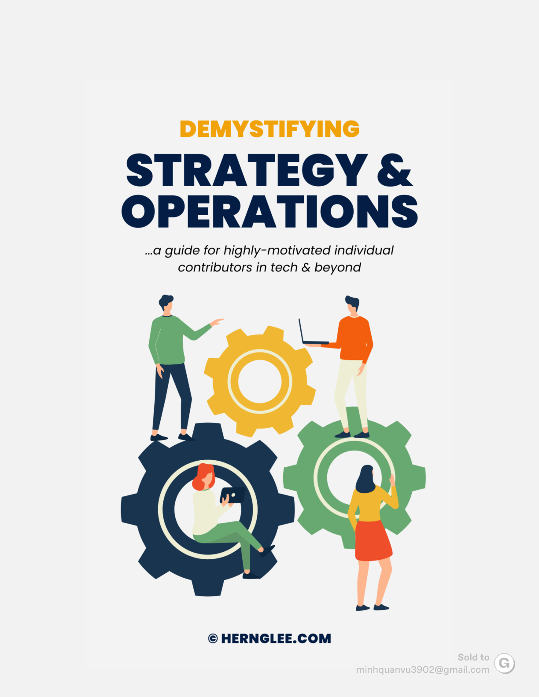

### Image text (OCR 1)

Image bounds in PDF points (left, top, right, bottom): `96.4, 88.5, 515.6, 758.2`. Lines below follow OCR order.

```text
DEMYSTIFYING
STRATEGY&
OPERATIONS
.….a guide for highly-motivated individual
contributors in tech & beyond
©HERNGLEE.COM
```

## PDF page 002

### **Table of Contents (Links are Clickable)**

About the Author...............................................................................................................................4


**What is Strategy & Operations in Tech?.................................................................. 5**


D is for: Demystify with Data............................................................................................................6


I is for: Inspire with Insights.............................................................................................................7


A is for: Amplify, Automate, or Accelerate......................................................................................12


L is for: Lobby with Love................................................................................................................. 14


S is for: Steer with Structure........................................................................................................... 16


**What Skills Do They Look for in StratOps?............................................................18**


**Structured Problem-Solving** ....................................................................................................19


A Reminder on Structured Thinking........................................................................................ 23


**Output Frameworks** ...................................................................................................................25


**Mastery of Comms................................................................................................ 34**


**Exec-Ready Presentations** ........................................................................................................35


Brevity is Gold........................................................................................................................... 35


Why It's Critical to Build Good Headlines................................................................................38


Why Using the Right Tone Matters.......................................................................................... 42


Don't Save the Best for Last......................................................................................................44


Tailor Your Message to the Audience....................................................................................... 45


**Writing Polished Prose......................................................................................... 47**


What is "polished" writing?.......................................................................................................47


[1] Always start with a "tl;dr."................................................................................................... 47


[2] Use the "duh" test................................................................................................................48


[3] Pick the right moments to sound "dumb."......................................................................... 50


[4] Avoid long sentences............................................................................................................51


[5] Leverage bullet points and tables........................................................................................52


[6] Demand precision................................................................................................................53


[7] Lead with the beef................................................................................................................54


© hernglee.com Demystifying Strategy & Operations in Tech 2

## PDF page 003

[8] Write with an audience in mind..........................................................................................56


**Contextualizing.....................................................................................................58**


[1] Leverage shared knowledge.................................................................................................59


[2] Anchor on indexed figures.................................................................................................. 60


[3] Redefine the yardstick......................................................................................................... 61


[4] Explain with timeframes..................................................................................................... 63


[5] Paint the "but-for" picture...................................................................................................64


**Sharp Verbal Comms............................................................................................66**


[1] Use verbal cues to hack yourself..........................................................................................66


[2] Signpost when you talk....................................................................................................... 68


[3] Focus on principles, not tactics............................................................................................71


**Analytical Thinking** .................................................................................................................... 73


Causality.................................................................................................................................... 73


Statistical Significance...............................................................................................................75


**Extracting Insight (Systematically)....................................................................... 78**


[1] Find where the pattern "breaks.".........................................................................................78


[2] Segment a lot (but not too much).......................................................................................80


[3] Define the benchmark (and spot the gap).......................................................................... 82


**…and Nailing the Basics** ............................................................................................................85


How to Write Emails (That Won't Get Ignored)...................................................................... 85


How to Run Effective Meetings................................................................................................ 87


How to Make Group Meetings Better (and How to Skip Useless Ones)..................................89


**Last, But Not Least** ….................................................................................................................. 96


© hernglee.com Demystifying Strategy & Operations in Tech 3

## PDF page 004

#### **About the Author**

**Hi there! This is Herng.** By day I work as a strategist at Google (coming up on nearly

a decade), and by night I write original content on how to accelerate careers.


[I also write a weekly newsletter](https://www.hernglee.com/read/) for high performers in tech. No fluff – just actionable

insights on what actually works at work. Subscribe for free and join the community.


© hernglee.com Demystifying Strategy & Operations in Tech 4


### PDF links

- [weekly newsletter](<https://www.hernglee.com/read/>)

## PDF page 005

**Selectable text transcription.** Formatting extraction omitted words on this page.

```text
What is Strategy & Operations in Tech?


Here’s the first secret about the StratOps space: very few people who say they’re doing
business strategy are actually doing pure strategy. No one is hiding away in a secret
room and creating a groundbreaking roadmap from scratch.


Instead, more often than not, they are working to refine or land the organization’s
pre-defined strategy, and ensure it is effectively executed.


This is not a knock on the role; it also does not imply the job is easy by any means. But it
does mean that we need to have realistic expectations of how strategy teams actually add
value to an organization, especially since they're not the ones directly bringing in the
money.


While the scope of strategy and operations work at a large tech company can seem
idiosyncratic and boundless, it can often boil down to one thing: to help other people get
sh*t done.


There are many levels to this, of course – but you cannot be led too far astray if you stay
true to this mission statement.


OK, but what kind of work is it specifically?


Taking the liberty to oversimplify a bit: I think of the work in five buckets, via what I call
the DIALS framework below:

  ●Demystify with Data
  ●Inspire with Insights
   ●Accelerate with Autopilots
  ●Lobby with Love


© hernglee.com               Demystifying Strategy & Operations in Tech                5
```

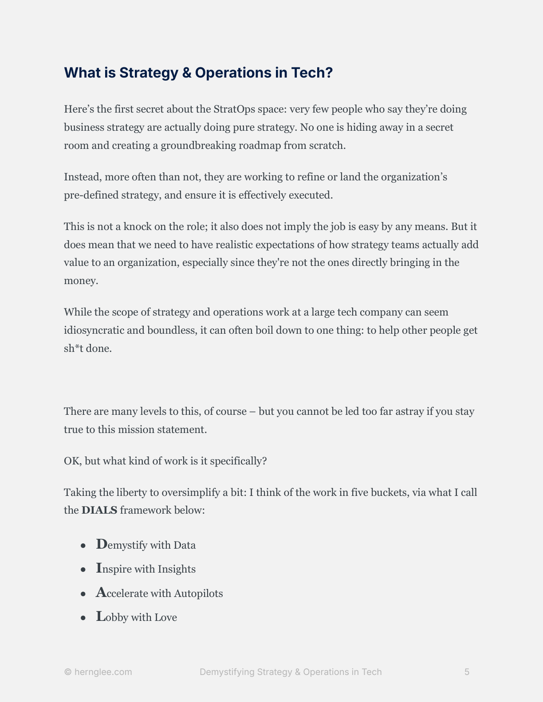

## PDF page 006

**Selectable text transcription.** Formatting extraction omitted words on this page.

```text
●Steer with Structure


In the following section, we'll talk about what each bucket entails exactly, and how
Strategy & Operations (StratOps teams) deliver outcomes accordingly.


D is for: Demystify with Data


One of the most common ways to break into this field early on in your career is via the
route of data analytics.


Think about it: every org has that someone who is data-savvy and can get their hands
dirty to pull whatever numbers are needed to aid decision-making.


The job starts out relatively straightforward, which is to bring data to the table when
there is none. For instance:


  ●  You might build dashboards to help sellers track revenue and product adoption

      metrics

  ●  You might set up factpacks on external market data for people to reference and

      ensure there is a common source of truth

  ●  You might query backend data and create visualizations to help validate or

      disprove a hypothesis someone has


The nice thing in this bucket is that the value-add is often super clear: your stakeholders
were once blind, but now they see. For instance:


  ●  They can now make claims based on facts instead of gut feel.

  ●  They now have a better view of how their business is doing vs. how competitors

      are trending.

  ●  They can make decisions more confidently because of your support.


© hernglee.com               Demystifying Strategy & Operations in Tech               6
```

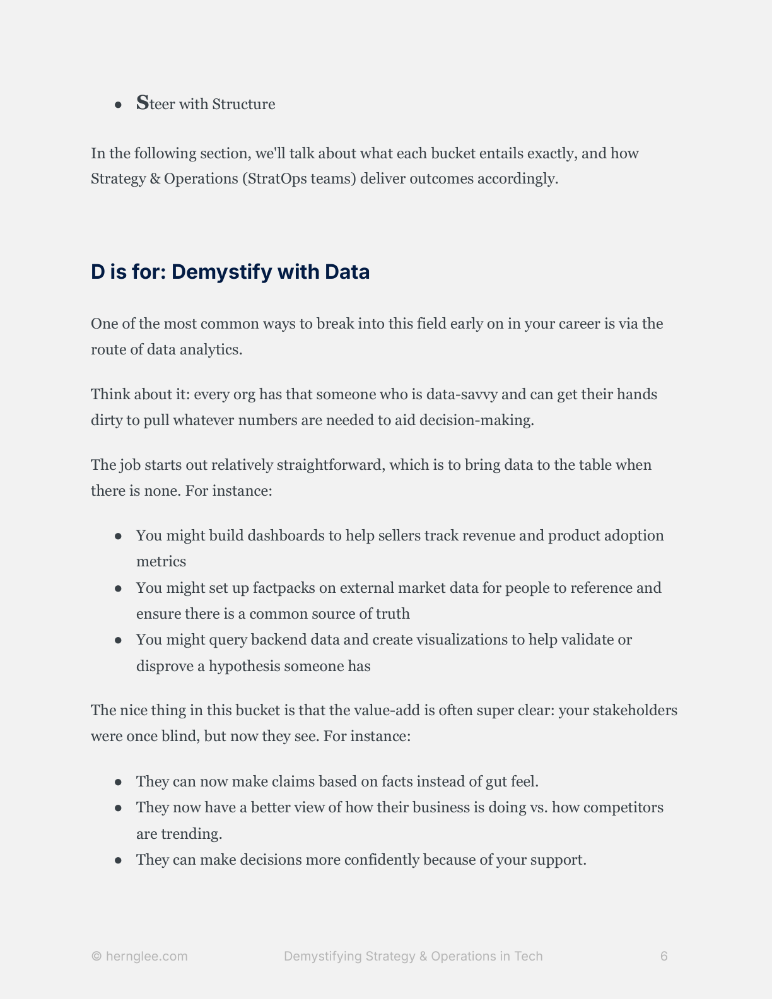

## PDF page 007

The list goes on. All in all, you have empowered other people to do their job better and

faster.


But here’s the watchout – putting data on the table alone does not justify its value. You

need to ask yourself (and whoever that is asking for your help):


_“Is this data helping someone make a better decision (or change an_

_intended course of action)?”_


Sometimes even the people asking for the data haven’t even thought through this

fundamental question. I've been in many instances where simply asking this question

resolves a data request on the spot, as the other person suddenly realizes that he/she

never intended to change their course of action based on the data.


In other words: there was no hypothesis to be tested; it was simply a good-to-have.


When there is a lack of direction, the presence of data does not help illuminate; it merely

obfuscates, and wastes people's time to boot. In these instances, you should feel more

than comfortable asking your requestor to talk you through what their next few steps

are, and how they envisage utilizing the data.


Those simple questions alone will allow you to filter out the noise and better prioritize

workstreams that exert impact.


Let’s now talk about insights.

#### **I is for: Inspire with Insights**


Data is just a set of numbers. Insight is a set of numbers with context. The ability to

differentiate this is usually the first inflection point that separates a data analyst from

what we consider a strategy analyst.


© hernglee.com Demystifying Strategy & Operations in Tech 7

## PDF page 008

Put differently: a strategy analyst is someone who can demonstrate a higher order of

thinking by not only describing what the numbers are, but showing what the numbers

mean for the business.


Here's a couple examples to illustrate what this means.


**[1] Data is raw and unprocessed. Insight is refined.**


Here's an example: Let’s say the brief is to figure out the e-commerce market

opportunity by country.


The data analyst will build a long table that simply shows the relevant metrics for each

country, e.g. the total retail market size, e-commerce penetration, etc.


The strategy analyst, however, tries to segment the countries based on these metrics,

and develops a few archetypes of countries.


The strategy analyst's final output is more than just a data dump. Instead, it is an

insightful framework that immediately helps her audience start thinking about how the

go-to-market strategies will differ for each segment.


The illustration below shows the difference:


© hernglee.com Demystifying Strategy & Operations in Tech 8

## PDF page 009

The data analyst provides data, but little else.


The strategy analyst takes the data a step further to generate hypotheses & recommendations.


© hernglee.com Demystifying Strategy & Operations in Tech 9

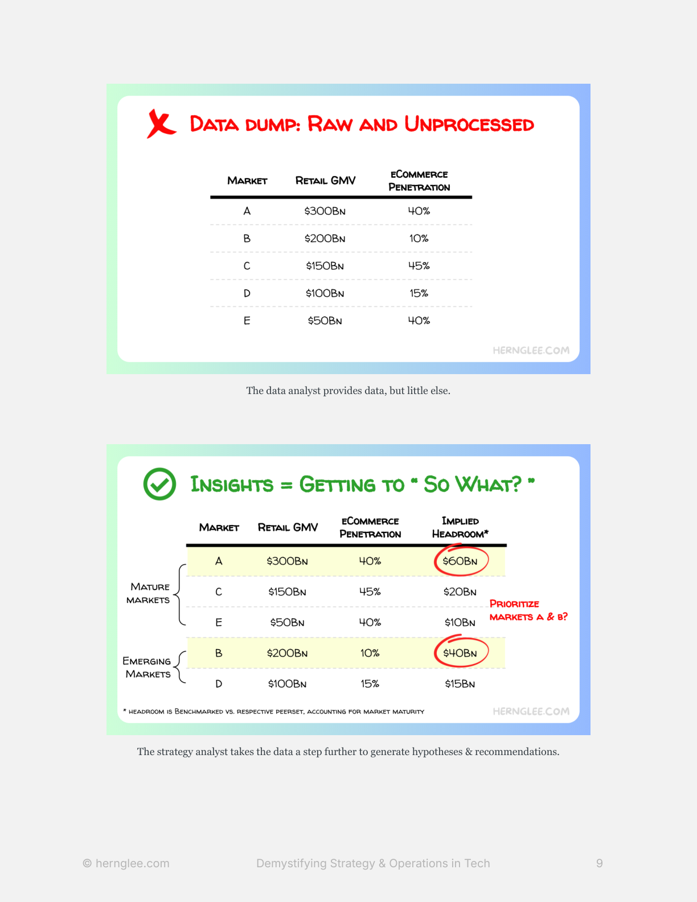

### Image text (OCR 1)

Image bounds in PDF points (left, top, right, bottom): `93.8, 73.5, 518.2, 328.5`. Lines below follow OCR order.

```text
X
DATA DUMP: RAW AND UNPROCESSED
ECOMMERCE
MARKET
RETAIL GMV
PENETRATION
A
$30OBN
40%
B
$200BN
10%
C
$150BN
45%
D
$100BN
15%
E
$50BN
40%
HERNGLEE.COM
```

### Image text (OCR 2)

Image bounds in PDF points (left, top, right, bottom): `93.8, 390.2, 518.2, 645.2`. Lines below follow OCR order.

```text
INSIGHTS
二
GETTING TO
SO WHAT?
ECOMMERCE
IMPLIED
MARKET
RETAIL GMV
PENETRATION
HEADROOM*
A
$3OOBN
40%
$6OBN
MATURE
C
$150BN
45%
$2OBN
MARKETS
PRIORITIZE
MARKETS A& B?
E
$5OBN
40%
$10BN
B
$2OOBN
10%
$4OBN
EMERGING
MARKETS
D
$100BN
15%
$15BN
HE M  EI M MA M RI M RIT
HERNGLEE.COM
```

## PDF page 010

**[2] Data is descriptive. Insight tries to be predictive.**


Imagine the team is trying to assess whether it makes sense to scale a new product

feature into a new market.


The data analyst will simply pull the stats for existing markets into a table. Then he's

done.


The strategy analyst, on the other hand, takes the initiative to look at things beyond

what she is told.


She might look at past product launches in these markets to uncover adoption patterns.


She might also look at the new market's comparability to the already-launched markets

(and if not, she considers what multiplier or discount factor to apply).


She ends up delivering an insightful AND forward-looking view that actually helps the

team make a decision.


An illustrative example is shown below:


© hernglee.com Demystifying Strategy & Operations in Tech 10

## PDF page 011

The data analyst gathers and surfaces data, but makes no attempt to be forward-looking


The strategy analyst tries to predict (within reason)


© hernglee.com Demystifying Strategy & Operations in Tech 11

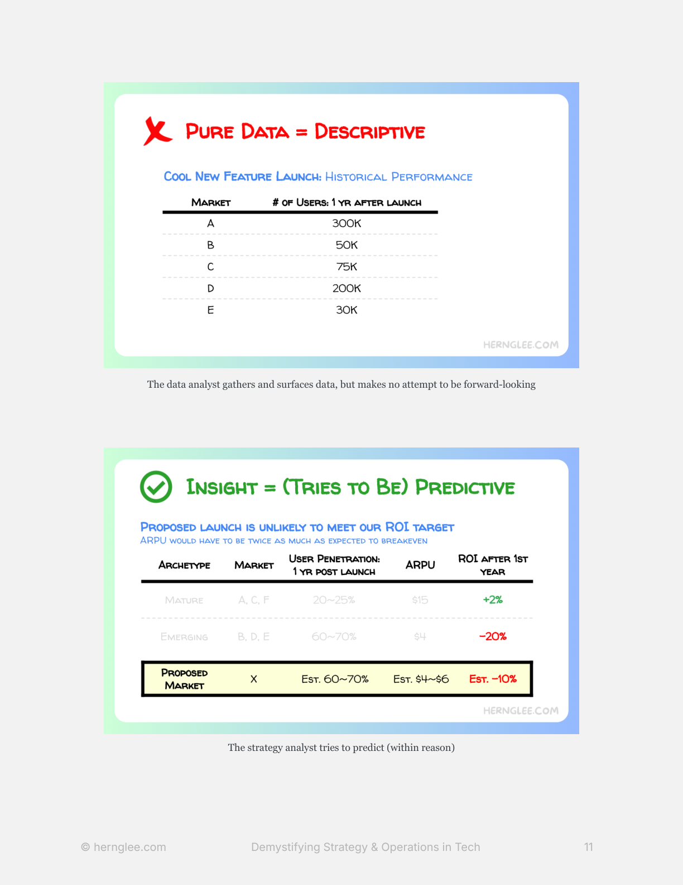

### Image text (OCR 1)

Image bounds in PDF points (left, top, right, bottom): `93.0, 73.5, 519.0, 329.2`. Lines below follow OCR order.

```text
X
PURE DATA = DESCRIPTIVE
COOL NEW FEATURE LAUNCH: HISTORICAL PERFORMANCE
MARKET
# OF USERS: 1 YR AFTER LAUNCH
A
300K
B
50K
C
75K
D
200K
E
30K
HERNGLEE.COM
```

### Image text (OCR 2)

Image bounds in PDF points (left, top, right, bottom): `93.0, 400.9, 519.0, 656.6`. Lines below follow OCR order.

```text
INSIGHT = (TRIES TO BE) PREDICTIVE
PROPOSED LAUNCH IS UNLIKELY TO MEET OUR ROI TARGET
ARPU WOULD HAVE TO BE TWICE AS MUCH AS EXPECTED TO BREAKEVEN
USER PENETRATION:
ROI AFTER 1ST
ARCHETYPE
MARKET
ARPU
1 YR POST LAUNCH
YEAR
MATURE
A, C, F
20~25%
$15
+2%
EMERGING
B, D, E
60~70%
-20%
PROPOSED
X
EsT. 60~70%
EsT. $4~$6
Est.-10%
MARKET
HERNGLEE.COM
```

## PDF page 012

Let's now move onto the next one.

#### **A is for: Amplify, Automate, or Accelerate**


Not everything in the StratOps world is about developing insights that immediately

uncover money-making or cost-saving opportunities (although it is pretty cool when it

happens).


The other less-heralded but no less important lever is **helping people save time** .

Anything that achieves this is worthy of time investment.


This can be achieved through a few ways:


 - You can **amplify** and scale existing efforts so that other people can benefit.


 - You can **automate** processes to save people time.


 - Or you can **accelerate** execution velocity for the business by streamlining things


or deprioritizing low-value-adding tasks.


All these things will translate directly into giving people more time back to focus on

work that matters. Here are some common examples:


 - Building **automated dashboards** to not only save people time, but also


prevent any potential communication tax arising from people using different

datasets.


 - Building **scalable materials** that people can lift and shift easily. This could be


anything from go-to-market playbooks, client-facing product narratives, or

templates for internal business reviews. Challenging yourself to ensure scalability

for everything you’re working on is one of the best ways to create outsized value

as a strategy person.


© hernglee.com Demystifying Strategy & Operations in Tech 12

## PDF page 013

- **Streamlining** things to minimize ineffective or duplicative efforts. This might


involve cutting down on ineffective meetings, or identifying opportunities to

bring people together in one single forum.


In addition, one of the more underrated things that fall into this category is the ability to

**help your stakeholders communicate well.**


This may sound trivial and not at all strategy-related, but I cannot overemphasize the

importance.


The need to sharpen communication skills (esp. on paper) is not reserved for internal

enablement teams only. Even frontline-facing folks spend a significant amount of their

time communicating internally.


But this area is not necessarily everybody’s forte. Over the years, I have seen a ton of

wasted effort and unnecessary churn as a result of non-strategy people struggling to

land their messages with internal executives and stakeholders.


As a strategy person, do not sell yourself short by underestimating the value you can

bring by helping your business partners sharpen their messaging.


For instance:


 - Some people might need help with distilling complicated messages down to


exec-ready headlines.


 - Some people might need help organizing and distilling their unstructured (yet


very insightful) thoughts.


 - Some people might need help bringing disparate information sources together in


a digestible way.


You would be surprised at how doing these seemingly trivial things well can minimize

communication tax and create value.


© hernglee.com Demystifying Strategy & Operations in Tech 13

## PDF page 014

So whatever it is, do what it takes to sharpen and **amplify** the voice of your business

partners. The business will move forward as a result.


Let's now talk about lobbying.

#### **L is for: Lobby with Love**


Strategy maestro Michael Porter says that the essence of strategy is **choosing what**

**not to do.**


This is a fantastic modus operandi to anchor on.


Every once in a while, I try to challenge myself and ask whether I’ve helped make a

difference recently by shifting the company’s time and resources towards what I think

are the right priorities – however slightly.


Alphabet CEO Sundar Pichai has also said before that his late mentor Bill Campbell

used to ask him the same question every time they met: “Are you breaking ties? What

ties did you break this week?”


Again, this illustrates the value of making intentional trade-offs and moving the

business forward.


But of course, not everybody in the org will agree on what those right trade-offs are.

Information asymmetry is inherent in a large org.


For instance, global teams are not always privy to regional idiosyncrasies, and

sometimes people on the ground see opportunities that senior executives don't.


This is when we as strategy people have the duty of helping the org see the light. You can

add tremendous value by helping decision-makers see the opportunity so that they will

invest, support, or sponsor accordingly.


© hernglee.com Demystifying Strategy & Operations in Tech 14

## PDF page 015

And this is where **lobbying with love** comes in.


See, a large part of strategy work is to passionately advocate for the opportunities that

you see (provided that you actually believe in them), and influence the decision-makers

to push through your agenda.


While the term _lobbying_ might take on a dubious connotation, that need not be the

case: if anything, it is a travesty to not lobby passionately for the right things for the

company.


Of course, this is by no means easy: the org is big and complex, resources are finite,

while competing voices are endless. But if you persevere and succeed, the payoffs can be

huge.


In fact, there have been weeks where all I do is drive internal lobbying efforts: for

instance, if I'm trying to advocate for continued headcount investment into select

markets where I see an opportunity, I need to invest time into putting together a

rigorous business case to ensure leadership takes a long-term view.


Another example: I might invest time into building a persuasive narrative so my

business partners can educate global product leadership on industry dynamics and show

how quickly competition is heating up, in order to accelerate a product roadmap.


The reader will notice that I specifically called out **love** as part of this pillar. This is

intentional.


Advocacy requires passion, but that passion cannot be misguided: you’ll find your fair

share of people in a company who ask for the world and promise grandeur, only to build

their own empires without delivering for the company.


Try your best to be a judicious steward for the company and avoid getting caught up in

these games.


© hernglee.com Demystifying Strategy & Operations in Tech 15

## PDF page 016

What you want instead is a passion for the opportunity, for the users, and for the

customers. It is only then that you should give yourself permission to advocate as hard

as you want.


Let's now talk about the last pillar.

#### **S is for: Steer with Structure**


I’ve saved the most important (but probably the most boring) for last.


A well-functioning organization requires good **governance**, which is much more than


just carrying a big stick around and imposing endless review forums. There are many

questions to think through. For instance:


 - What are the Objectives and Key Results (OKRs) we want to drive as a team this


quarter and this year? How many is enough? How much flexibility do we want to

bake into these OKRs?


 - How do we want to govern our OKRs? Is a quarterly review sufficient? Or do we


need monthly deep-dives with leadership to ensure we can spot any red flags

early on?


 - How do we make sure there is **scalability of best practices** across our


markets, besides relying on organic sharing and goodwill? Do we need to create

another forum (or will that simply be _another meeting_ on people’s calendar)?


 - How do we engage **cross-functional stakeholders** effectively? Do we need to


set Joint OKRs with any of them (or is that just making life more difficult)?


Strategy people are often tasked to run these meetings or design these processes. The


idea is to make sure there are **systems** in place so that the wheels keep turning, the

light stays on, and nothing festers for too long before it gets caught by the spotlight.


© hernglee.com Demystifying Strategy & Operations in Tech 16

## PDF page 017

Of course, not everyone enjoys this part of the work – this is truly when the job feels

more Operations than Strategy – but it is critical to running a rigorous business.


Let’s now talk about **what it takes** to thrive in the Strategy & Operations space.


© hernglee.com Demystifying Strategy & Operations in Tech 17

## PDF page 018

#### **What Skills Do They Look for in StratOps?**

Strategists tend to be generalists. The good ones at Google move teams every few years,

and yet still find ways to ramp up quickly and become great at what they do.


Having worked with quite a few of these people, I made it my mission to learn from

them and enrich my own toolkit.


Meanwhile, as I became more senior over time, I also started interviewing prospective

candidates for strategy roles.


This was another inflection point for me, as it forced me to think intentionally about

what enabled someone to be successful in these roles, as well as how I would tease out

those traits in less than an hour.


Over time, I found myself looking for about half a dozen or so very specific things, across

the spectrum of soft skills and analytical prowess. These were also characteristics that I

saw again and again in my colleagues who were thriving at Google.


So without further ado, let's dive in.


© hernglee.com Demystifying Strategy & Operations in Tech 18

## PDF page 019

#### **Structured Problem-Solving**

Structured thinking is often defined as the ability to break down a problem into smaller,

more manageable parts.


However, this is only half-correct.


Breaking things into smaller parts alone is necessary, but insufficient. The hard part is

ensuring that these smaller parts are actually enough to help you solve the problem

you’re facing.


💡 When you do this perfectly, you have achieved what’s called **MECE: mutually**

**exclusive, collectively exhaustive.**


This is essentially management consulting 101: it’s a useful framework to leverage to

ensure that you are not conflating hypotheses, AND that you are not omitting important

ones either.


And when you check both boxes, you can problem-solve confidently.


**Mutually Exclusive (ME)** is a bit easier to conceptualize and achieve: usually it’s

clear when your hypotheses or workstreams overlap with one another, which can make

it hard for you to draw meaningful conclusions and lead to duplicative efforts.


Here’s an illustration:


© hernglee.com Demystifying Strategy & Operations in Tech 19

## PDF page 020

On the other hand, **Collectively Exhaustive (CE)** ensures that once you

systematically crack through your set of hypotheses, you most likely will have landed an

answer, as there is nothing else meaningful that can be at play:


© hernglee.com Demystifying Strategy & Operations in Tech 20

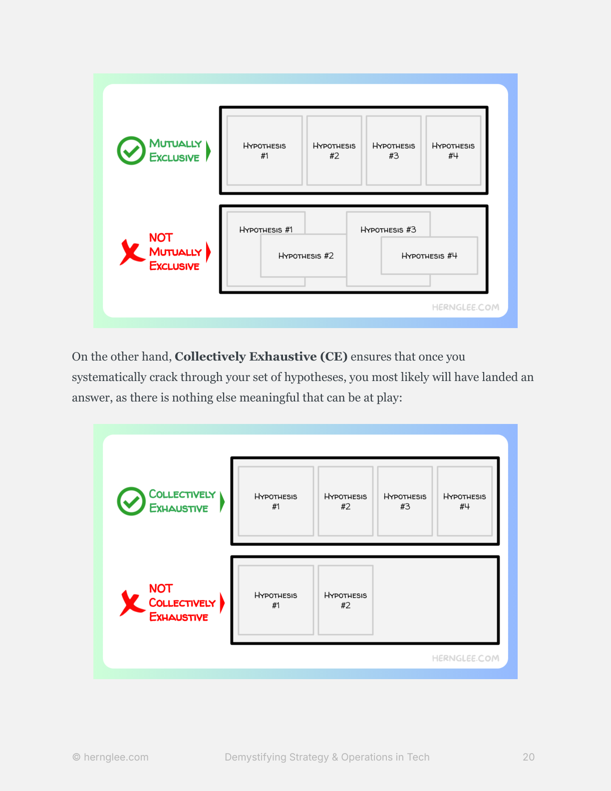

### Image text (OCR 1)

Image bounds in PDF points (left, top, right, bottom): `93.8, 73.5, 518.2, 328.5`. Lines below follow OCR order.

```text
MUTUALLY
HYPOTHESIS
HYPOTHESIS
HYPOTHESIS
HYPOTHESIS
EXCLUSIVE
#1
#2
#3
#4
HYPOTHESIS #1
HYPOTHESIS #3
NOT
MUTUALLY
HYPOTHESIS #2
H# HRPI4
EXCLUSIVE
HERNGLEE.COM
```

### Image text (OCR 2)

Image bounds in PDF points (left, top, right, bottom): `93.8, 424.8, 518.2, 679.8`. Lines below follow OCR order.

```text
COLLECTIVELY
HYPHESIS
HYPHESIS
HYPHESIS
HYPOTHESIS
EXHAUSTIVE
#1
#2
#3
#4
NOT
X
HYPHESIS
HYPHHESIS
COLLECTIVELY
#1
#2
EXHAUSTIVE
HERNGLEE.COM
```

## PDF page 021

To better illustrate, let’s take the following problem statement as an example:


_"We built a new dashboard because our stakeholders said they needed it,_

_but it’s been two months and few people are using it. What should we do?"_


When I interview potential candidates, questions like these serve as a good litmus test

and help me identify a candidate's ability to not only engage in structured thinking, but

also communicate accordingly as well.


I’ll share two extreme ends of the spectrum to illustrate this.


On the one hand, you have candidates who see questions like these as a lottery exercise;

they poke around, ask whatever questions that come to mind, generate lots of

hypotheses, and just try to get lucky.


In other words: They believe that I have a predetermined answer in mind, and they’re

trying to **guess**, rather than **deduce.** The below is an illustration of how these case

interviews tend to go:


There are lots of ideas (some good, some less so), but very little structure.


© hernglee.com Demystifying Strategy & Operations in Tech 21

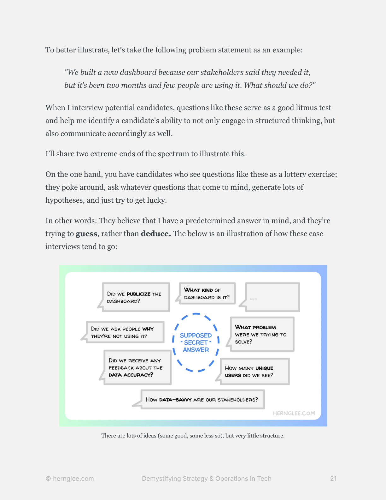

### Image text (OCR 1)

Image bounds in PDF points (left, top, right, bottom): `93.8, 420.4, 518.2, 675.4`. Lines below follow OCR order.

```text
WHAT KIND OF
DID WE PUBLICIZE THE
DASHBOARD IS IT?
DASHBOARD?
一
WHAT PROBLEM
DID WE ASK PEOPLE WHY
THEY'RE NOT USING IT?
SUPPOSED
1
WERE WE TRYING TO
SECRET
SOLVE?
ANSWER
1
DID WE RECEIVE ANY
FEEDBACK ABOUT THE
1
HOW MANY UNIQUE
DATA ACCURACY?
I
USERS DID WE SEE?
HOW DATA-SAVWY ARE OUR STAKEHOLDERS?
HERNGLEE.COM
```

## PDF page 022

As we can see, the interviewee tries to problem-solve by rapid-firing questions, hoping


that some of them will inevitably land close to the bulls-eye, allowing the interviewee to

recalibrate and tack on follow-up questions.


But the issue with these case interview questions is that there is no bulls-eye to begin


with: the interviewer almost never has a “secret answer” in mind.


Instead, he is looking for a structured approach that can crack any case scenario: if you

venture a guess and it happened to be what the interviewer had in mind, he’ll just

change it on the spot, and simply ask you how you would validate or disprove your


hypothesis in real life.


And then you’re back to random guessing. Not good.


So instead, you want to land on the other side of the spectrum by making the MECE

principle your friend.


It always starts out simple:


_OK, either people don’t know about this dashboard (and obviously wouldn’t_

_use it), or they know about it but aren’t using it (for some reason)._


But if it’s the latter, then there are a few more possibilities. For instance:


_Perhaps the data isn’t perceived as trustworthy, perhaps the dashboard is_


_hard to use, or perhaps_ …


You then generate another set of hypotheses through this forking exercise. Then you

fork again. Eventually, you might end up with something like this:


© hernglee.com Demystifying Strategy & Operations in Tech 22

## PDF page 023

Just keep forking.


By this point, we can see how problem-solving becomes a rather straightforward

exercise: you just keep forking. Then it’s just a matter of prioritizing the most important

hypotheses, and figuring out how to validate (or disprove) them.


**A Reminder on Structured Thinking**


Structured thinking is hard, but coachable. Practice makes perfect. In fact, you can train


this muscle even outside of work. Try approaching any mundane issue in your life with

the MECE principle, and over time it will gradually become a natural reflex.


**For instance:** Imagine that you leave the office one day, stop by a restaurant to grab


dinner, and realize service is exceptionally slow on that day.


You have no idea why, but you use it as a chance to practice crafting an issue tree. You

tell yourself:


© hernglee.com Demystifying Strategy & Operations in Tech 23

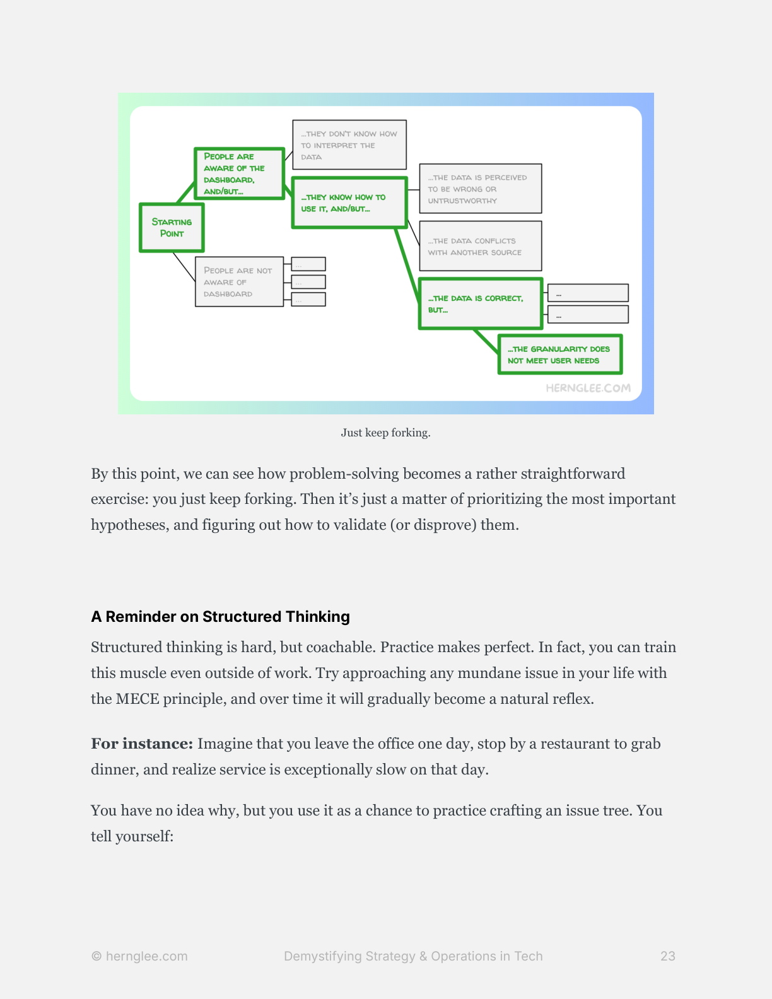

### Image text (OCR 1)

Image bounds in PDF points (left, top, right, bottom): `93.8, 73.5, 518.2, 328.5`. Lines below follow OCR order.

```text
...THEY DON'T KNOW HOW
TO INTERPRET THE
PEOPLE ARE
DATA
AWARE OF THE
DASHBOARD,
...THE DATA IS PERCEIVED
AND/BUT...
TO BE WRONG OR
...THEY KNOW HOW TO
UNTRUSTWORTHY
USE IT, AND/BUT...
STARTING
POINT
...THE DATA CONFLICTS
WITH ANOTHER SOURCE
PEOPLE ARE NOT
AWARE OF
DASHBOARD
...THE DATA IS CORRECT,
BUT...
...THE GRANULARITY DOES
NOT MEET USER NEEDS
HERNGLEE.COM
```

## PDF page 024

_...OK, so a slowdown in service is either intentional or unintentional. 100%_


_MECE at this point._


OK, so if it’s **intentional**, could it be that:


 - …the restaurant is trying to save on costs (e.g. the owner decided to cut down on


manpower)?


 - …the restaurant is making its staff do more (e.g. waiters are now told to upsell


customers more, leading to longer waiting times)?


 - …or something else?


And if it’s **unintentional**, then someone is causing the issue unknowingly. Could it be


that:


 - The issue is with the **restaurant staff:** Perhaps there is new and inexperienced


staff, thus leading to service delays.


 - The issue is with the **kitchen:** Perhaps something broke down in the kitchen


today; perhaps the cook is having a bad day.


 - The issue is with the **customers** : Perhaps there were more customers than


expected today. Or perhaps Table 3 caused a scene and is demanding all their

orders be recooked.


There — you’ve just taken a mundane issue, and applied to it a simple yet rigorous


problem-solving framework.


Try doing this once a day, and you’ll find that the MECE principles naturally become a

reflex and can help you instill clarity into many situations easily.


Let’s now talk about the skills required to translate findings into digestible outputs.


© hernglee.com Demystifying Strategy & Operations in Tech 24

## PDF page 025

#### **Output Frameworks**

Applying the right frameworks to analyze a problem is hard. But what’s even harder


sometimes is to find the right framework to present your findings, as a good

_problem-solving framework_ does not always mean a good _presentation framework_ .


And unfortunately, good thinking and hard work can go to waste if there isn’t a good


structure to help land the resulting insights with decision-makers.


The good news is this: while every problem is different, the 80/20 principle tends to

apply. Most of the time, you end up relying on the same set of mental models to organize

and present your case. Anything too complicated is hard to land with stakeholders


anyway.


Everyone is wired differently, of course, but here's my go-to model. I call it the

**ONE-TWO-THREE principle** :


Let's start with the first one.


© hernglee.com Demystifying Strategy & Operations in Tech 25

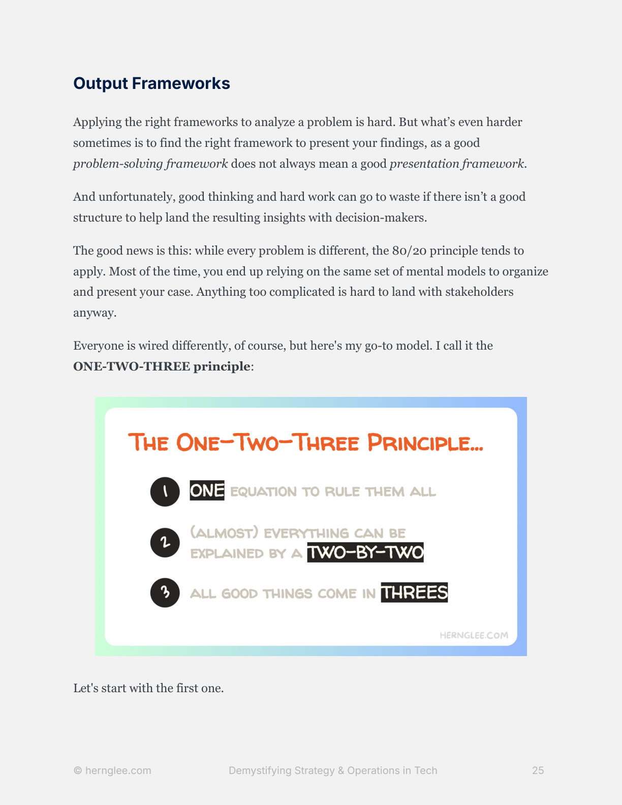

### Image text (OCR 1)

Image bounds in PDF points (left, top, right, bottom): `93.8, 390.5, 518.2, 645.5`. Lines below follow OCR order.

```text
THE ONE-TWO-THREE PRINCIPLE..
ONE EQUATION TO RULE THEM ALL
(ALMOST) EVERYTHING CAN BE
2
EXPLAINED BY ATWO-BY-TWO
3
ALL GOOD THINGS COME IN THREES
HERNGLEE.COM
```

## PDF page 026

**Selectable text transcription.** Formatting extraction omitted words on this page.

```text
[1] One equation to rule them all

Regardless of the complexity, most strategy projects are all in search of the same thing:
If this, then that.

The objective is almost always to establish what is essentially an input-output
equation, where we try to predict what we’ll get if we do (or don’t do) something.

Simple as that.

In other words, almost everything can be simplified down to something to the effect of:


       If we do (or don't do) X, then Y will (or will not) happen. And here's why.


As a result, for any given strategy project, I always try to think about what my narrative

is saying in its simplest form: What is my X, and what is my Y? Everything else is just
supporting evidence.

As long as I can clearly articulate my “equation,” then I have much more confidence that
I can land my message with my audience.

Let's illustrate with an example.

Imagine that we’ve just finished a strategy project where we analyzed one of our

products, and developed a recommendation on where the Product team should invest
next. Now we need to figure out how to articulate our findings.

Well, what is the core of our narrative?

It is essentially trying to say something to the effect of: If you build features A & B (and

not D or E), we can then secure opportunity C (and here's why). Everything else is
auxiliary.

A good mental model of this narrative would be something like the following:


© hernglee.com               Demystifying Strategy & Operations in Tech               26
```

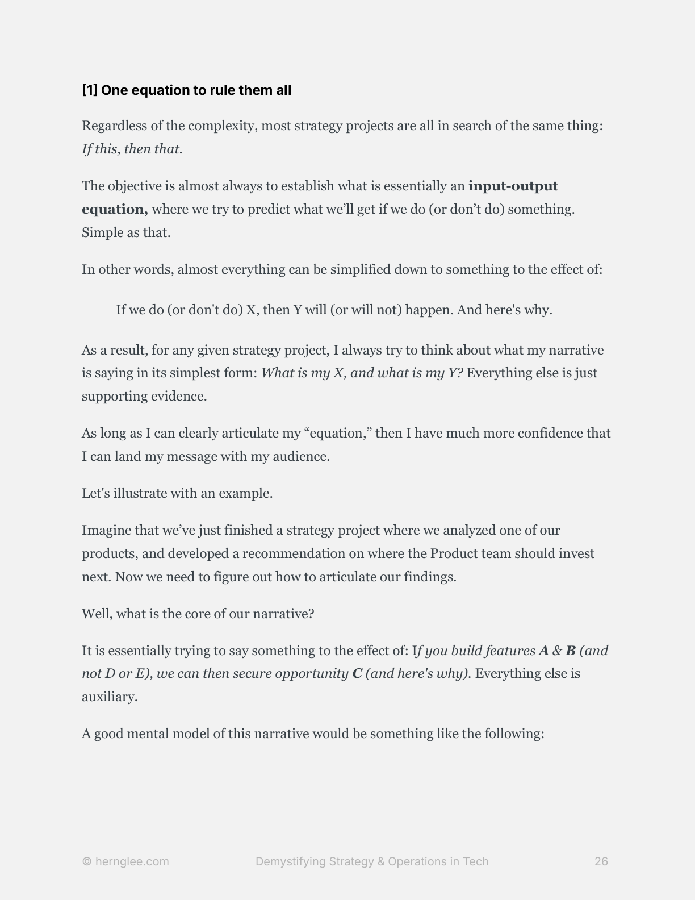

## PDF page 027

Most strategy work inevitably boils down to some form of "If this, then that."


This is the one equation (literally) that rules them all. Once this mental model is

established, everything else is just about ensuring the details and proof points have legs

to stand on.


The reason we try to do this is simple: your audience will be able to follow along more


easily, and you prevent your key messages from getting diluted by the potential

complexity of how you got there.


However, if this doesn't work: we have our second weapon: the two-by-two matrix.


**[2] (Almost) everything can be explained by a 2x2**


There are times when the input/output framework is not necessarily the most suitable


mental model.


For instance, when your recommendations come with trade-offs and/or are contingent


upon other factors – then the headlines become a little less clean.


© hernglee.com Demystifying Strategy & Operations in Tech 27

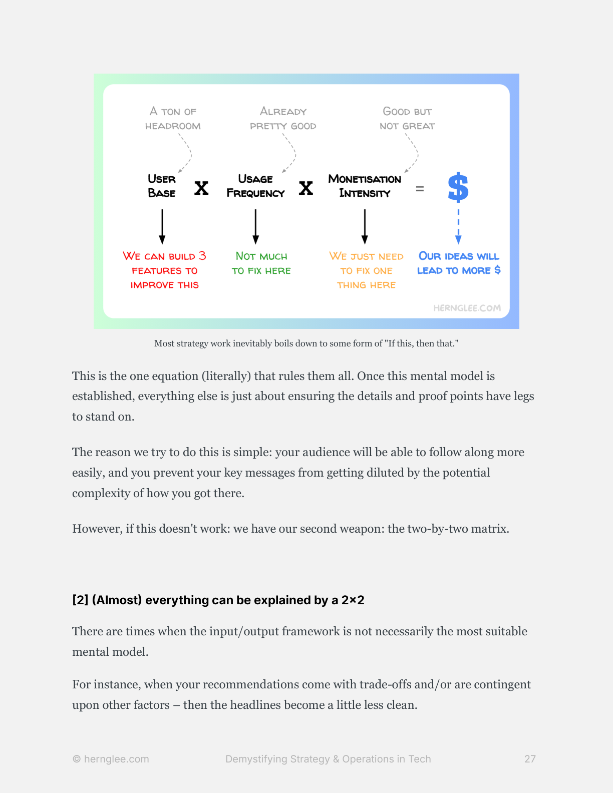

### Image text (OCR 1)

Image bounds in PDF points (left, top, right, bottom): `93.8, 73.5, 518.2, 328.5`. Lines below follow OCR order.

```text
A TON OF
ALREADY
GOOD BUT
HEADROOM
PRETTY GOOD
NOT GREAT
USER
USAGE
MONETISATION
$
x
x
BASE
FREQUENCY
INTENSITY
WE CAN BUILD 3
NOT MUCH
WE JUST NEED
OUR IDEAS WILL
FEATURES TO
TO FIX HERE
TO FIX ONE
LEAD TO MORE
$
IMPROVE THIS
THING HERE
HERNGLEE.COM
```

## PDF page 028

But fret not: in these cases, instead of force-fitting into a simple input-output


framework, you might want to consider whether a two-by-two matrix can do the trick.


Let's illustrate with an example.


Imagine that the problem statement is to develop a **project prioritization strategy**


for the team.


Clearly there’s no silver bullet here: some things are important (but less urgent), while

some things are urgent (but less important). It is hard to articulate simple prescriptive

advice that also accounts for all the trade-offs.


However, one option is to consider leveraging something like the Eisenhower Matrix,


which does a good job at providing nuanced yet actionable guiding principles for

different scenarios:


Two-by-two matrices are a simple yet powerful tool that can help bring nuance into


conversations without overcomplicating things.


© hernglee.com Demystifying Strategy & Operations in Tech 28

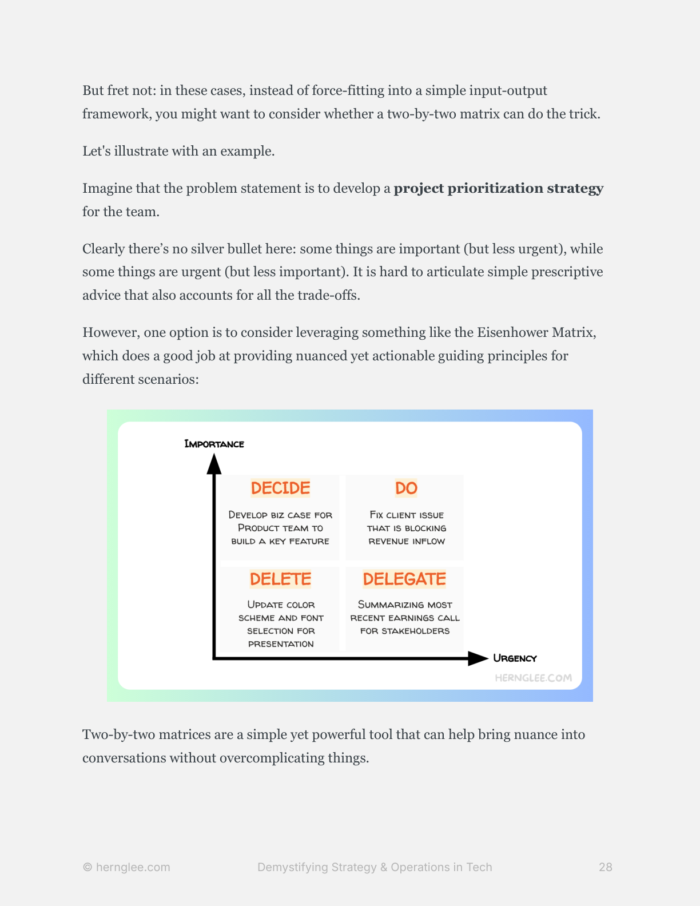

### Image text (OCR 1)

Image bounds in PDF points (left, top, right, bottom): `93.8, 358.5, 518.2, 613.5`. Lines below follow OCR order.

```text
IMPORTANCE
DECIDE
DO
DEVELOP BIZ CASE FOR
FIX CLIENT ISSUE
PRODUCT TEAM TO
THAT IS BLOCKING
BUILD A KEY FEATURE
REVENUE INFLOW
DELETE
DELEGATE
UPDATE COLOR
SUMMARIZING MOST
SCHEME AND FONT
RECENT EARNINGS CALL
SELECTION FOR
FOR STAKEHOLDERS
PRESENTATION
URGENCY
HERNGLEE.COM
```

## PDF page 029

In fact, it's also a nifty input framework to support the problem-solving process. By


intentionally forcing yourself to anchor a complicated problem statement down to the

two most critical dimensions, you might be pleasantly surprised at the amount of clarity

you can bring to an issue.


Here’s another example.


Imagine that you're trying to reimagine **how the company serves its customers,**

and you need a good framework to summarize the proposed approach.


One clean way to communicate your strategy might be to use the following matrix to


segment your customers, and then talk about how you would differentiate your


go-to-market strategy accordingly:


The beauty of this framework is that you often really only need to tackle two quadrants:


after all, the jobs to be done for your "stars" (top right corner) and your "dogs" (bottom


left corner) are often no-brainers.


© hernglee.com Demystifying Strategy & Operations in Tech 29

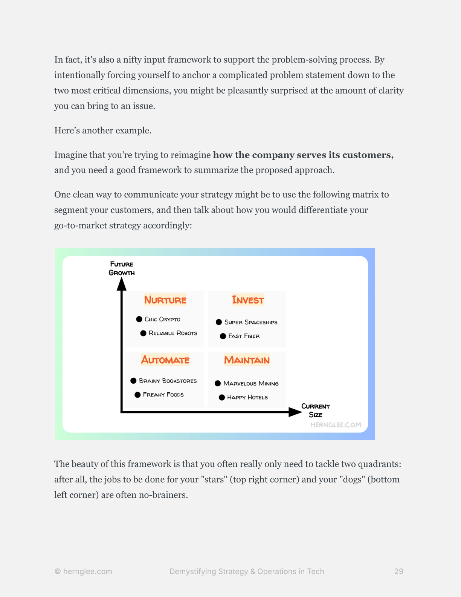

### Image text (OCR 1)

Image bounds in PDF points (left, top, right, bottom): `73.5, 329.0, 498.0, 584.0`. Lines below follow OCR order.

```text
FUUURE
GROWTH
NURTURE
INVEST
CHIC CRYPTO
SUPER SPACESHIPS
RELIABLE ROBOTS
FAST FIBER
AUTOMATE
MAINTAIN
BRAINY BOOKSTORES
MARVELOUS MINING
FREAKY FOODS
HAPPY HOTELS
CURENT
SIZE
HERNGLEE.COM
```

## PDF page 030

In this example, it's clear that the **“invest”** and **“automate”** quadrants are


straightforward to strategize against. Meanwhile, the **“maintain”** and **“nurture”**

quadrants are where you can introduce nuance into your strategy.


For instance, you might recommend that we start developing incentive programs for the


“maintain” quadrant, in order to squeeze more incremental growth out of


already-mature customers.


By contrast, for the "nurture" segment, you might recommend dedicated resources to

incubate those clients, and you might even design bespoke programs in order to unlock


their future potential.


Of course, maybe the right way to think about your strategy isn’t based on size and

growth, but rather other factors, such as competitive dynamics or product-market fit.

That’s totally OK.


The key is to ensure your most important guiding principles can be easily


communicated, and a 2x2 matrix is a useful tool to achieve that.


**But what if you need more than two dimensions?**


If you need to wield the power of a third dimension, nothing’s stopping you: for


instance, you can use bubble sizes, shapes, and/or colors to introduce further nuance as


you see fit.


But tread carefully and don’t go too crazy: most stakeholders simply cannot deal with

the complexity of anything beyond two dimensions, even if your logic is perfectly


reasonable. Better to keep it simple (or split things up), rather than have it backfire.


Now let's talk about #3.


© hernglee.com Demystifying Strategy & Operations in Tech 30

## PDF page 031

**[3] All good things come in threes.**


There are two kinds of people in this world: **people who think in sets of three, and**

**those who don’t.**


For some reason, you’ll find that most good narratives tend to abide by the rule of three.

Sometimes it almost feels like a necessity: anything more than that feels like a laundry


list, and anything less might as well be communicated via a single, punchy headline.


The rule of three has another benefit when it comes to presentations: you have the


flexibility to go as deep or as shallow as the situation permits, without altering your

framework too much.


If all you have is five minutes, no problem: with some finessing, there’s no reason why

you shouldn’t be able to communicate the gist of your analysis with 3 strong bullet


points.


And if you have an hour, then great: you can double-click into each of your three pillars,


fork into supplementary details, and deliver a well-structured presentation backed by

strong evidence.


And for anything in between: simply tee up your three pillars, cut to the chase, and let

your audience decide which pillar or two they'd like to double-click into.


There are very few situations where a three-pillar framework fails to do the trick.


Now, just like how MECE principles can and should be practiced in daily life, I also


know people who make it an active reflex to compartmentalize their thoughts into sets

of three. The idea is to train until it becomes a natural muscle.


And I do think it helps. When I interview people, I can easily tell which candidates are


used to compartmentalizing their ideas in a structured manner, and which ones aren’t.


The ones who have this muscle tend to communicate their ideas better – even if they

don’t strictly adhere to three buckets.


© hernglee.com Demystifying Strategy & Operations in Tech 31

## PDF page 032

Now, to be clear: organizing your thoughts into three buckets is a good start, but does


not automatically mean it will land well. There are suboptimal ways of organizing one’s

thoughts as well.


For instance, let’s go back to our earlier example where we proposed a set of


go-to-market strategies for our customer base.


What if we structured our executive summary in our presentation as follows:


 - We expect to **capture xx% more market share** if we evolve our approach with


our superstar customers


 - We’ll **improve cost efficiency by yy%** if we adopt a scaled approach for the


tail customers in our portfolio


 - We need to set up **a timeline and process** to communicate the implications of


these changes to our sellers


These are all valid points, but clearly one is not like the other (hint: it's the last one).


The key to employing a three-pronged approach is to ensure each of your pillars works


hard enough on its own.


In this example, the first two headlines are sharp, strategic, and impactful; the third one

is tactical and none of those things. It is thus a poor example of a three-pillar approach.


Instead, it would be much more impactful if the third bullet point attempted to address


something of equal importance, e.g. the potential risks to this strategy (and any

mitigation mechanisms).


I do want to be clear, however, that I am not suggesting that we fixate on cookie-cutter


approaches and force-fit all problems into predetermined frameworks.


Rather, I am arguing that the simplicity and familiarity of such frameworks make it

much easier for our audience to follow along. But what works for me may not work for

you. And what works for you may not work for your stakeholders.


© hernglee.com Demystifying Strategy & Operations in Tech 32

## PDF page 033

There are best practices, but there need not be a one-size-fits-all approach. Your


frameworks need to not only work for yourself, BUT also your audience as well.


So train this muscle. Even if you don't end up using these output frameworks in your

work, the attempt to apply such frameworks will help sharpen the thinking process as


well.


Let’s now talk about another critical piece: mastery of communication skills.


© hernglee.com Demystifying Strategy & Operations in Tech 33

## PDF page 034

#### **Mastery of Comms**

The bar for communication skills (“comms”) is incredibly high in the world of StratOps.


Every single day, you are expected to set direction, influence people, deliver insight,

build systems and processes… and they all require impeccable comms.


Of course, comms is a wide-reaching umbrella term: it includes everything from written


to verbal comms, and from slides to docs to emails.


In the following sections, we will cover these specific areas (click links to jump ahead):


 - Written comms: How to build exec-ready **<u>presentations</u>**


 - Written comms: How to write polished **<u>vertical docs</u>** (i.e. prose-based)


 - Written & verbal comms: How to make people care by **<u>contextualizing</u>**


 - Verbal comms: How to **<u>make people listen</u>** to what you say


I want to also be clear: while mastery of comms is especially critical for StratOps

operators, it is equally important for anyone looking to influence clients, partners,


stakeholders, or decision-makers at work.


Let’s start by talking about how to build exec-ready presentations.


© hernglee.com Demystifying Strategy & Operations in Tech 34

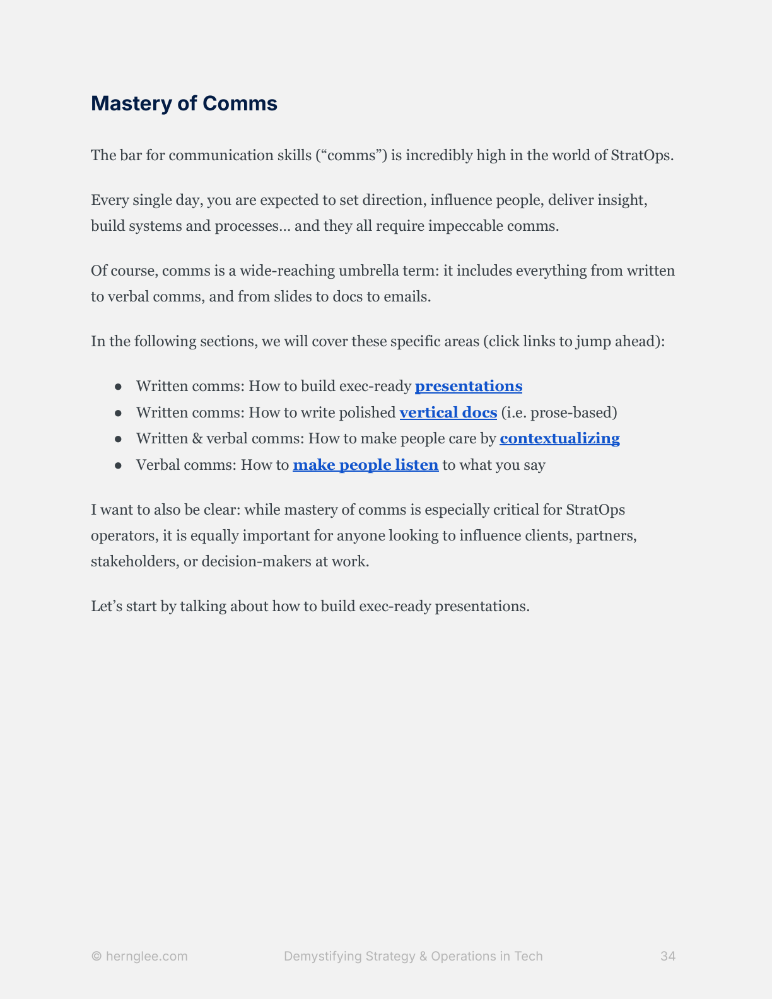

## PDF page 035

#### **Exec-Ready Presentations**

Building exec-ready presentations is hard.


Because first off, you’re expected to make sense of a complex topic. Then you need to


deliver a point of view in a highly crystallized fashion.


After all, that is the only way it will resonate with leaders and decision-makers, who are

often removed from the details, pressed on time, and short on patience.


It’s really hard. And so incredibly important.


The science of building exec-ready presentations requires much more real estate; we will

talk about some of the most critical guiding principles here.


But if you want the full experience? I built a 50-page playbook to teach people how to


[build exec-ready slides. You can grab it for free here.](https://hernglee.gumroad.com/l/slide-science)


Let’s get started.


**Brevity is Gold.**


One of my favorite quotes goes, “If I had more time, I would have written a shorter

letter.“


This is the essence of brevity, and it should be your golden rule. It applies to everything:


not only the overall length of your presentation, but also all the way down to how sharp

your individual bullet points should be.


Most presentation decks are way too long. This is not a sign of people working too hard


- it is actually a sign of laziness. Doing a brain-dump and hoping something will stick is


easy; condensing and distilling is much harder.


© hernglee.com Demystifying Strategy & Operations in Tech 35

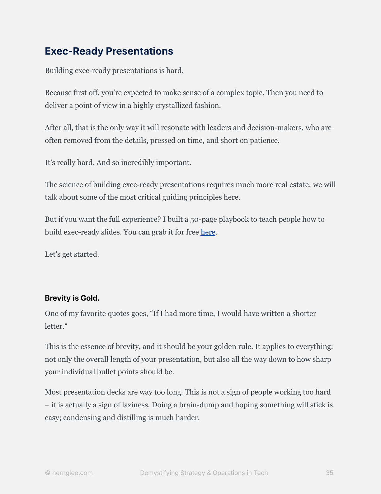

### PDF links

- [here](<https://hernglee.gumroad.com/l/slide-science>)

## PDF page 036

Here are my rules of thumb when it comes to the ideal length of presentations


(especially if the audience is senior):


 - 30-minute presentations (especially to execs) should have no more than 5 to 6


punchy slides.


 - 60-minute presentations can probably go up to 8 to 10 slides. Anything else can


be included as pre-read or appendix slides (i.e. included but not presented).


If you struggle to meet these constraints: that is a sign that (a) you either have an


incredibly complex situation that can’t be tackled in one short meeting or (b) you

probably need to ruthlessly sharpen and prioritize your messaging further.


Most of the time it’s the latter.


Here’s why all of this matters: Execs are often impatient. Most do not have the patience


for you to deliver a long soliloquy or run a presentation at your own flow. They’ll read

the headlines quickly and jump in with questions within minutes if they sense you’re

burying the lede.


Side note: this is also why you should almost never put animations into your


presentations with senior audiences. When you’re in front of execs, you will rarely have

the opportunity to control the flow exactly as you plan, as they will interject with

comments and questions as they please.


And when they throw questions at you (and you happen to be in the middle of your cool


animation flow that takes five clicks — or was it four?), you want to be able to tackle

those questions directly, or jump quickly to the slide that addresses them.


The last thing you want is to appear rattled while you’re frantically clicking around your


animation-littered slides to find the right landing spot.


But now back to our topic on brevity. It's worth noting that it doesn’t matter how smart

or how nice your senior audience is. You simply can’t get away with sloppy slides.


© hernglee.com Demystifying Strategy & Operations in Tech 36

## PDF page 037

Here’s why: the really sharp execs will not tolerate time being wasted. To this day I still


vividly remember an incident early on in my career. I was delivering a strategy

presentation to a director, and I was literally less than 10 seconds into my first slide

before the director cut me off and said, " _OK, next_ ."


Needless to say I was rattled. But looking back, it was laughably obvious why she reacted


that way. My slide had a big bar chart that only served to illustrate one very simple

datapoint. Even worse, it turned out to be a largely irrelevant datapoint to the strategy I

wanted to deliver.


No wonder she wanted to fast-forward.


This was a prime example of me being lazy: not only did I waste a whole slide on one

simple datapoint (strike 1), I used that weak slide as my opening slide (strike 2), and it

turns out that datapoint had little to do with the actual strategy I wanted to present


(strike 3).


Even now I cringe just thinking about it!


On the other hand, ironically enough, execs that are not very sharp will also disrupt your

flow, because they have terrible attention spans, and/or get lost in minutiae super


quickly.


Early on in my career I worked for someone who would never let me get past my first

slide, because they would inevitably get distracted by some minor point within the first

few minutes and go straight down a rabbit hole. We would spend the whole 30 minutes


talking about the trees rather than the forest.


So very quickly I learned to be prepared. I went into meetings as if I only had one slide

to present. I made sure that one slide was sharp, to the point, and effective.


However, brevity is not just about having the least number of slides. It’s also making


sure that every slide has a purpose. The litmus test is this: if you remove a certain slide,


does your story flow break? Is your argument significantly weakened?


© hernglee.com Demystifying Strategy & Operations in Tech 37

## PDF page 038

If the answer is _not really,_ you probably have a lazy slide that needs to work harder (or


even scrapped altogether). To have any slides that don’t “work” hard enough to deliver

above-average impact is to waste the valuable time you have with exec-level audiences.

The opportunity cost is larger than you think.


Now let's talk about something that appears trivial but is disproportionately critical:


**headlines.**


**Why It's Critical to Build Good Headlines**


Headlines will make or break your presentation.


They take 10 seconds to write but can take hours to get right. I have seen over and over


again instances where really good material fails to deliver the desired impact, simply


because of sloppy headlines alone.


In fact, some people neglect to write actual headlines on their slides: they put down

_labels_, i.e. simply describing what the slide is about _(“annual growth rates by market_


_for the last 5 years”)_, instead of writing an actual headline with insight _(“we_


_underperform against competition in our biggest markets”)._


Here are two questions I use to interrogate every slide in every presentation I build:


 - If the entire content of a presentation was removed except the headlines, do the


headlines themselves still tell a coherent, logical, and tight-knit story?


 - Do the charts and bullet points in the slide actually support the headlines?


If I find myself answering “no” at any point, I know that I have work to do.


To be fair, it’s quite natural to develop blind spots as you build out your slides.


Sometimes you forget that the flow of your headlines don’t work anymore given you

rejigged the storyline.


© hernglee.com Demystifying Strategy & Operations in Tech 38

## PDF page 039

Sometimes you don’t realize that you could have easily combined two slides into one and


delivered the same message.


And sometimes you move charts and graphs around and you forget that some headlines

now lack supporting evidence. All of these things can trip up your presentation and


create opportunities for distraction or confusion.


Now, assuming that your headlines jive with your content and they tell a logical story,

you should then pressure-test how good those headlines are individually. Luckily

enough, the guiding principles for writing headlines that work are rather simple:


 - **Be Strong**


 - **Be Direct**


 - **Be Crisp**


Let's start with the first one.


**[1] Being Strong**


A lot of the guiding principles for writing a good resume apply to writing good headlines


for presentations.


A weak headline is something like _the project was enabled by collaboration and deep_


_alignment. (_ I've actually seen this headline in an internal presentation).


The issue with this headline is that it is not only passive, but also uninsightful: who

would ever argue that collaboration isn’t important for any project? And why would you

ever need to dedicate a slide to claim that it is?


And as if that wasn’t enough, the nail in the coffin is the generic corporate jargon: we


naturally tune out these buzzwords whenever we see them, and such a headline makes

us want to simply skip ahead without ever needing to see the content.


© hernglee.com Demystifying Strategy & Operations in Tech 39

## PDF page 040

Here are a couple more real-life examples I’ve seen from actual strategy presentations


that unfortunately epitomize the meaning of weak headlines:


⛔ **“Our focus and attention will be centered on our org’s themes.”** First off,

don’t focus and attention mean the same thing? Also, who would realistically claim that


their strategy doesn’t align to their organization’s focus areas? This is a safe headline


that ultimately says nothing of importance. If anything, I’d be more interested in a

headline that says “we’re focusing on something very different from other teams.”


⛔ **“Momentum of Supplier Outreach in XYZ Country Drives Results.”** I’m

not sure why they didn’t feel comfortable simply saying the supplier outreach program


drove results. I also don’t know whether we think the results are very good (or just

non-zero). There’s also no actionable recommendation or implied insight (should we

double down on this strategy or…?). As an audience I’m just left dangling and have to


interpret the charts on the slide myself.


Let's now talk about how to be direct.


**[2] Being Direct**


A lot of people fall into the trap of thinking that they need fancy words and complex

sentences in order to sound professional and be taken seriously.


This is not necessarily wrong – there’s a particular tone and prose we associate with

professional and high-quality work – but it will completely backfire if you apply that


notion to headlines.


The best thing you can do with your headlines is to be extremely simple and direct.

Avoid corporate jargon like it’s the plague.


Littering your headlines with corp-speak may make you feel like you’re a professional


consultant, but in reality you’ve simply created mini-headaches for your audience. At


© hernglee.com Demystifying Strategy & Operations in Tech 40

## PDF page 041

best they grimace and try to decode what you’re actually trying to say. At worse they


simply tune it out as they assume it's generic corp-speak with little substance.


Again, here are a couple real-life examples of what NOT to do (again, I wish I was

making them up):


⛔ **“Office location decisions to adapt to 3 key design objectives, leveraging**

**a 5 question framework to define suitability.”**


 - I had to read this three times. Then I realized it was simply telling me that there’s


a very smart framework in place and I should just trust it.


⛔ **“The decision will be made at an agreed-upon (RACI) level by following a**

**robust data driven process and partner teams need to be consulted.”**


 - I had to read this five times. Then I realized the message was basically “don’t


worry, we’ll have clear decision principles and you’ll be consulted.”


Here's the lesson: Be direct. Don’t be afraid of sounding dumb. If anything, it requires a

fantastic command of rhetoric to be able to create sharp but simple messages. The ones


littered with corpspeak are the ones that scream insecurity and inexperience.


So do yourself a favor and make your headlines sharp, punchy, and direct. Stop working

against yourself by crafting complex headlines that serve no purpose. Stop saying crazy

stuff like:


_"Large headroom ahead buoyed by market growth but our share of_


_advertiser budgets is under-indexed thus requiring a fundamental pivot in_

_go-to-market strategy."_


Instead, just say something like:


_"The opportunity is huge and we’re missing out."_


And lastly, let's talk about what it means to be crisp.


© hernglee.com Demystifying Strategy & Operations in Tech 41

## PDF page 042

**[3] Being Crisp**


Caveat: this guiding principle borders slightly on style, but I truly believe it is the

foolproof approach to craft an exec-ready tone.


In a way, this touches upon the earlier point about brevity as well: most of the time, if


you can make your headlines short, they’re likely to feel crisp as well, which adds that

extra punch for your message.


However, they don’t always necessarily go in tandem. Here’s a couple illustrative


examples:


 - **Short, not necessarily crisp:** Our Daily Active Users have been trending


down for 3 quarters.


 - **Short AND crisp:** We’re losing users.


Here’s another example:


 - **Short, not necessarily crisp:** Competitors X & Y combined for 70% of market


share.


 - **Short AND crisp:** Market is dominated by X & Y.


In a way, the crispness comes from **elevating statements to stories.** It gives life to


(boring) factual statements. If you do it right, you’ll find that your headlines will carry

an extra punch and captivate your audience from the get-go.


Now let's talk about tone.


**Why Using the Right Tone Matters**


We talked about being strong, direct, and crisp with headlines. If we zoom out a bit,


we’ll realize that similar guiding principles apply to any prose on your slides.


© hernglee.com Demystifying Strategy & Operations in Tech 42

## PDF page 043

I think of this as the **tone** of the presentation.


It may seem minor, but thinking about your tone intentionally not only helps you


increase the chances of your presentation landing, it also ensures that your intended

nuances are not lost when an offline audience reads your slides.


Sometimes you want your tone to be dispassionate and objective. Sometimes you want


to convey excitement and urgency. Sometimes you want to have your cake and eat it too,

e.g. telling your audience your business is really understaffed (while assuring them that


you're still doing a great job nonetheless).


This is when crafting the right tone (and ensuring its consistency) is incredibly


important.


I remember a global VP who used to visit my region every year, and without fail he

would always opine:


_"You guys always tell me business is great and growth is fantastic, but you_


_also always tell me that the house is burning and you can’t grow without_

_more headcount and product support. These two things can’t both be true."_


He was most likely half-joking (or rather, half-serious), but I think about this incident a


lot. His observation wasn’t wrong, but to be fair to our business, the two polarizing


sentiments were both valid – they just needed to be qualified accordingly and put under


the right context.


Again, this is when tone plays a huge role. It’s super easy to write a presentation that has


an incredibly optimistic tone and pats itself on the back on every slide. It’s also rather


easy to write a presentation with a doom-and-gloom tone in order to convey a sense of

urgency and instigate action.


However, it requires incredible precision to be able to convey that nuance. Thinking


clearly about how to construct your tone will help you master this.


© hernglee.com Demystifying Strategy & Operations in Tech 43

## PDF page 044

**Don't Save the Best for Last**


This is one of the things where, once you see it, you can’t unsee it.


I’m talking about something incredibly simple, which is putting your talking points in


descending order of importance (or urgency).


This works at the most granular level in any part of your slides. Whenever you have a list

of items (e.g. a list of asks, or a list of challenges), ask yourself whether the most


important talking point is on top.


This sounds trivial but it’s not.


Imagine you have a list of five things you want to pitch your stakeholders on. Do you...


 - ...start with the most **urgent** ask (e.g. the house will be on fire if you don’t get it


asap)?


 - ...start with the most **important** ask (e.g. something that won’t deliver


short-term revenue but will be a long-term gamechanger)?


 - ...start with the most **complex** ask (i.e. something that your audience won’t


understand unless you explain it live)?


Each of these approaches is an intentional, strategic choice that sends a meaningful


signal to a discerning audience. It is surprising how many people create lists in their


presentations, without realizing that the order of items implies a certain stack-ranking


and sends a certain message.


This is not even considering the fact that there is always the risk of running out of time


for presentations, in which case it becomes imperative to ringfence time for your most


important talking points.


Of course, you will have to be the one to decide what is _most important_ or _most urgent_


in each case. If you can do that, you are strategic.


© hernglee.com Demystifying Strategy & Operations in Tech 44

## PDF page 045

**Tailor Your Message to the Audience**


It should be rather obvious that you need to tailor your presentation to whoever is on

the receiving end.


But most people don’t think about this intentionally.


The common pitfall is to subconsciously assume every word, phrase, and abbreviation

will mean the same thing to your audience as to yourself.


The other common pitfall is not asking yourself whether your intended audience is likely


to even care about what you’re talking about.


When you do ask these questions, you’ll realize how important it is to flex: sometimes


you need to talk a bit more about the trees, and sometimes a bit more about the forest.


(And on some days it’s not about wood at all.)


Here’s an example.


I used to write a lot of presentations on behalf of senior leadership to lobby for support

in my region. While the talking points were mostly consistent over time, inevitably we’d


need to customize depending on the intended audience.


If we were lobbying Product and Engineering folks, we’d tend to index a bit more on


portraying local market nuances and competitive dynamics, in order to illustrate the


rapid pace of innovation in the region.


However, if we were talking to finance leadership, we’d craft our narrative to clearly


illustrate why there is a need to invest in the region for growth (and what returns the


company could expect to reap over time).


And sometimes we’d need to socialize these talking points in town-hall meetings. In


those cases, I’d craft our narrative with a careful tone of cautious optimism (“ _we have so_


_much potential ahead, but we can’t let our foot off the brakes”)._


© hernglee.com Demystifying Strategy & Operations in Tech 45

## PDF page 046

Be intentional about thinking through who your audience is, what they’ll care about, and


what message you want to land with them. The same exact presentation could be a


homerun for some audiences and a complete dud for some others.


© hernglee.com Demystifying Strategy & Operations in Tech 46

## PDF page 047

#### **Writing Polished Prose**

In this section, we’ll focus on how to write good documents, i.e. content that is primarily


based on prose.


**What is "polished" writing?**


One thing is worth establishing up front: Polishedness is a result of writing in a highly


effective manner. And polishing can help us get there. It is the process – not the goal.


Therefore, before talking about how to polish our written comms, let's first establish

what polished writing tends to achieve. In general, we are chasing 3 key outcomes:


 - Ensure the reader comprehends the content easily


 - Minimize risk of misinterpretation or confusion


 - Establish credibility and persuade effectively


It's worth noting that the first two outcomes should be seen as non-negotiable. Any


piece of writing can (and should) be polished to achieve those two outcomes.


(The third one, however, is a bit more dependent on the inherent quality of your


content. After all, you can only put so much lipstick on a pig.)


While there is no single "right" way of polishing our written comms, there are quite a

few best practices that can help get the job done.


Here are 8 (relatively low-lift) ones I recommend adopting:


**[1] Always start with a "tl;dr."**


"tl;dr" = "too long; didn't read." It's a quick summary (usually no more than 2-3


sentences) that should preface any document (or lengthy email).


© hernglee.com Demystifying Strategy & Operations in Tech 47

## PDF page 048

For example:


There's 3 reasons why leading with a tl;dr section is critical, even if you think what


you've written is crystal clear already:


1. **Think of it as insurance.** Few people read a document from end to end; most


people simply scan. Your tl;dr section, therefore, can help minimize the risk of


misinterpretation. You ensure that your key takeaways will always register with

your reader.


2. **It's a great forcing mechanism.** You're forced to distill your key message

down to 2-3 sentences. In fact, I often try to establish my tl;dr first, before


jumping into any actual writing. It ensures that whatever I end up writing


actually contributes to my key thesis.


3. **It helps you identify superfluous content.** When you write your tl;dr,


you're implicitly determining what are the most important messages – and what


aren't. This allows you to then identify (and drop) less-relevant content. When


people praise a document or presentation for being "tight" – that is what they

mean.


**[2] Use the "duh" test.**


The "duh" test is this: you read what you write, and you ask yourself:


© hernglee.com Demystifying Strategy & Operations in Tech 48

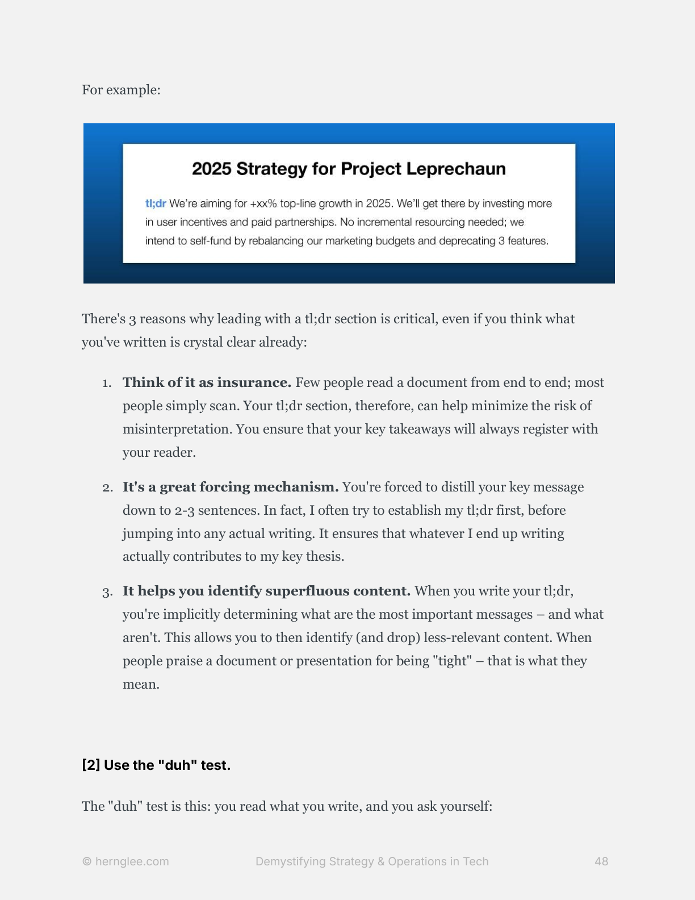

### Image text (OCR 1)

Image bounds in PDF points (left, top, right, bottom): `73.5, 109.0, 541.5, 249.2`. Lines below follow OCR order.

```text
2025 Strategy for Project Leprechaun
tI;dr We're aiming for +xx% top-line growth in 2025. We'll get there by investing more
in user incentives and paid partnerships. No incremental resourcing needed; we
intend to self-fund by rebalancing our marketing budgets and deprecating 3 features.
```

## PDF page 049

_Would anybody read this and go "duh!" (or "no sh*t")?_


If you've written something that no one would realistically disagree with – it's a waste of

space (and your reader's time). Every occurrence simply becomes another cue for your


reader to dismiss that paragraph and skip ahead.


Here are a couple real-life examples I've seen that fail the "duh" test:


_"This project was enabled by collaboration and deep alignment..."_


Who would ever argue that collaboration isn’t important for any project? And what new


insight about collaboration have you identified?


Here's another example:


_"Our focus and attention will be centered on our org’s themes..."_


Don’t focus and attention mean the same thing? Also, who would realistically claim that


their strategy doesn’t align to their organization’s focus areas? This fails to say anything


of importance.


If anything, I’d be more interested in reading a paragraph that starts with “we’re


focusing on something very different from other teams.”


There's obviously a caveat here: something that's patently obvious to me might be


eye-opening for you. And vice versa. This is why knowing your audience matters (we'll


cover this later).


Otherwise – the "duh" test can help tighten up your writing immensely.


© hernglee.com Demystifying Strategy & Operations in Tech 49

## PDF page 050

**[3] Pick the right moments to sound "dumb."**


We're not really trying to sound "dumb," of course. But you'll find that in an attempt to

sound professional or smart – most people end up littering their writing with generic


corp-speak.


And they forget that they need to storytell.


Consider the following paragraph:


_“Wakanda is a fast-growing market with significant potential. We are_


_currently under-monetized (compared to mature-market benchmarks),_


_and we have an opportunity to achieve profitable ROI if we can prioritize_


_Wakanda for our new feature launch this year.”_


OK, this paragraph isn't bad at all. It's factual and professional. Consider, however, what


we could achieve if we led with this instead:


_“We're leaving a lot of money on the table in Wakanda. Here's how we_

_can capture it…”_


Let's be clear: sounding "dumb" doesn't mean you water everything down. It doesn't


give you the right to ignore numbers or engage in generic platitudes either.


Rather, it means that you **find the simplest way** to anchor or hook your audience.


Then you have permission (and the obligation) to back it up with rigorous detail.


For example, consider the following paragraph:


© hernglee.com Demystifying Strategy & Operations in Tech 50

## PDF page 051

_“Our DAUs have been trending down for 3 quarters. Despite doubling_


_our marketing spend this quarter, we have yet to see a statistically_


_significant increase in new users acquired. We should explore external_

_partnership opportunities and redesign our user incentives program_


_instead.”_


Fair, factual, objective...yet it feels like something's missing. How about:


_“We're losing users. And doubling down on marketing isn't quite_


_working. Here's our proposed fix…”_


Again, you're not trying to "dumb down" your entire body of content. That would be


foolish. But you are trying to tell your audience how to feel right off the bat. And if you


can do that crisply – you have their attention.


(Which then gives you the license to pitch further detail and nuance.)


Think of the act of "dumbing it down" as cooking with spices: too much or none at all


results in a failed dish. But doing it selectively at the right moments? It adds a powerful

kick to your end product.


**[4] Avoid long sentences.**


I can't think of many instances where long sentences work better than short ones. It

simply adds more tax for the reader.


But what if your content has to be nuanced? What if it's too complex to be shortened?


What if there are critical caveats that cannot be omitted?


© hernglee.com Demystifying Strategy & Operations in Tech 51

## PDF page 052

I call BS on that. That's a false dilemma. There's always a way to simplify. Because you


can always...


**[5] Leverage bullet points and tables.**


The most readable documents I see at work aren't constrained by prose. Their authors

leverage a mix of formats to convey their points effectively.


For instance, instead of writing a chunky block of text, they might opt for bullet points:


There's nothing too advanced here – it's simply finding ways to add pattern and

predictability to your writing (and make life easy for the reader).


In fact, if you're dealing with content that contains more dimensions? Consider


leveraging tables. Not only do you make life easy for your readers – you're also forcing


yourself to think in a structured manner.


For instance, I love it when I read strategy documents like this:


© hernglee.com Demystifying Strategy & Operations in Tech 52

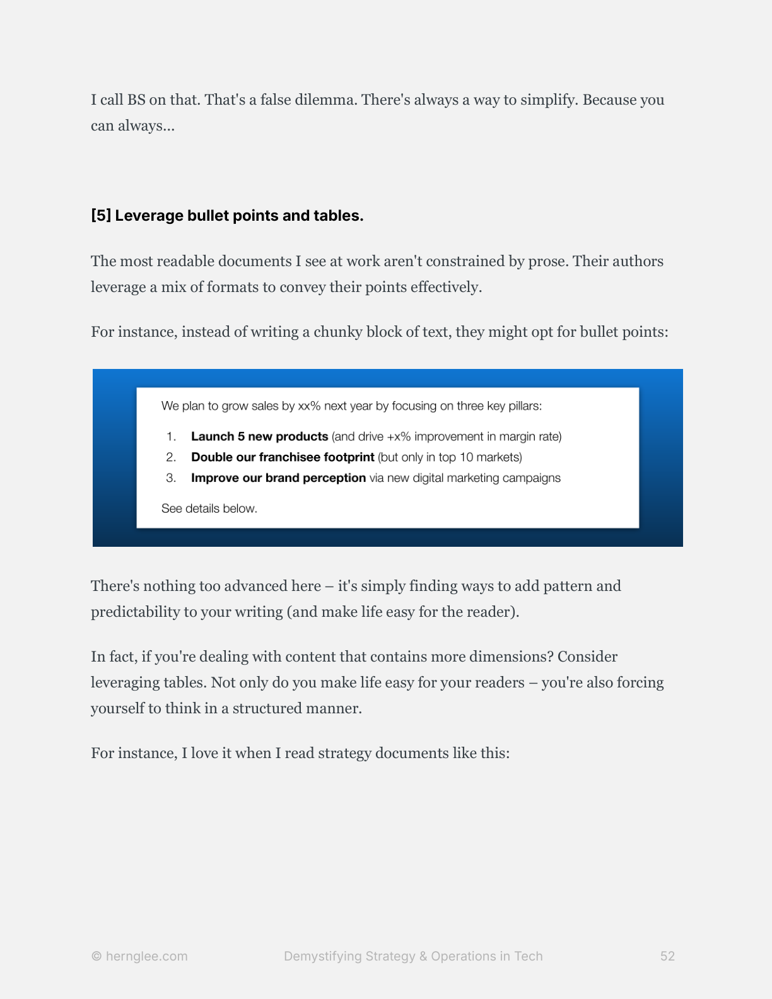

### Image text (OCR 1)

Image bounds in PDF points (left, top, right, bottom): `73.5, 293.0, 541.5, 433.2`. Lines below follow OCR order.

```text
We plan to grow sales by xx% next year by focusing on three key pillars:
1.
Launch 5 new products (and drive +x% improvement in margin rate)
2.
Double our franchisee footprint (but only in top 10 markets)
3. Improve our brand perception via new digital marketing campaigns
See details below.
```

## PDF page 053

Again – there's no rocket science (in fact, the goal is probably to achieve the opposite).

It's simply finding ways to lower comprehension tax for your audience.


**[6] Demand precision.**


Polished writing isn't fancy. It's just incredibly precise.


So don't say:


_"This is a really interesting market with a lot of great potential."_


Why? Because it's vague and unhelpful. Think about it – it could imply any one of the

following statements:


© hernglee.com Demystifying Strategy & Operations in Tech 53

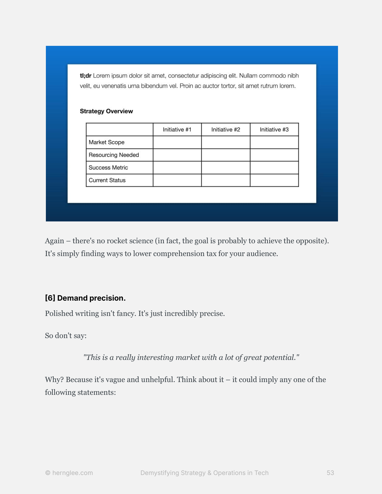

### Image text (OCR 1)

Image bounds in PDF points (left, top, right, bottom): `73.5, 73.5, 541.5, 354.8`. Lines below follow OCR order.

```text
tl;dr Lorem ipsum dolor sit amet, consectetur adipiscing elit. Nullam commodo nibh
velit, eu venenatis urna bibendum vel. Proin ac auctor tortor, sit amet rutrum lorem.
Strategy Overview
Initiative #1
Initiative #2
Initiative #3
Market Scope
Resourcing Needed
Success Metric
Current Status
```

## PDF page 054

- "This is a fast-growing market that we've barely monetised (and we should devise


a plan for it)."


 - "We see very unique consumer behaviors in this market; the learnings we


uncover here have implications for our 5-year plan."


 - "This market won't be ready for monetisation in the short run, but we should


start studying it already."


Of course, you don't have to nitpick every sentence. Nor is the goal to dummy-proof


every sentence with qualifiers and modifiers (that goes against principle #3 and #4).


Rather, it's all about intentionality.


Because sometimes you want to be highly precise and leave no room for


misinterpretation. While sometimes you want to trade away precision for crispness, and


you know that's OK (because detail will ensue).


Either is fine – as long as there is a high degree of intentionality. Just don't let laziness

get in the way.


**[7] Lead with the beef.**


We talked about the importance of having a tl;dr up front. By the same token, you want


to craft your sentences and paragraphs in a way such that the core concept tend to show


up first.


You don't need to adhere to this religiously. But sometimes it makes a big difference. For

example, consider the following paragraph:


© hernglee.com Demystifying Strategy & Operations in Tech 54

## PDF page 055

_“Compared to last year – where we did not prioritize paid acquisitions –_


_this year we prioritized digital advertising channels and cleaned up our_


_data attribution. This led to 3x growth vs. last year at highly competitive_

_ROI levels – truly incredible results.”_


This is not wrong, technically. Except half the people will probably read the first few


words (and yawn) and skip ahead.


And how could you blame them? The key message (an exciting one at that) has been


buried at the very end, and the reader was given no reason to read past the first few


words.


Remember: attention and comprehension are earned, not given. The onus is on the


writer to make it as easy (and as compelling) as possible for the reader.


So as an alternative, consider the following adjustment:


_“Our two key bets this year have delivered incredible results (new_


_acquisitions are up 3x vs. last year): (a) Prioritizing digital advertising_

_channels (b) Cleaning up data attribution.”_


You can also further tweak this to turn the spotlight onto the what ("acquisitions are


up") instead of the how ("two key bets"), i.e. –


_“We tripled new acquisitions this year – all thanks to two key bets that_


_panned out. The two bets: (a) Prioritizing digital advertising channels (b)_

_Cleaning up data attribution.”_


It may seem like we're splitting hairs with these adjustments, but think of it as


insurance. Again: attention is earned, not given. You do a huge disservice to your own

hard work (and to the reader as well) by burying the lede.


Why take the risk?


© hernglee.com Demystifying Strategy & Operations in Tech 55

## PDF page 056

**[8] Write with an audience in mind.**


There is no such thing as a perfect document. There is also no such thing as a perfect


document for everyone.


And if you do not write with a specific audience in mind – your document will not work

for anyone.


Before I write a document, I try to ask myself these questions:


 - Who is my primary audience?


 - How far will my document travel?


 - How much context do I expect the reader to have?


 - How high are the stakes? Does misinterpretation matter?


Why do these questions matter? Because then I'm able to decide:


 - How much jargon can I use?


 - How much detail should I go into?


 - How much context do I need to provide?


 - How much evidence do I need to land my point?


 - What arguments do my readers care the most about?


As an example, let's say I'm a leader in the business org. I'm writing a proposal to ask a


senior finance leader (who has little familiarity with my market) to invest in a new


initiative.


Then I would consciously write in the following way:


 - Limit my use of jargon or abbreviations


 - Minimize unnecessary detail (but link out selectively in footnotes)


 - Provide local market context (in order to properly educate)


© hernglee.com Demystifying Strategy & Operations in Tech 56

## PDF page 057

- Surface evidence that is quantitative and robust


 - Tie my arguments to financial outcomes


The best pieces of writing don't work for everybody. They're written in a way so that


they're highly optimized for the primary reader.


And it's the writer's job to make those trade-off's.


© hernglee.com Demystifying Strategy & Operations in Tech 57

## PDF page 058

#### **Contextualizing**

If you want people to care about what you write or say at work – you need to


contextualize.


Because if you don’t? Two unfortunate things can happen:


1. People outside of your world won’t “get it.” Your work’s influence will be limited.


2. You’ll only know how to tell strong stories when you have numbers that speak for


themselves. And when you don’t? You’ll struggle.


So what qualifies as "good" contextualizing? It's anything that quickly minimizes the gap


between your domain knowledge and your audience's understanding.


(Notice the emphasis on "quickly," as we're not trying to turn our audience into domain


experts. We're just trying to minimize their mental tax.)


In fact, the best operators take the concept of contextualizing a step further. Because it's

not just about landing the facts. Sometimes you're actually trying to sell.


Of course, different situations call for different contextualization techniques. Here are


the top 5 "tricks" I rely on:


1. Leverage shared knowledge.


2. Anchor on indexed figures.


3. Redefine the yardstick.


4. Explain with timeframes.


5. Paint the "but-for" picture.


© hernglee.com Demystifying Strategy & Operations in Tech 58

## PDF page 059

**[1] Leverage shared knowledge.**


Messages are easy to land when the datapoints are self-explanatory; this usually

happens when they're tied to a common knowledge base.


For example:


_●_ _“She makes a million US dollars a year.”_ (Yes, that's always a lot.)


_●_ _“We doubled our market share to 40%.”_ (Yes, impressive in any context.)


_●_ _"Our customer satisfaction score is only at 60%."_ (Yes, that's rarely acceptable.)


But what happens when there's no shared knowledge base? Then people have no idea


how to feel. For example:


_●_ _"We acquired +100,000 new users this year"_ (Stunning achievement or colossal


failure?)


_●_ _"Our average user spends 25 dollars on our app every year"_ (Underwhelming or


actually incredible?)


_●_ _"Asia has added 1.5 billion new internet users over the last decade."_ (Is that a


lot?)


A common mistake people make? Trying to rectify this by telling people how to feel,


instead of actually showing. For example:


_●_ _"We acquired a_ **_whopping_** _+100,000 new users this year"_


_●_ _"Our average user spend ($25) has_ **_exceeded expectations_** _"_


_●_ _"Asia has added 1.5 billion new internet users over the last decade - an_


**_incredible feat_** _of digitization."_


© hernglee.com Demystifying Strategy & Operations in Tech 59

## PDF page 060

Of course, all this signposting is better than nothing – but it fails to meaningfully


persuade. If you don't already possess some prior knowledge in this instance? The


numbers mean very little to you.


So instead, imagine leveraging shared knowledge bases and contextualizing as per


below:


_●_ _"We acquired 100,000 new users this year; for context, that's more than the_


_total number of users we had just 18 months ago!"_


_●_ _"Our average user spend was $25 this year; that's on par with the biggest_


_player in our industry!"_


_●_ _"Asia has added 1.5 billion new internet users over the last decade – that’s the_


_same as all existing internet users in Europe and the Americas today!"_


Of course, note that your audience's proximity to your world matters. The "farther" away

they are, the more intentional you need to be to find the right base of shared knowledge.


**[2] Anchor on indexed figures.**


One of my biggest pet peeves at work? Seeing ginormous numbers on presentations.


Things like:


 - ...535 million watch hours


 - ...256 million clicks


 - ...350,000 transactions


Why? Because when numbers are aggregated in such a way, they're not inviting. They're


so far beyond comprehension, that they're actually alienating (and often intentionally


so).


© hernglee.com Demystifying Strategy & Operations in Tech 60

## PDF page 061

In other words, they're just different ways of saying: **"Trust me bro – it's huge."**


There's nothing wrong with wanting to impress your audience. But in certain situations,


I suggest doing it by leveraging **indexed figures.**


It is more honest, more inviting – and actually more persuasive.


For instance, consider the framing below instead:


 - "Our platform has driven 535 million watch hours this year – that means half the


adults in this country **each spends x minutes** a day on our platform" (i.e.


indexed at an individual level)


 - "Our latest marketing campaign has driven 256 million clicks – that is **triple the**


**engagement** we've seen from similar campaigns in the past" (i.e. indexed


against historical benchmarks)


 - "Our software processes 350,000 transactions everyday – that means **1 out of**


**every 3 purchases** goes through us" (i.e. indexed against the total "pie")


Remember: when it comes to datapoints, bigger isn't always better. Contextualizing is


about reducing mental tax and fatigue for your audience – not increasing it.


**[3] Redefine the yardstick.**


Contextualizing isn’t just about finding benchmarks for revenue, profit, or users.


Sometimes it’s about turning the game on its head, so YOU can define what you deem to


be the right “context.”


For instance, imagine that you represent a small (but fast-growing) market, and you're


trying to secure resourcing for future growth.


© hernglee.com Demystifying Strategy & Operations in Tech 61

## PDF page 062

You won't get very far if you simply talk about dollars and cents in their rawest forms.


You're too small to matter (for now).


But consider the attention you could land by proposing new "yardsticks," such as:


 - ...your market's contribution to incremental growth


 - ...your market's headcount efficiency


 - ...your market's speed of execution


The thing to realize about contextualizing is this: it's not always about remixing existing

datapoints. That only takes you so far.


Instead, if you think of contextualizing as _reframing_ - it then opens up a lot of


possibilities.


In our example above, our audience is almost always wired to only pay attention to


markets that are already big today. We're not in that bucket – but that doesn't mean we


don't have a case.


So to give ourselves a fighting chance? The onus is on us to reset the context and

challenge our stakeholders to consider our argument from another angle. That's what it


means to "redefine the yardstick."


Of course, let's be clear: contextualizing is not about hiding unfavorable metrics. Nor is

it about wilful ignorance of competing arguments.


Rather, it's about finding low-lift ways to access your audience's mindspace – so that


you at least give yourself a chance to "sell."


Sure, you may not be successful in the end – but that is categorically better than being

rejected outright at the door.


© hernglee.com Demystifying Strategy & Operations in Tech 62

## PDF page 063

**[4] Explain with timeframes.**


Contextualizing is not always about volume and quantity. Talking about timeframes can


easily bring your narrative to life.


And there's actually two ways to go about this.


The first way is this: contextualize by talking about the before and after. Tell your


audience what's changed.


So instead of saying:


_"Thanks to the new software, our employees now spend less than an hour_

_a quarter filing expense reports..."_


It's much more powerful to say:


_"Thanks to the new software, our employees went from having to waste_ **_5_**

**_hours a quarter_** _dealing with expenses to less than 1 hour a quarter."_


Of course, you can also make use of principle #2, e.g. –


_"Thanks to the new software, our employees now spend_ **_80% less time_**


_filing expense reports."_


Meanwhile, the second way is this: contextualize by focusing on speed.


For instance, instead of just saying:


_“Investing in this initiative could help us achieve x% product adoption."_


Try saying:


© hernglee.com Demystifying Strategy & Operations in Tech 63

## PDF page 064

_"Investing in this initiative could help us reach product adoption goals_ **_2_**

**_years ahead of schedule._** _"_


**[5] Paint the "but-for" picture.**


Contextualizing isn't only about measuring what we can see. Sometimes it's about what


we can't.


And in those cases, you can be more persuasive by painting the "but-for" picture, a.k.a.

the **counterfactual.**


For instance, instead of saying:


_"We monetised in this market too late and missed out on a lot of_


_growth..."_


It's much more persuasive to say:


_"Had we started monetising in this market 3 years ago, we would've had_


_a $100M ARR contributor to our business today."_


You can also paint a counterfactual picture of the future, and bring the opportunity cost

into your narrative.


For instance, instead of simply saying:


_"If we prioritize launching feature X by end of year, we could grow_


_revenue by an additional 2~3%..."_


Consider saying:


© hernglee.com Demystifying Strategy & Operations in Tech 64

## PDF page 065

_"If we do not launch feature X by end of year, we risk leaving $10~20_

_million ARR on the table..."_


Of course, this is where you need to be careful. Painting a picture of the counterfactual


doesn't give you the right to fabricate the counterfactual.


So if you intend to contextualize this way? Make sure your assumptions are solid in

[order to protect your credibility.](https://www.hernglee.com/blog/hurt-credibility/)


© hernglee.com Demystifying Strategy & Operations in Tech 65

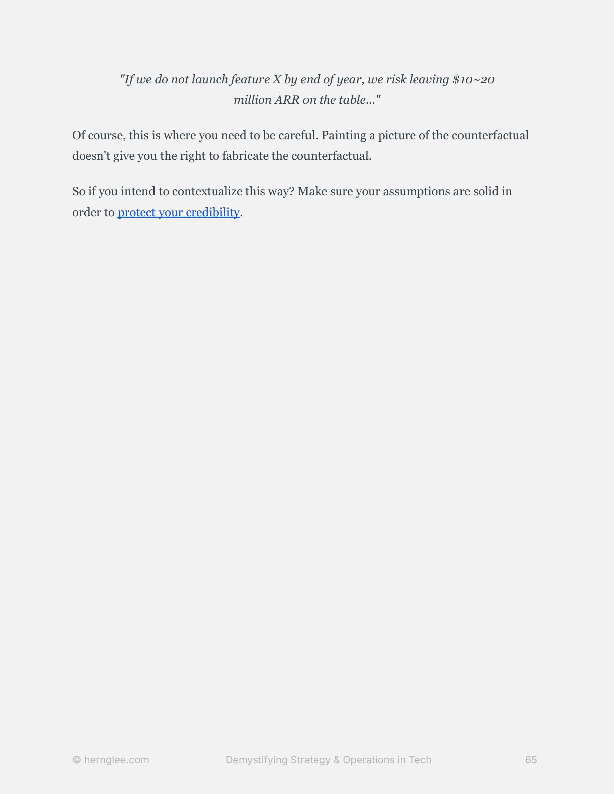

### PDF links

- [protect your credibility](<https://www.hernglee.com/blog/hurt-credibility/>)

## PDF page 066

#### **Sharp Verbal Comms**

There is nothing more frustrating than when you pour your heart and soul into

delivering a point of view to someone – and receive silence or inaction in return.


(We've all been there. People won't tell you you're wrong or that they disagree. They just


simply...move on.)


Actually, one thing is more frustrating.


And that is being completely unaware why this is happening, and repeating the same


mistake over and over again.


After all, few people are honest enough to tell us things like:


_●_ _“Your response was too complicated; I just want a simple answer.”_


_●_ _“Your email was too long; I lost patience and didn't read it.”_


_●_ _“You said so many things; I can't tell which ones matter.”_


_●_ _“You wasted half the meeting presenting slides I don't care about.”_


And therefore we keep making the same mistakes, over and over again.


But that need not be the case.


Here are 3 things I suggest doing to maximize the effectiveness of your verbal comms:


**[1] Use verbal cues to hack yourself.**


Most people are too long-winded when they speak. They refuse to lead with the

conclusion.


(The reason is simple. It feels unnatural and illogical. It feels like you've built the roof


first before building the floor.)


© hernglee.com Demystifying Strategy & Operations in Tech 66

## PDF page 067

So if the question goes:


_"How confident are you that we can hit our sales target this quarter?"_


They'll say:


_●_ _“We have visited and revisited all our clients to ask for budget…”_


_●_ _“We have also sought out market intel to understand macro trends…”_


_●_ _“We analyzed the data to seek out more opportunities…”_


_●_ _“...and we still don't think we can make up the remaining gap.”_


This is extremely logical. Yet unfortunately extremely frustrating for the listener, who is

in limbo while waiting for you to cut to the chase.


Of course, in the responder's defense: many things are difficult to summarize with a


short answer. Many things are of the "yes, but..." or "no, except that..." variety. You don't


want to mislead people by saying something that hasn't been qualified or caveated. I get

it.


But leading with the conclusion is how you make sure people actually listen. No one has


the patience for a long-winded buildup (unless you're a character in an Agatha Christie


novel).


Thankfully, the fix is simple. Just use verbal cues to "hack" yourself.


For instance, the go-to phrase I use for myself is:


**_The tl;dr* is this…_**


_*tl;dr = too long; didn't read_


When I start a sentence with "The TLDR is this," it forces me to lead with the conclusion

(to put my interlocutor at ease), but also signal that what I'm saying is over-simplified


("so please don't cut me off before I give you sufficient context").


© hernglee.com Demystifying Strategy & Operations in Tech 67

## PDF page 068

Then I proceed with my caveats, my rationale, or other supporting detail.


Your magic phrase doesn't have to be "tl;dr." For instance, you can say:


_"Short answer is [abc]. Long answer is [xyz]."_


Sometimes I even switch it up. I might say something like:


_"The answer is yes, but with a tiny asterisk. We believe we can meet the_

_quota, but contingent upon X feature launching in time. Let me also take_


_a minute to talk you through the details so you have a better sense of our_


_confidence levels."_


If you don't lead with the conclusion, your reader is left with an unscratched itch. Even if

you help them scratch that itch at the end of your spiel – it will not have been a pleasant


experience.


So use verbal cues to force yourself to lead with the conclusion (but also signal to the

listener that there's more nuance). It'll make a world of difference.


**[2] Signpost when you talk.**


Signposting involves using a variety of cues to help your reader or listener follow along

[much more easily. Wes Kao has a fantastic post](https://newsletter.weskao.com/p/sign-posting-how-to-reduce-cognitive?ref=hernglee.com) on it.


Signposting comes naturally when we write. For instance:


 - We use headers, sub-headers, and other titles to help the reader follow along


 - We use formatting ( **bolding**, _italics_, <mark>coloring)</mark>


 - We use explicit verbiage to signal intention, e.g.


    - For context...


    - Up until this point, this was true. However...


© hernglee.com Demystifying Strategy & Operations in Tech 68

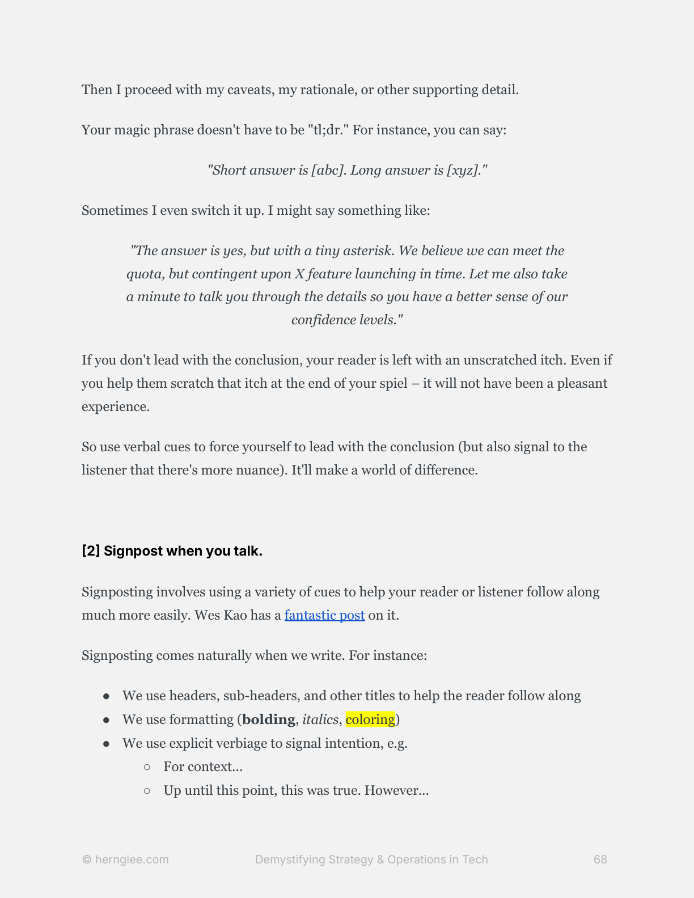

### PDF links

- [fantastic post](<https://newsletter.weskao.com/p/sign-posting-how-to-reduce-cognitive?ref=hernglee.com>)

## PDF page 069

- In short...


    - Contrary to…


However, when it comes to speaking: people forget to signpost all of a sudden.


After all, everything makes sense in their heads. They don't realize the listener needs


some help to follow along.


Here are two things I do to avoid this mistake.


The first (and simplest) is to stick to this three-step process:


1. Tell them what you’re going to tell them...


2. Tell them...


3. Tell them what you’ve told them.


Doing so does wonders. For instance, I might say something like:


_●_ _“I'd like to take the next 2 minutes to flag an issue we've been facing this past_


_quarter, and give you an example of how it hurts our business…”_


_●_ _(I then deliver my spiel...)_


_●_ _“The example I've given you illustrates how not fixing this small thing could_


_cause us lots of $ in the long run. My ask to this group is that we prioritize_


_solving this within the next 30 days.”_


The second thing I do is to give the "meta-message" up front.


For instance, I start by saying things like:


_●_ _"I don't need any action from you; I just want to share to give you more context_


_in case helpful."_


_●_ _"I don't need you to help me problem-solve; I just want to think out loud and_


_bounce ideas off you."_


© hernglee.com Demystifying Strategy & Operations in Tech 69

## PDF page 070

_●_ _"I'd like to explore whether you are the right person to partner together on this,_


_which is why I'd like to give you the full context first."_


When I do this, my audience immediately knows what part of their brain to switch on.

They also know whether they need to chime in with questions.


It is astounding to me how many people engage in a conversation by simply jumping


into their spiel, with no mention of **why** the listener should care.


A patient listener will listen on without interrupting – but half of his mindspace will be

spent wondering:


_●_ _“...Are they explaining this b/c they plan to ask me for a favor?”_


_●_ _“...Are they sharing this because they want my help in brainstorming?”_


_●_ _“...Are they sharing this b/c they simply want to keep me in the loop?”_


A less patient listener will zone out. Or they'll ask a bunch of questions that they never


would've asked if they knew of your true intention.


And it becomes a waste of time for both sides.


Note that this also applies if you're in a group meeting. For instance:


_"I'd like to share one issue that is specific to my business for now, but_

_could be a hidden risk in the future for others in the room."_


All of a sudden people in the room know why they should care.


On the other hand, if you're not able to signpost your own message and justify why


others should listen to you, you should ask yourself: _"Why am I even speaking?"_


You might then realize you didn't really have to take up other people's time.


© hernglee.com Demystifying Strategy & Operations in Tech 70

## PDF page 071

And this is equally valuable: not only did you preserve other people's time, you also

avoided saying low-value-add stuff. That makes other things you actually say _that much_


_more_ impactful.


**[3] Focus on principles, not tactics.**


Common pitfall that trips a lot of people up (myself included): **Debating tactical**


**decisions, rather than principles.**


Here's an example. Imagine that you're discussing with a colleague how to best design

seller incentives for a sales org.


Tactical questions include:


 - Do we announce the incentives via email or at a live townhall?


 - Do we track payouts in real-time or at a fixed cadence?


 - Who is on point for the escalation channel?


Tactical questions aren't unimportant. But they're tactical and (often) secondary. And


they can't come at the expense of establishing fundamental principles. Otherwise you'll


get nowhere.


What are principles-based questions? Examples:


 - What trade-off's do our incentives create?


 - Do the incentives jive with our org principles?


 - Have we optimized for fairness & transparency?


Here's an easy trick to save others (and yourself) from over-fixating on tactics:


© hernglee.com Demystifying Strategy & Operations in Tech 71

## PDF page 072

_Label, explicitly._


For instance, if you sense someone going down a rabbit hole in a meeting, you can say


things like:


_“I'd love to come back to this point you raised just now, because it does_

_matter for execution. However, could I suggest we park tactical decisions_

_aside first, and discuss....”_


You can also say stuff like:


_“I'd love to take a step back and discuss the bigger picture here…”_


Of course, sometimes tactical decisions are important – in which case you can

pre-qualify what you're saying, so people know that you're fully aware (and that you


don't intend to distract):


_This is a rather tactical point, but I wanted to flag it to this group because_

_it is rather time-sensitive..._


Labeling is important, and extremely helpful. Just make sure you do it carefully – after


all, you don't want to come off as condescending or dismissive.


●●●


This marks the end of this section on comms. If you found nerding out on this section

[interesting, you might also enjoy my weekly newsletter, where I frequently talk about](https://www.hernglee.com/popular-posts/)


how to build your comms toolkit in the workplace.


Let’s now talk about another critical element in the world of StratOps: **analytical**

**thinking.**


© hernglee.com Demystifying Strategy & Operations in Tech 72


### PDF links

- [my weekly newsletter](<https://www.hernglee.com/popular-posts/>)

## PDF page 073

#### **Analytical Thinking**

You don't need to be a math genius to be analytical. But it does help to be good with

numbers.


But I’m not talking about doing long division in our heads.


Rather, we want to possess a very specific set of statistical and mathematical concepts,

which can help bring clarity to many facets of the job (not to mention improving your

bullsh*t radar immensely!).


Don’t worry – it’s not a very long list, and most of these concepts are very digestible,


even if they take a little bit of getting used to.


The first one is the concept of **causality.**


**Causality**


Consider the following scenario: You are a General Manager overseeing the business of

several countries.


One day, one of your country managers tells you that her team recently launched a new


sales campaign in one city, and the city's sales this month rose 3% vs. last month.


As a result, she is lobbying you to invest a substantial amount so she can scale the

campaign to the rest of her country.


Your first instinct should be to question the country manager’s claim on attribution.


How do we know if the recent rise in sales can actually be attributed to this campaign?

And if so, how much?


It is surprising how often people fail to challenge these types of claims in the workplace;


over and over again, I see instances where if there is some action, and there is some


© hernglee.com Demystifying Strategy & Operations in Tech 73

## PDF page 074

(positive) result, someone is claiming credit for it without putting much effort into

proving the causality.


In this example, if we were the General Manager, we should ask the country manager to


explain why she believes this sales campaign truly drove an uplift.


Here are some potential answers, in ascending order of sophistication:


 - **Not bad, but not great:** “We can’t prove it, but this is the only thing we did


differently this month, so we believe the sales campaign must have driven most of

the 3% uplift.”


 - **Slightly better:** “We can’t prove it, but we did look at other cities as well, and


most saw a small decline this month. Our test city was the only one to rise – so we

think the sales campaign must have worked.”


 - **Much better:** “For benchmarking purposes, we picked twenty similar cities that


didn’t run the sales campaign, and their monthly sales remained flat, while our

test city rose by 3%. This gives us much more confidence that our sales campaign

worked.”


Talking like this is a bit awkward obviously. But your holy grail is something like the


following graph, as it is the only way to credibly demonstrate causality:


© hernglee.com Demystifying Strategy & Operations in Tech 74

## PDF page 075

The holy grail of cause-and-effect.


**Statistical Significance**


Of course, in reality, not every experiment can be perfectly set up, and not every result is

clean and conclusive. And business decisions still have to be made with imperfect data.


However, even if business circumstances render this type of rigor impractical, you still


have ways of sense-checking these claims (and sniffing out potential bullsh*t).


This is when the concept of **statistical significance** comes into play.


The idea is actually quite simple: for a given signal, you’re simply trying to gauge how


likely it is to be random noise.


To do this, you want to get a sense of the variance of the metric in question, i.e. the


range in which it usually fluctuates. It turns out that most things follow what’s called a

normal distribution, which allows us to quantify how abnormal an observed incident is.


© hernglee.com Demystifying Strategy & Operations in Tech 75

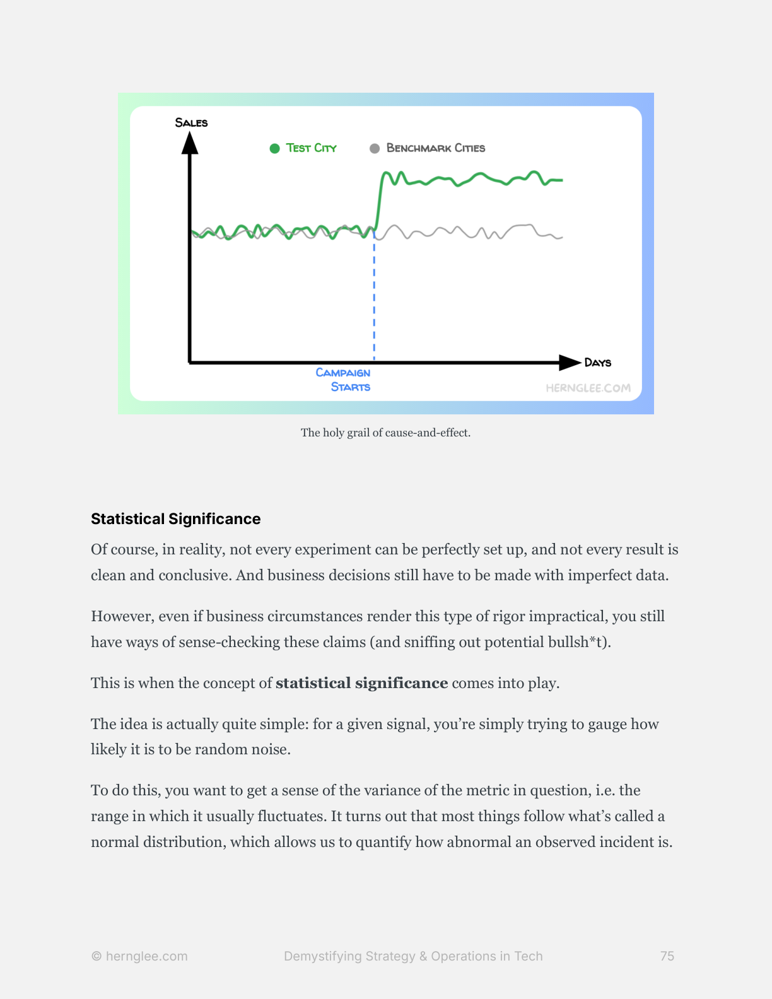

### Image text (OCR 1)

Image bounds in PDF points (left, top, right, bottom): `93.8, 73.5, 518.2, 328.5`. Lines below follow OCR order.

```text
SALES
TEST CITY
BENCHMARK CITIES
DAYS
CAMPAIGN
STARTS
HERNGLEE.COM
```

## PDF page 076

The more “abnormal” it is, the more confident we are that we’re reacting to something

that’s, well, worth reacting to.


Let's illustrate this by going back to the earlier example, where our country manager


told us about the amazing 3% sales uplift she observed.


We talked about how, in order to better establish causality, we would expect our country

manager to leverage control groups in her claim.


This is good, but technically not good enough.


Sure, we might have established a 3% incremental uplift, but we just don’t know how

meaningful that 3% uplift is. There is still a chance that we are reacting to noise, and the

problem is we don’t know what those chances are.


To figure this out, we simply need to figure out how sales figures tend to fluctuate.


Imagine a scenario where sales figures can easily differ by 10% every day. Well, in that

case, perhaps even if we did nothing, we wouldn’t be surprised to see a 3% rise suddenly.

It’s just part of the daily ebb and flow.


But on the other hand, what if sales were extremely stable? Then our country manager


could give us an extremely compelling answer, such as:


_“We compared our test city against the right benchmark cities, AND we_

_also looked at the statistical significance of the uplift. As you know, our_


_sales are very stable on a daily basis, with the standard deviation being less_


_than 1%. This gives us extreme confidence that the 3% average uplift we_

_saw this past month was not a fluke.”_


Of course, it’s hard to expect everyone at work to go through this level of rigor before


putting forth an argument. But if you can actually get your hands on the data, you can at


least quickly figure out **how much noise** you’re dealing with.


© hernglee.com Demystifying Strategy & Operations in Tech 76

## PDF page 077

Here’s the trick: When things follow a normal distribution pattern, then you can expect

about **68%** of datapoints to land within one standard deviation to both sides of the


average, and just over **95%** to fall within two standard deviations.


In human-speak, this means that if you’re given a signal that is at least two standard

deviations away from the expected average, you can be at least 95% sure that you’re

reacting to something out of the ordinary (and therefore meaningful).


If it’s only one standard deviation away from the average: well, it might still be


noteworthy, but you just need to know that you might simply be reacting to noise a third

of the time.


A third of the time is too high for me.


My personal rule of thumb is to only take things seriously when I feel that there’s at least


an 80% chance I’m not reacting to noise. In fact, I might even dial that threshold up to

90% for important decisions.


This means that if a given signal is not at least 1 to 1.5 standard deviations different from


the average, I treat it as noise until stronger evidence comes into play.


In fact, even if I can’t get my hands on the data, I make sure to ask whoever’s presenting

the argument to tell me a bit more about how much the metric in question tends to

fluctuate.


Sometimes I don’t even need an answer: just seeing the reaction of my interlocutors


alone already tells me how much confidence I should have in their claims.


Of course, analytical thinking is only the foundation. The key is to leverage analytical

thinking and actually **extract insight** - which is exactly what we’ll cover next.


© hernglee.com Demystifying Strategy & Operations in Tech 77

## PDF page 078

#### **Extracting Insight (Systematically)**

One of the struggles early on in my career (I worked in the data analytics space) was to

come up with proper "insight" in my analyses.


I struggled for a couple reasons:


 - I wasn't sure what counted as "insight." (What if I'm pointing out something


that's obvious to everyone?)


 - I didn't have a systematic approach. Sure, I'd try to copy good hypotheses from


past projects and replicate. But I'd struggle when I dealt with a new client or new


industry.


Years later, I have a much better understanding of what actually qualifies as insight (see

earlier chapter for a refresher). I also have a much more replicable approach to


uncovering it.


And here are 3 foolproof ways I suggest applying to systematically extract insight from


anything:


**[1] Find where the pattern "breaks."**


There's no insight when something happens as expected. But think about what the

corollary of this suggests. It tells us that insight occurs when something unexpected


happens.


And thus when you're on the quest for insight, one of the most useful things you can ask


is:


“ _Where does the pattern break?"_


© hernglee.com Demystifying Strategy & Operations in Tech 78

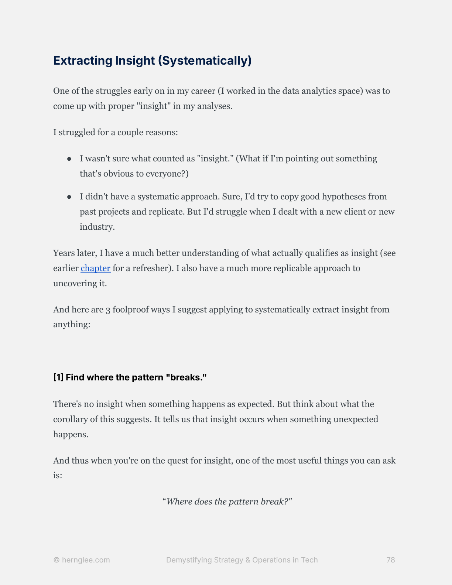

## PDF page 079

Sometimes this is simple and easy to identify. For instance:


 - A sudden dip after consecutive quarters of steady growth


 - A market that is underperforming the rest of the region


 - A metric that is negative when most other ones are all positive


But sometimes this is less obvious. And this is where intentionally looking for pattern

breakers can help you uncover what others fail to see. That's when you deliver insight.


Here's an example: Monthly sales appear to be steady over the past 12 months. No


surprises (and no particular insight) so far.


However, when you analyze the sales composition, you suddenly realize the top-selling

categories have completely changed in the past month:


Simple observation – but ample insight will follow.


© hernglee.com Demystifying Strategy & Operations in Tech 79

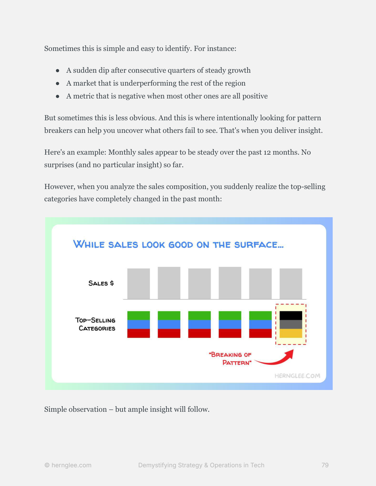

### Image text (OCR 1)

Image bounds in PDF points (left, top, right, bottom): `73.5, 354.2, 541.5, 635.4`. Lines below follow OCR order.

```text
WHILE SALES LOOK GOOD ON THE SURFACE..
SALES $
TOP-SELLING
CATEGORIES
"BREAKING OF
PATTERN"
HERNGLEE.COM
```

## PDF page 080

**[2] Segment a lot (but not too much).**


It turns out that most insights come from segmenting. In fact, we often encounter (and


use) segmentations unknowingly all the time. For instance:


 - My favorite basketball has won the last 10 games in a row (but 9 out of the 10


games were against the worst teams in the league)


 - The average starting salary might have gone up over the years (but only for


certain industries)


 - A restaurant has extremely high ratings on Google Maps (but the 5-star reviews


were all from tourists, not locals)


Segmenting is how we uncover insights that may be obfuscated by simple averages and

aggregations. It is simply a process of slicing and dicing.


The key, however, is recognizing what dimensions are most useful to segment along.


As an example, let's imagine you run a lemonade stand business. Tracking sales data is


simple. But insight comes from asking the following questions:


 - How do my sales vary by time of day (or day of the week)?


 - How do my sales vary by demographics (gender, age, etc.)?


 - How do my sales vary by product type (cup size, flavor, price point)?


 - How do my sales vary by customer type (first-time vs. repeat)?


When you segment rigorously, you're more likely to find instances where the pattern


breaks (see tip #1) – and therein lies your path towards insight.


However: you cannot segment everything. And you should not segment everything.


Here are 3 reasons why.


© hernglee.com Demystifying Strategy & Operations in Tech 80

## PDF page 081

⚠️ The first is that you don't always have the right data. And there are often costs

associated with obtaining that data.


For instance, to collect any type of customer demographics data:


 - Does the salesperson (in a physical store) have to eyeball it and write it down,


thus taking time away from serving customers?


 - Do you ask your customer to fill it out (and create friction in the buying process)?


Some data dimensions are valuable and worth collecting. Some aren't.


⚠️ The second is that over-segmentation often leads to noise. Even if you're sitting on a

treasure trove of granular data, you need to ensure integrity in your segmentation

efforts.


For instance, let's go back to our lemonade stand. Imagine if you wanted to analyze the


sales patterns of male customers between the ages of 35-40 who visit on weekdays


during lunch hours.


Sure, you'll get more than enough dimensions to analyze. But you might also end up

extrapolating from a sample size of 2 people.


⚠️ The third and last thing is that there isn't always actionability.


But there is almost always a cost to extracting, interpreting, validating, and revalidating

the data.


More data isn't always better. Sometimes it's just a distraction. Especially when there's


no actionability.


© hernglee.com Demystifying Strategy & Operations in Tech 81

## PDF page 082

For instance: let's say we somehow managed to identify that men in suits tend to buy

lemonade more often than men in shorts.


But so what? What can we actually action on based on this seemingly insightful nugget?


Segmentation is important and helpful. But don't overdo it.


**[3] Define the benchmark (and spot the gap).**


What if there's no obvious break in pattern, and you've run out of dimensions to

segment?


That's where redefining the benchmark comes in.


Remember that in tip #1, we established that "insight occurs when something


unexpected happens."


But someone needs to establish what that expected baseline is!


In some instances, that's easy.


For instance, we might just look backwards: e.g. my lemonade stand brought in $50 a


day on average last year, so that's probably what I can expect this year.


However, in some instances, the benchmark is less clear. It might even be erroneous.


For example, imagine that I run a chain of fast-food restaurants, and I operate across


100 locations. And I'm about to open up my 101st store next month.


**Question:** What revenue can I expect to generate for my new store?


© hernglee.com Demystifying Strategy & Operations in Tech 82

## PDF page 083

Well, I could look at the average sales for the other 100 stores ($10K/month) and call it


a day. So maybe I should expect $10K/month?


But it turns out half of my 100 existing stores are next to metro stations with heavy


footfall (while my new store isn't). And the average sales for those 50 other non-metro


stores is only $10K/month.


So maybe I should expect only $10K/month?


But wait – I now remember that only 10 of those 50 stores were renovated in the last


year, while the other 40 are old and run down. My new store is obviously renovated, so...


...you get the picture. This is where defining the proper benchmark brings incredible

insight and critical value.


Because without the right benchmark, any downstream insight you extrapolate is


questionable.


Once you realize this, you'll see opportunities to define (and sometimes redefine) the


right benchmark everywhere. You'll learn to ask questions like:


_"How high is high?"_


Or, you might also ask:


_"What does 'good' look like?"_


That is the only way you can establish whether something is good, bad, or meh. For


instance, imagine the following statements:


 - Your revenue is growing at 50% year-over-year


 - Your product penetration in a given market is at 5%


 - You secured 20% of your client’s annual budget


Which headlines call for celebration? And which ones are of concern?


© hernglee.com Demystifying Strategy & Operations in Tech 83

## PDF page 084

People have no idea, unless you help benchmark and contextualize.


Then you might realize 50% growth is pathetic (market is growing at 100%!), and 5%


penetration is actually very commendable (since your previous products all plateaued at


3%).


And that's insight.


© hernglee.com Demystifying Strategy & Operations in Tech 84

## PDF page 085

#### **…and Nailing the Basics**

If you’re in the world of StratOps, you need to ensure excellence in the basics. So let’s

talk about what it means in the context of emails and meetings.


**How to Write Emails (That Won't Get Ignored)**


Almost everybody will read your emails, but not all of them will actually respond or take


action. When it comes to writing emails and maximizing the chances of getting what I


want, I have the following guiding principles:


📌 **Keep the email short.** My audience should be able to finish reading my email

within 20 seconds. Use crisp bullet points (ideally no more than three); avoid long


prose. Brevity also improves tone, which helps build executive presence.


📌 **If you cannot realistically keep the email short:** ask yourself whether you

should set up a live meeting instead (or send a brief email to set context but reserve the

discussion for the live meeting). Continue to avoid long prose and structure your email


into sections, for example:


 - **Context:** Travel budgets are being slashed; we need to deprioritize 2 out of 3


events for the rest of the year.


 - **Ask:** Please take 3 minutes to read through the trade-off assessment here (link)


and start formulating your view


 - **Next Steps:** I’ve set up time for us to discuss live this Thursday and make a


decision collectively.


📌 **Another reason not to write long emails:** It has the unintended side effect of

showing that you lack exec readiness, given your inability to distill things down to


simple, crisp messages.


© hernglee.com Demystifying Strategy & Operations in Tech 85

## PDF page 086

📌 **If action is needed**, put “Action Needed” in the subject line, and put the ask as the

first sentence in my email. Even better, tell them if this is a 10-second / 1-minute /


5-minute ask.


📌 **If action is NOT needed,** put "No Action Needed" in your subject line. Trust me,

there is nothing your recipients will appreciate more.


📌 **Avoid email chains with too many recipients.** Accountability diminishes as

more names appear in the recipient list. If you intend to gather feedback from more


than 3 people, invest the time to send them each an email separately instead. They’ll feel

much more compelled to respond.


📌 **For sensitive subjects or dividing issues:** I’ve never seen someone influence

others effectively by winning a debate through email. Remember: tone and trust are


hard to convey through emails and pings, and emotions can escalate quickly.

Meanwhile, people often forget to assume good intention. So when in doubt, be crisp


with your email, but offer to talk in person to show goodwill.


📌 **As a corollary to the above:** as the recipient, always assume good intention when

you can.


📌 **Always assume that your emails can be forwarded.** If there are statements

you would rather someone not see (even if taken out of context) – assume there’s a


non-zero chance they’ll see it. Either rephrase, ping privately, or save it for live meetings


where you can caveat or add nuance accordingly.


📌 **Last but not least: Always review.** Almost always you’ll find that you have

sentences that can be merged or cut entirely. Sometimes you’ll find things that make


sense individually but are now out of place because of the preceding content. Don’t skim


on the 2 minutes for revision and end up letting the first 10 minutes go to waste with an

email that falls flat.


Now let's talk about **meetings.**


© hernglee.com Demystifying Strategy & Operations in Tech 86

## PDF page 087

**How to Run Effective Meetings**


Let’s talk about one-on-one meetings first.


Specifically, let’s focus on cadenced meetings, which tend to happen with people like


your manager, business partner, or an important senior stakeholder.


Here are my recommended best practices.


📌 **Keep an agenda doc.** It can be as simple as dropping in bullet points on what you

want to discuss for an upcoming meeting. This has a few benefits:


 - It gives both sides a sense of what to prioritize discussing first, and how much


time to invest on a topic before switching gears.


 - In addition, it gives you the chance to dictate the flow and show proactiveness,


especially if it is with your manager or someone more senior.


📌 **Track action items (on your shared agenda document).** If you’re meeting

someone and some action items fall on you, you can make a note directly in your

document. The next time you meet, you can easily give updates, and continue to

establish a good track record of executing on what you said you would.


 - This works both ways, i.e. if the action item falls on the other person. It then


becomes much easier to follow up using the document and ensure accountability.


📌 **Always give the headline first** . Imagine you intend to use your upcoming 1:1

time with your manager so he/she can weigh in on a tricky decision. A lot of people


make the mistake of trying to paint the full picture before they get to their ask.


What they do is this: they explain the context, what they’ve tried already, the challenges


they’re facing…and then ten minutes later, they finally tell their manager they’d like


some advice.


You want to do the opposite instead. Flip it around. Tell your manager that you are


seeking their opinion, and give them a 30-second version of the problem. Also clarify


© hernglee.com Demystifying Strategy & Operations in Tech 87

## PDF page 088

how much (or how little) context they have, and use that to calibrate how deep you need


to go.


Then you can dive in.


This helps put your manager in the right mindset when they listen to your spiel: they


know they are in problem-solving mode together with you, and which gears to turn in

their heads as you speak.


The reverse is true as well: if you’re simply trying to provide your manager with visibility


of the challenges you’re working through (but don’t really need them to step in), **say**

**that up front.** You can say something like:


“ _I don’t need anything from you, but I just wanted to make sure you have_


_visibility of what’s taking up half my time this week.”_


Then they know they don’t need to jump in with their problem-solving hat on, and

instead focus on listening. They can also do things like: look out for things you did well,


or think through how to readjust your upcoming project pipeline based on your


bandwidth.


📌 **Think about the meta-game.** If you have fixed cadences with certain people,

think deeply about what message you’re sending based on the pattern of how you’re


using these meetings. Not every meeting has to be about critical business topics, but it’s


a problem if every meeting ends up being about tactical execution.


For instance: it’s fine to use 1:1 meetings with your manager to flag bandwidth problems


and ask for support, but if that becomes a recurring pattern every meeting, your

manager might question your ability to prioritize and execute independently. Make sure


you are using your meetings intentionally, and establish a pattern over time that is


reflective of the brand you want to portray for yourself.


📌 **Last but not least: think about the value exchange.** Meetings are a time

investment; on balance both parties should be getting non-trivial value from meeting


© hernglee.com Demystifying Strategy & Operations in Tech 88

## PDF page 089

regularly. Usually this is a non-issue: meetings where one side is benefiting significantly


less than the other will slowly disappear anyway.


However: be aware if you find yourself in meetings where you need the other person


more than they need you. That is OK, but you do want to be extra prepared and effective


in those instances, so as not to further disincentivize them from spending more time on

you.


**How to Make Group Meetings Better (and How to Skip Useless Ones)**


Let’s now talk about **group meetings.** We’ll focus on situations where you have no


more than a dozen people: anything more than that is usually a unilateral presentation


rather than a discussion-based meeting.


But instead of sharing a laundry list of best practices, I want to share four simple


questions that we can use to pressure-test the efficacy of any meeting.


Every meeting is different (some meetings shouldn’t even exist in the first place), but if


you ask yourself these questions after every meeting, you’ll find yourself participating in


(or conducting) meetings much more effectively.


You might even get the gift of time by knowing which meetings to skip!


**Here are the four questions:**


1. What was the purpose of this meeting?


2. Did I need to be there?

3. If I did, what value did I add?


4. Did we achieve said purpose, and what could we have done better?


Let's go one by one.


© hernglee.com Demystifying Strategy & Operations in Tech 89

## PDF page 090

**[1] "What was the purpose of this meeting?"**


It is surprising how many people are willing to sit through meetings with unclear


agendas, without a single attempt to clarify the purpose of the meeting.


Sometimes this is due to the fear of looking dumb ( _what if it’s clear to everybody else?)_ .

Sometimes this is due to not wanting to appear rude _(what if I make the person running_


_the meeting look bad?)._


But those concerns can be easily overcome. What you want to always keep in mind is

that there are essentially only 3 types of meetings, and if you can’t figure out what kind

of meeting you’re in, that’s a red flag.


The 3 types are as follows:


 - **Information-sharing meetings:** Most meetings tend to fall into this category.


The purpose is to minimize information asymmetry and make the attendees


better-informed. This can range all the way from super important cascades (e.g.


someone giving a debrief on recent discussions with leadership) to super tactical

updates (e.g. someone sharing instructions on how to provide input in a


spreadsheet).


 - **Decision-making meetings:** Self-explanatory. Intention is to obtain input


before making a call on something again, this can range from critical business


decisions ( _do we move ahead with this investment?)_, to those that are less so


( _what topics do we cover in our next quarterly review?)_


 - **Problem-solving meetings:** Self-explanatory, although the format can look


very different depending on the problem type. Whether you are brainstorming,


whiteboarding, debating, or simply presenting something to gather feedback, you


are in a problem-solving meeting. Problem-solving meetings are all about


surfacing and polishing ideas.


To be clear: this is not rocket science.


© hernglee.com Demystifying Strategy & Operations in Tech 90

## PDF page 091

However, the key is to use this framework so we can recognize (a) when there’s no clear


anchor for a meeting or (b) when a meeting type morphs into another one


unintentionally.


For instance: imagine that you’ve brought together four people from different


departments to discuss how you might build a business case for a new product launch.


Your intention is not to make immediate decisions, but rather to problem-solve together


by getting the creative juices going from a diverse set of perspectives.


However, if you don’t make your intentions clear, you could find some people holding

back, as they might mistakenly think this is simply an information-sharing meeting, and

they haven’t been given the right to debate or disagree.


You could also run the risk of your meeting getting hijacked if you’re not clear about


your intentions: some people might treat this as a good opportunity to update one

another on the latest product roadmap updates – never a bad thing, but heavily distracts


from your original intention, and wastes the precious time you have.


Always know what kind of meeting you're running – and then say it explicitly.


Let’s now move onto question #2.


**[2] Did I need to be there?**


OK, so you’ve established the purpose of the meeting. You should then ask yourself:


_"Did I need to be there? What would’ve happened if I didn’t join? Could I_

_have created more value by spending that time elsewhere?"_


These are not trivial questions. Whether it’s pride, confusion, politeness, or something


else: most people tend to treat meeting invites as if they are edicts. Their default is to

accept any calendar invite that comes their way.


© hernglee.com Demystifying Strategy & Operations in Tech 91

## PDF page 092

Their logic usually goes:


 - … _if I’m invited, there must be a good reason._


 - _…if I ask whether I can simply follow up offline, I’m implying that the meeting is_


_not important and I might offend the person._


 - _…if I don’t show up and everyone else does, it implies that I am dispensable._


 - _…if I don’t show up, I might miss something important, and I won’t have a way_


_to know for sure_


At the core of all of this is **fear.** Fear of appearing dumb. Fear of offending other people.

Fear of appearing unimportant. Fear of ignorance.


And when fear takes over, we end up joining meetings that we really didn’t need to.


Look around the next time you have a group meeting, and try to spot the people who are


multitasking away on their laptop: chances are half of them didn’t really need to join


this meeting.


Instead, we should feel fully empowered to decline meetings if we believe we can engage


more effectively via other means.


As a result, your first step should always be to assess what you contribute to this


meeting. If you don’t believe you’ll add incremental viewpoints versus other attendees,

skip it.


Alternatively, if you can contribute more effectively through other means (e.g. via a


short email offline, or having a two-minute in-person chat with the person separately) –

then you should also exercise discipline and decline to join.


OK, but let’s say the meeting invite passes the initial smell test. Then your next step


should be to consider **what you’ll be getting from this meeting.**


Yes, you have the right to be slightly selfish and think of your time as a valuable asset

(which it is!). You want to ensure that on average, you are getting enough bang for your


buck when you invest your time into meetings.


© hernglee.com Demystifying Strategy & Operations in Tech 92

## PDF page 093

Of course, treating your time as a valuable asset does not mean that you only take


meetings that benefit you – collaborativeness is a two-way street after all – but you do


want to make sure that you regularly ask yourself, " _am I protecting my time_


_adequately?"_


Nobody sets out to waste other people’s time, but it just naturally happens. The onus is

fully on _you_ to get over various forms of fear, and properly protect your time. Here’s a


simple A-B-C framework you can leverage to say no to meetings (respectfully):

#### **Ask More Questions:**


 - _Can I get more details on the agenda and objectives to make sure I’m needed?_


 - _Could you share the intended questions for discussion and we can decide if we_


_need a meeting to discuss?_

#### **Bring Context:**


 - _I won’t be able to attend unfortunately, as I need to prioritize a deliverable for_


_this week, but happy to follow up offline._


 - _I won’t join this one as Kevin is confirmed to attend and can represent our_


_team’s point of view already._


 - _I won’t join this one but I will share my updates for the group via a write-up_


_prior to the meeting._

#### Call an Audible: Put yourself down as a maybe, pending other developments. Perhaps


an email thread or hallway conversation will have easily solved the issue prior to the


meeting, thus no longer requiring your attendance.


**[3] If I needed to be there, what value did I add?**


Assuming you’ve attended a worthwhile meeting, this is when you honestly ask yourself:


_Did I add enough value?_ While the onus is on the meeting organizer to ensure clear


© hernglee.com Demystifying Strategy & Operations in Tech 93

## PDF page 094

meeting objectives and facilitate the discussion accordingly, the onus is on us to ensure


we actually added value.


Here are some common pitfalls to watch out for.


The first is **attempting to multitask.** What tends to happen is that you get the worst


of both worlds, as you are unable to fully engage in the live meeting, and you do a

mediocre job with whatever you were doing on your laptop. If the meeting is worth


joining, then it’s probably worth dedicating your entire mindspace. Otherwise, ask


yourself why you’re there in the first place.


The second is **not speaking up.** This doesn’t apply to every single situation, but a good

rule of thumb is to challenge yourself to deliver a point of view at least once for every


meeting you choose to attend; otherwise, choose to not attend at all.


Part of this is to force yourself to scrutinize whether you are actually bringing a unique

perspective to the table (otherwise why are you there in the first place?).


But part of it is also to protect your reputation: ironically, you are much better off not


attending a meeting at all, compared to showing up to a meeting but not saying a word.


You want to either show up and demonstrate a strong presence, or not show up at all.


Just don’t show up with a weak presence.


The third pitfall to watch out for, ironically, is **speaking up too much.**


Let me be clear: for the most part, being vocal is rarely a bad thing. But at some point in


your career (usually 8 to 10 years in) you will hit an inflection point, where you are


expected to demonstrate a certain level of executive presence and gravitas.


This is when you realize that sometimes the more you speak, the more you dilute your


message and your impact. You need to resist the urge to comment on everything, and


only throw your best punches.


In fact, as you become more experienced and senior, so will your natural urge to opine.


© hernglee.com Demystifying Strategy & Operations in Tech 94

## PDF page 095

Resist that urge.


Make sure that the one or two or three comments you make in a meeting are crisp and


to the point. If you exercise this discipline consistently, people will notice, and they will


take what you say extra seriously. You do not want to be the person in the room who


tries to comment on everything, seemingly adding a lot of value, but is unknowingly

diluting his or her own gravitas.


**[4] Did we achieve said purpose, and what could we have done better?**


Sometimes meetings get derailed by other topics. Sometimes meetings aren’t


well-facilitated. Whatever it is, if a meeting did not accomplish its objectives, then we


want to think about what we can do to prevent the problem from festering and repeating

itself in the future.


For instance, we could consider doing the following:


 - **Give feedback** to the meeting owner. Let them know how the meeting could’ve


been run better. Too many people shy away from giving feedback as an attendee,


but this just means more time is wasted in the future.


 - **Speak up** the next time you spot a meeting potentially being derailed. Ask for a


time-check, or ask for something to be addressed offline.


 - **Suggest alternative approaches** . Perhaps it didn’t make sense to hold a


group discussion before a certain analysis was built so the discussion could be

grounded on data. Perhaps a few 1:1 meetings should have taken place first to


align people on basics before bringing the group together. Whatever it is, make


sure you take a forward-looking view and think about what could’ve been done


better. Again, this will help you better protect your time going forward.


© hernglee.com Demystifying Strategy & Operations in Tech 95

## PDF page 096

#### **Last, But Not Least…**

🧠 [I write a newsletter](https://www.hernglee.com/popular-posts/) for highly-motivated individual contributors (ICs) in tech

and beyond. Subscribe for free to get it directly in your inbox and join us.


[Thank you for reading! I hope you found this guide helpful. Drop me a note](https://www.linkedin.com/in/hernglee/) on


LinkedIn and let me know your feedback.


© hernglee.com Demystifying Strategy & Operations in Tech 96

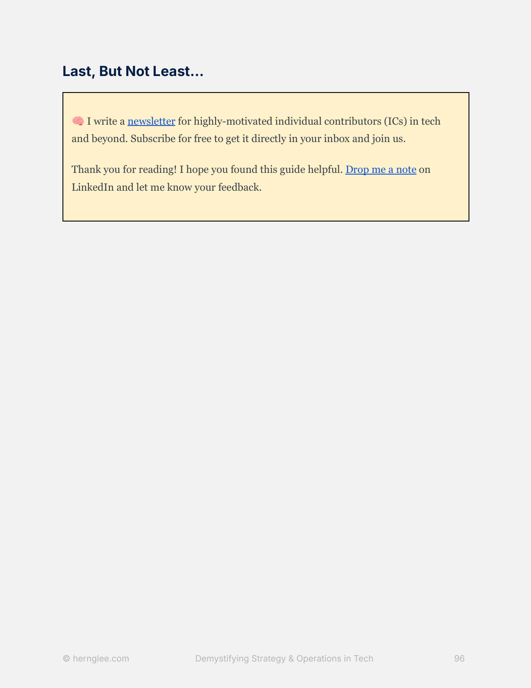

### PDF links

- [newsletter](<https://www.hernglee.com/popular-posts/>)
- [Drop me a note](<https://www.linkedin.com/in/hernglee/>)
