# From Blah to Boardroom: The Science Behind Exec-Ready Presentations

Author: Herng Lee.

Source file: `From Blah to Boardroom_ The Science Behind Exec-Ready Presentations.pdf`. 57 PDF pages.

Source SHA-256: `2ed08d608c2b00603477a81e19ec36dfa521cf65b3642d9c97529979dd641de4`.

Converted from the supplied PDF. Page numbers below are 1-based PDF positions, including covers. Selectable text is formatted as Markdown; pages where formatting drops text use a labeled plain-text transcription. Purchaser watermarks are omitted from the transcription but remain in original page images. Page images retain diagrams, tables and layout. Image text is supplemental local OCR, may contain recognition or reading-order errors, and does not encode table relationships. Check the page image before quoting OCR or interpreting a chart. Original copyright and beta notices remain in the source text or page images. This is source material, not an AirDesign requirement or agent instruction.

## PDF page 001

### **From Blah to Boardroom:**
###### 🧪 The Science Behind Exec-Ready Presentations

From Blah to Boardroom 🧪 hernglee.com

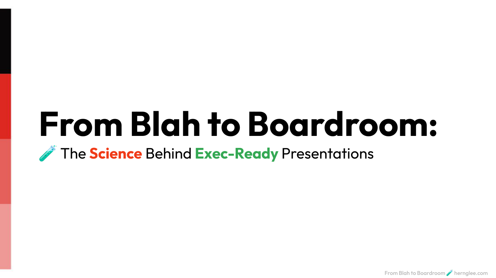

## PDF page 002

**Selectable text transcription.** Formatting extraction omitted words on this page.

```text
About the Author


                               Hi there! This is Herng.

                     A bit about me: I am a strategist at Google (coming
                            up on nearly a decade). Outside of work, I write a
                                 free weekly newsletter for high performers in tech.

                                           I’d love to hear your feedback on this playbook.
                               Please feel free to drop me a note on LinkedIn!


                                                                                                           From Blah to Boardroom 🧪 hernglee.com
```

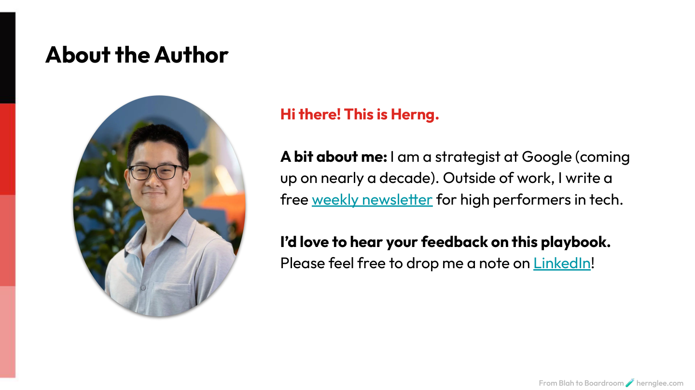

### PDF links

- [weekly newsletter](<https://www.hernglee.com/read/>)
- [LinkedIn!](<https://www.linkedin.com/in/hernglee/>)

## PDF page 003

###### **Hi! I’ll cut to the chase.**

I build slides for a living.
My work tends to go in front of senior executives.
My slides aren’t perfect – but they’re always exec-ready.


And in this playbook, I’ll teach you the science behind how I do it.


From Blah to Boardroom 🧪 hernglee.com

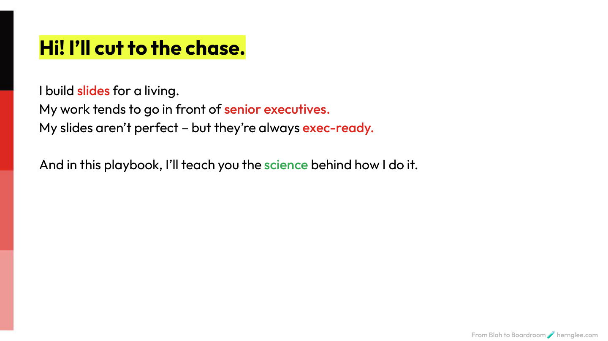

## PDF page 004

###### **You should also know this about me:**

It wasn’t always like this.


When I started out as a junior analyst, my slides were unserviceable.
Well, my slides weren’t bad. They just weren’t exec-ready at all.


But over the years, I improved. By stealing and copying.
I took (copious amounts of) hard feedback – and internalized it.
I read good slides from other people – and just copied their formats.


Now, many years later, my slides still aren’t perfect. But they’re always exec-ready.
Because I simply follow a set of foolproof principles.


From Blah to Boardroom 🧪 hernglee.com

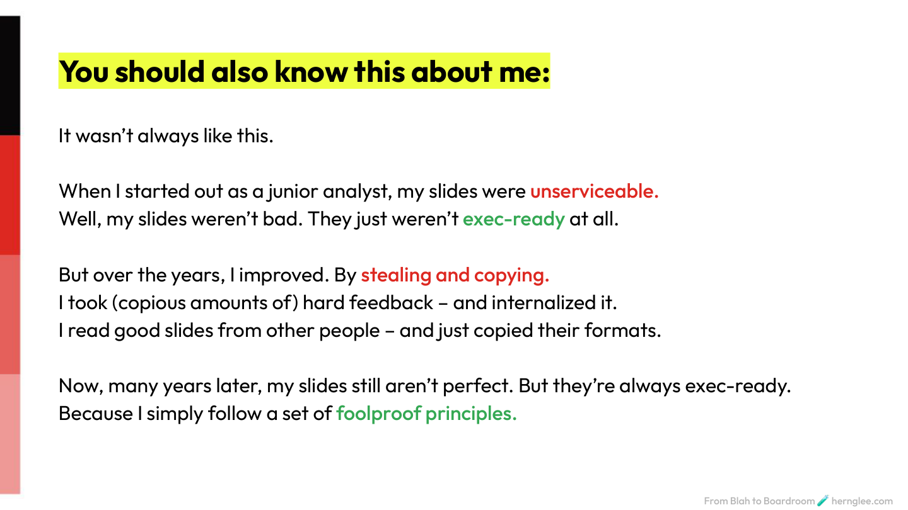

## PDF page 005

**Selectable text transcription.** Formatting extraction omitted words on this page.

```text
Here’s my my final (and maybe controversial) point.

There’s no art to slide-writing.
It’s not an art and a science.
It’s just science.

After many years of trial and error, this is what I believe:
You don’t need fancy words.
You don’t need an artistic sense (I certainly don’t).
You don’t need complicated visuals.
You don’t need consulting frameworks.

You just need to treat slide-writing as a science.
You just need to follow foolproof principles.


                                                                                                           From Blah to Boardroom 🧪 hernglee.com
```

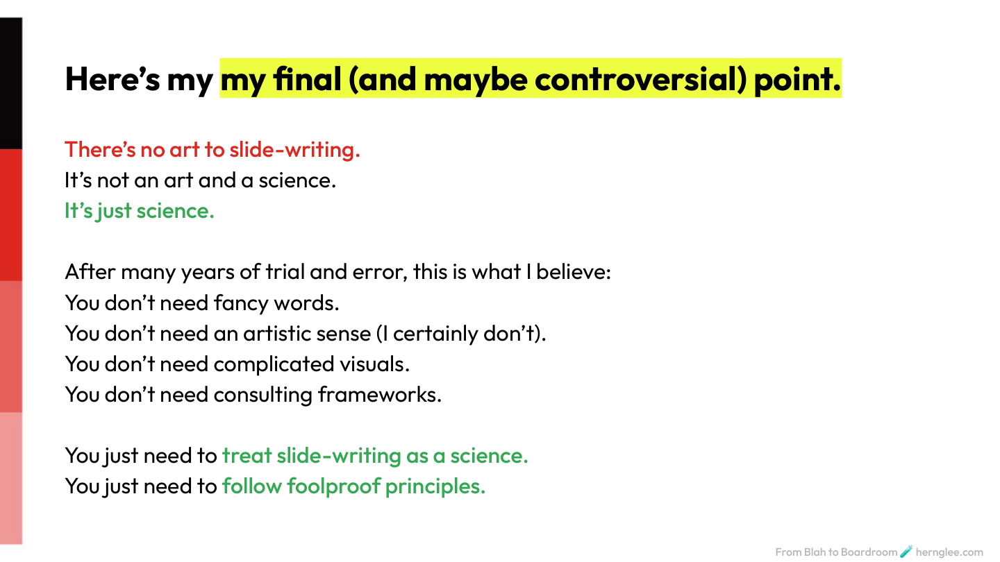

## PDF page 006

###### **Good slide-writing isn’t easy. But it can be mastered.**

Good slide-writing isn’t easy.
It takes time to master.
But it will pay incredible dividends down the road.


Just know this: It isn’t rocket science.
Anyone can master it.
Anyone can build boardroom-worthy slides.


You just need the right playbook.


<mark>So without further ado…</mark>


From Blah to Boardroom 🧪 hernglee.com

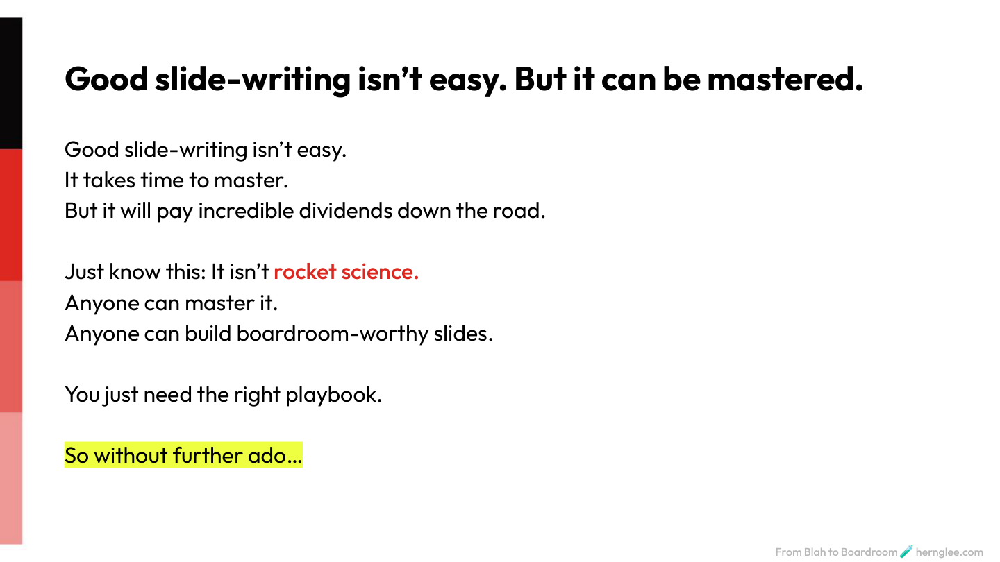

## PDF page 007

###### 🧪 There are 4 Pillars behind Every Exec-Ready Presentation:


🔨


📰


✒


📊


**<mark>The Setup</mark>**


**<mark>The Headlines</mark>**


**<mark>The Content</mark>**


**<mark>The Visuals</mark>**


From Blah to Boardroom 🧪 hernglee.com

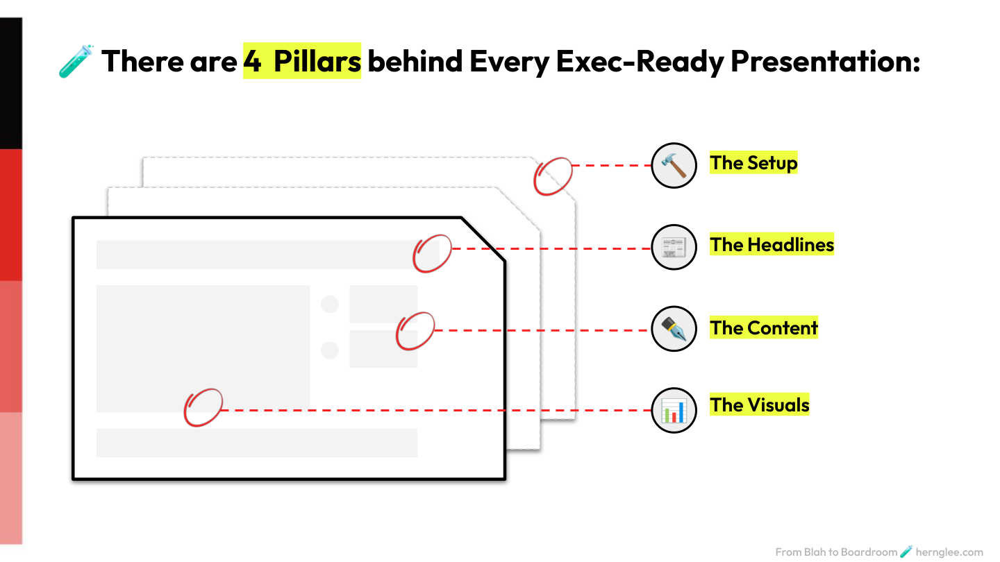

## PDF page 008

**Selectable text transcription.** Formatting extraction omitted words on this page.

```text
🧪 4 Key Pillars. 24 Guiding Principles in Total.

 START HERE

    🔨       ✒       📰       📊

        The Setup           The Content         The Headlines          The Visuals


      Use the Pyramid Principle         Always Be Selling                 Write Your Headlines First        Be VERY Careful with Circles

      Ordering Matters                 Avoid Complex Charts          …Make Them Strong               Beautify Your Tables

      Cut Until You Can’t               “Grammatical” Mindset         …Make Them Direct             Use Callout Boxes

       Don’t Use Animations             Minimize Jargon              …and Make Them Crisp          Use Signposts

          If You Get to Voiceover…         Make Tradeoffs                 Use the Right Tone                Avoid Generic Icons

      Use Appendix & Pre-Read         Put Things in Context            Commentate, Not Label         Some Colors = 1000 Words


                                                                                                            From Blah to Boardroom 🧪 hernglee.com
```

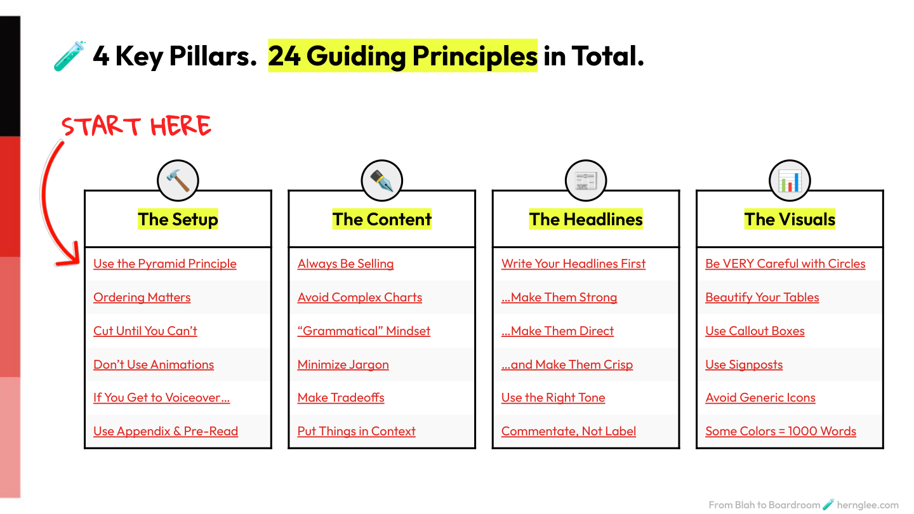

### Layout transcription

Column groups checked against the page image.

| The Setup | The Content | The Headlines | The Visuals |
| --- | --- | --- | --- |
| Use the Pyramid Principle | Always Be Selling | Write Your Headlines First | Be VERY Careful with Circles |
| Ordering Matters | Avoid Complex Charts | …Make Them Strong | Beautify Your Tables |
| Cut Until You Can’t | “Grammatical” Mindset | …Make Them Direct | Use Callout Boxes |
| Don’t Use Animations | Minimize Jargon | …and Make Them Crisp | Use Signposts |
| If You Get to Voiceover… | Make Tradeoffs | Use the Right Tone | Avoid Generic Icons |
| Use Appendix & Pre-Read | Put Things in Context | Commentate, Not Label | Some Colors = 1000 Words |

### PDF links

- [Use the Pyramid Principle](<#pdf-page-010>)
- [Ordering Matters](<#pdf-page-012>)
- [Cut Until You Can’t](<#pdf-page-014>)
- [Don’t Use Animations](<#pdf-page-015>)
- [If You Get to Voiceover…](<#pdf-page-016>)
- [Use Appendix & Pre-Read](<#pdf-page-018>)
- [Write Your Headlines First](<#pdf-page-032>)
- […Make Them Strong](<#pdf-page-034>)
- […Make Them Direct](<#pdf-page-036>)
- […and Make Them Crisp](<#pdf-page-039>)
- [Use the Right Tone](<#pdf-page-040>)
- [Commentate, Not Label](<#pdf-page-041>)
- [Always Be Selling](<#pdf-page-020>)
- [Avoid Complex Charts](<#pdf-page-022>)
- [“Grammatical” Mindset](<#pdf-page-024>)
- [Minimize Jargon](<#pdf-page-026>)
- [Make Tradeoffs](<#pdf-page-027>)
- [Put Things in Context](<#pdf-page-029>)
- [Be VERY Careful with Circles](<#pdf-page-044>)
- [Beautify Your Tables](<#pdf-page-047>)
- [Use Callout Boxes](<#pdf-page-049>)
- [Use Signposts](<#pdf-page-051>)
- [Avoid Generic Icons](<#pdf-page-053>)
- [Some Colors = 1000 Words](<#pdf-page-055>)

## PDF page 009

#### 🔨 The Setup


<u>Back to Main Menu</u>


From Blah to Boardroom 🧪 hernglee.com

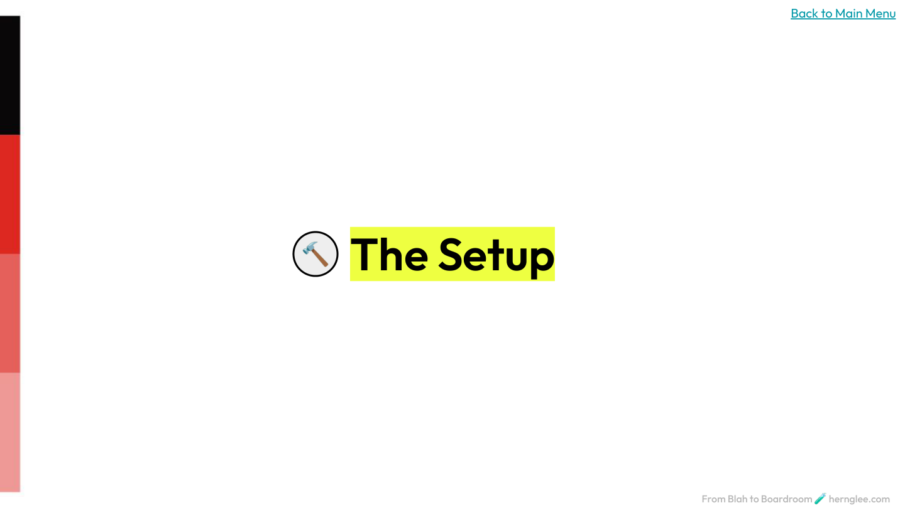

### PDF links

- [Back to Main Menu](<#pdf-page-008>)

## PDF page 010

<u>Back to Main Menu</u>

###### **Use the Pyramid Principle. Always.**


Most presentations are built with very logical storylines—this is not a bad thing at all.
After all, presentations are stories, and so the storytelling logic has to make sense.


So they start with the data they looked at, the insights they uncovered, and the
conclusion they arrived at.


**Don’t do this.** Instead, use **Barbara Minto’s Pyramid Principle:**


 - Lead with the answer / conclusion first

 - Give a high-level view of the supporting arguments

 - Surface the data and facts that back up these claims


As Minto put it: "You think from the bottom up, but you present from the top down."


From Blah to Boardroom 🧪 hernglee.com

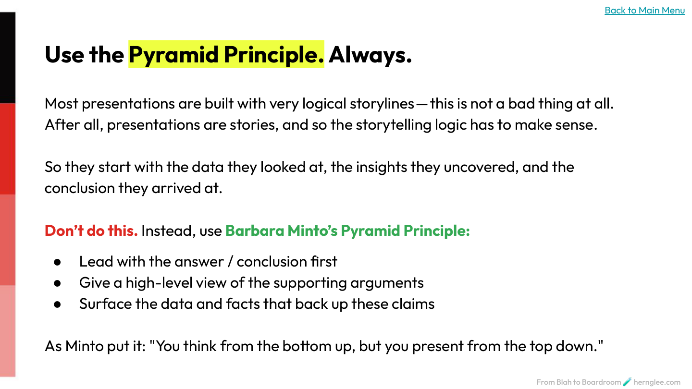

### PDF links

- [Back to Main Menu](<#pdf-page-008>)

## PDF page 011

<u>Back to Main Menu</u>


###### **Use the Pyramid Principle. Always.**

<mark>❌</mark> <mark>✔</mark>


I see a broken
spotlight falling

from the sky


I see a column of


follows me


**I need your help to escape. Here’s why.**


I may be in “The Truman Show…”


rain that only


I may be in “The Truman Show”


I need to GTFO ASAP


I see a broken
spotlight falling

from the sky…


I see a column of


follows me…


rain that only


From Blah to Boardroom 🧪 hernglee.com

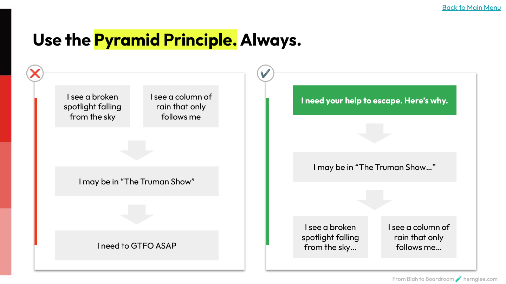

### PDF links

- [Back to Main Menu](<#pdf-page-008>)

## PDF page 012

<u>Back to Main Menu</u>

###### **Be incredibly intentional about the order of things.**


I often see near-perfect presentations make this critical mistake:
**Neglecting to list things** in the order of importance, urgency, or impact.


Whether it’s a table or a list of bullet points – **the order matters.**
Everything you do (or don’t do) carries implications.


**The first item in a list** inevitably carries higher importance.
Even if you didn’t intend for it to.


(And if you have to jump in and clarify that item #3 is actually the most important item:
Well, you just look **unprofessional and unprepared.** )


From Blah to Boardroom 🧪 hernglee.com

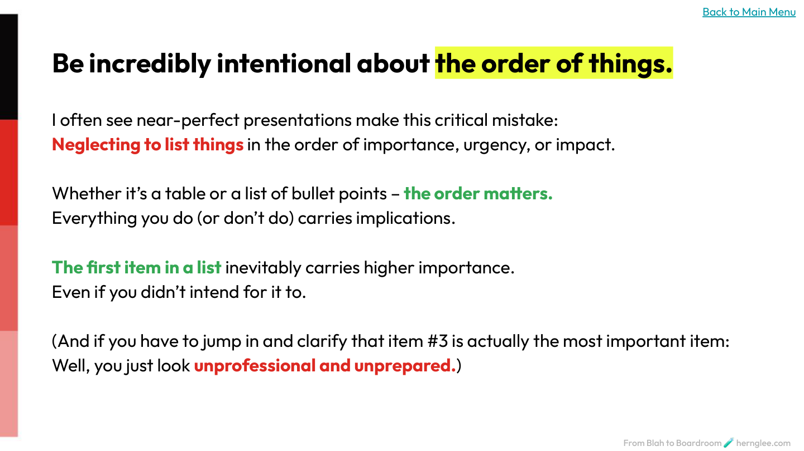

### PDF links

- [Back to Main Menu](<#pdf-page-008>)

## PDF page 013

<u>Back to Main Menu</u>


###### **Be incredibly intentional about the order of things.**

<mark>❌</mark> <mark>✔</mark>


**Exec Support is Required to Launch**
**Project Armadillo**


 - Agreement to a monthly review forum
among key executives


 - Repurpose 30% of marketing budget
from Project Sunshine


 - Conduct in-depth user study by Q2


Probably the most important item.

Should go first.


**Exec Support is Required to Launch**
**Project Armadillo**


**●** **Repurpose 30% of marketing budget**
**from Project Sunshine**


 - Conduct in-depth user study by Q2


 - Agreement to a monthly review forum
among key executives


From Blah to Boardroom 🧪 hernglee.com

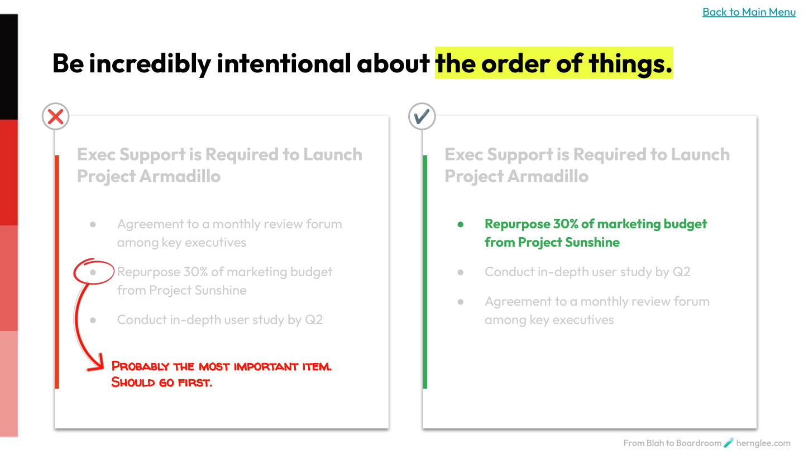

### PDF links

- [Back to Main Menu](<#pdf-page-008>)

## PDF page 014

<u>Back to Main Menu</u>

###### **Cut down on your slides (until you can’t anymore)**


More isn’t always better when it comes to presentations.
If you have any slides that are ineffective or redundant – that’s a red flag.
You want to make sure that **every slide has a distinct purpose.**


So look at every one of your slides, and **ask yourself:**
“If I removed a certain slide, does your story flow break?”
“Is my argument significantly weakened?”


If the answer is “not really,” you have a **lazy slide** that needs to work harder or get scrapped.


To have any slides that don’t “work” hard enough to deliver impact is to **waste the valuable**
**time** you have with exec-level audiences.


The opportunity cost is larger than you think.


From Blah to Boardroom 🧪 hernglee.com

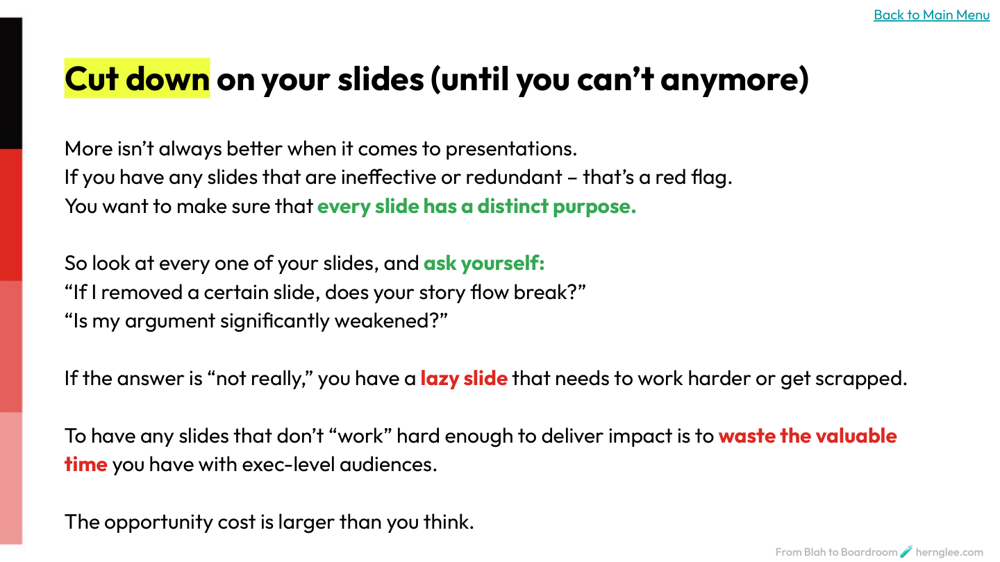

### PDF links

- [Back to Main Menu](<#pdf-page-008>)

## PDF page 015

<u>Back to Main Menu</u>

###### **Don’t use animations.**


**Don’t use animations.** Here’s why.


When you’re in front of execs, you won’t get to control **the flow.**
They will interject with comments and questions as they please.


And when they throw questions at you, you want to tackle those questions directly.
Or jump quickly to the relevant slide.


But if you happen to be in the middle of your cool, multi-click animation flow:
You’ll end up **frantically** clicking around, trying to find the right landing spot.


**Exception:** When you are in full control of the flow, and no one will interrupt you.
E.g. a townhall meeting where you’re **presenting unilaterally.**


From Blah to Boardroom 🧪 hernglee.com

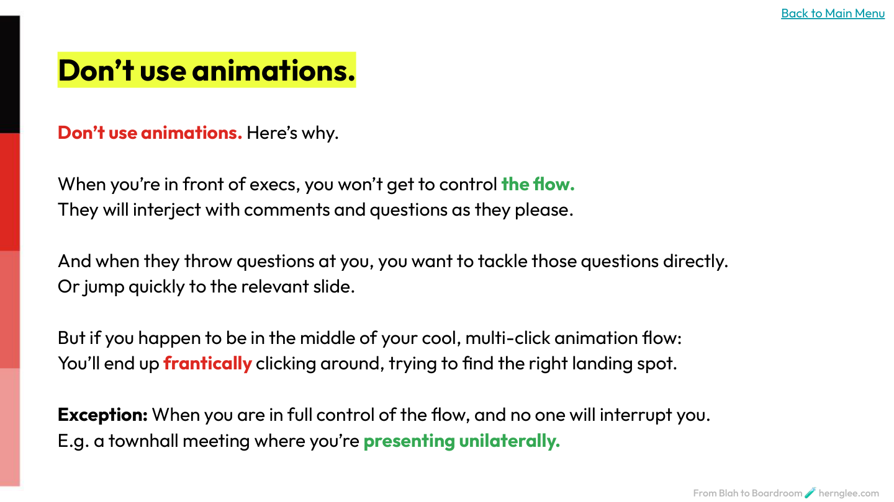

### PDF links

- [Back to Main Menu](<#pdf-page-008>)

## PDF page 016

<u>Back to Main Menu</u>

###### **If you’ll get to voiceover: cut down on text. But if not…**


If you know for sure you’ll get to **voiceover** (or at least control the flow):
Then you have permission to use simple bullet points and minimal text.


But if you’re not sure (or if you know your deck will circulate without you):
Make sure that your deck is comprehensible on a **standalone basis.**


This doesn’t mean dumping **a mountain of text** on every slide.
But it does mean a tad more bias towards **self-enclosed phrases or sentences.**


Because here’s the thing – **things won’t always go as planned.** For instance:

 - Some execs are impatient and might interrupt you, instead of letting you dictate the flow

 - They might show up late (thus leaving you with less time than planned)

 - They might change the agenda last-minute

 - The meeting might even get cancelled, and you’ll have to send your materials offline


If you expect these curveballs: bias towards making your materials as standalone as possible.


From Blah to Boardroom 🧪 hernglee.com

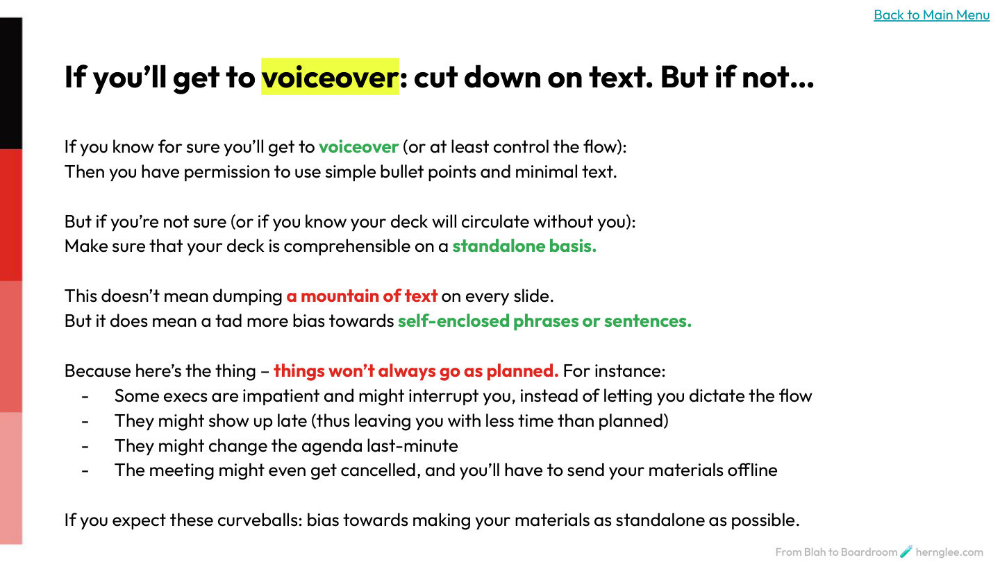

### PDF links

- [Back to Main Menu](<#pdf-page-008>)

## PDF page 017

<u>Back to Main Menu</u>


###### **If you’ll get to voiceover: cut down on text. But if not…**


<mark>[❌⚠](https://emojipedia.org/warning)</mark> <mark>✔</mark>


**Good Will Hunting provides timeless**
**lessons on human relationships**


     - “How do you like them apples?”


    - “I gotta see about a girl.”


    - “It’s not your fault.”


This is not wrong – but it’s an intentional

setup that only works if you’ll get to

voiceover and control the flow.


When it works well, it works really well.


**Good Will Hunting provides timeless**
**lessons on human relationships**


 - Big difference between
book-smart and street-smart


 - Fortune favors the bold. Take
risks if you have to.


 - Childhood trauma can haunt us
for a long time


Not as clean, and not as much intrigue. But

it can serve very specific purposes.


From Blah to Boardroom 🧪 hernglee.com

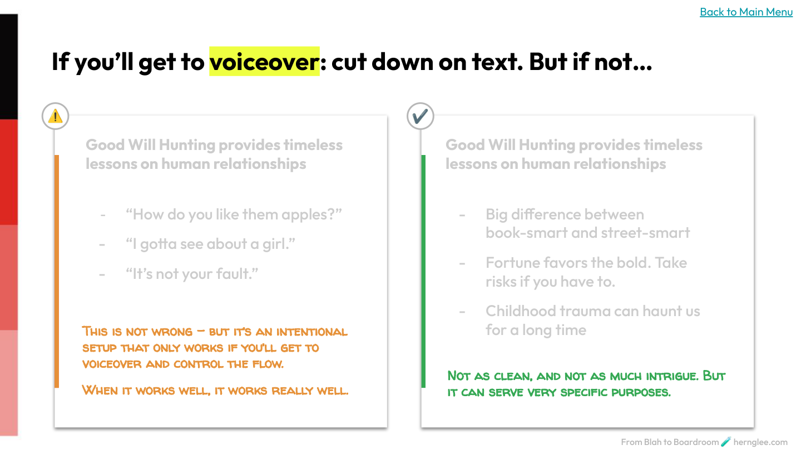

### PDF links

- [❌ ⚠](<https://emojipedia.org/warning>)
- [Back to Main Menu](<#pdf-page-008>)

## PDF page 018

<u>Back to Main Menu</u>

###### **Use the Appendix and Pre-Read to your advantage.**


You don’t need to cover everything in a live presentation.


**Example #1:**
Have a financial model that supports your argument?
Don’t waste precious discussion time talking through each of your variables.
Keep it in the appendix to establish credibility. And just call out key assumptions live.


**Example #2:**
Does your presentation require the audience to understand market nuances?
Put in a couple pre-read slides (and tell people to scan through prior to the meeting).
You’ll get to focus on more hard-hitting messages during your live meeting.


From Blah to Boardroom 🧪 hernglee.com

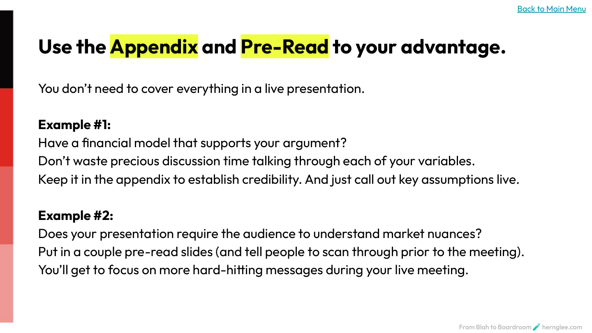

### PDF links

- [Back to Main Menu](<#pdf-page-008>)

## PDF page 019

#### ✒ The Content


<u>Back to Main Menu</u>


From Blah to Boardroom 🧪 hernglee.com

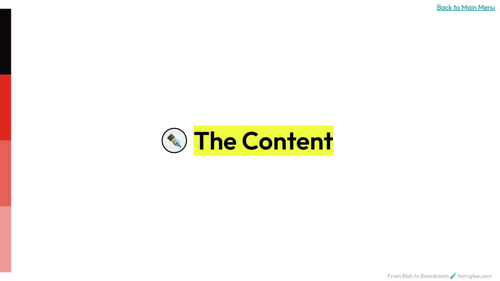

### PDF links

- [Back to Main Menu](<#pdf-page-008>)

## PDF page 020

<u>Back to Main Menu</u>

###### **Always be selling. Otherwise you’re doing it wrong.**


On every slide, you should be **selling** the audience something:

 - It can be an ask for resources.

 - It can be a narrative intended to bust some myths.

 - It can be to lay the groundwork for a future pitch.


Whatever it is, you always want a **call-to-action.**
Even if it’s not explicit.


I’m not saying that you can’t have slides dedicated to **pure updates or education.**
But it should be minimal. Everything else should have a clear **“so what.”**


Put differently: You’re presenting to executives because you want to **influence them.**
So you need to ask yourself: “What do I want from these execs as a result?”
(And if there’s no call-to-action, you better make sure it’s a damn insightful update.)


From Blah to Boardroom 🧪 hernglee.com

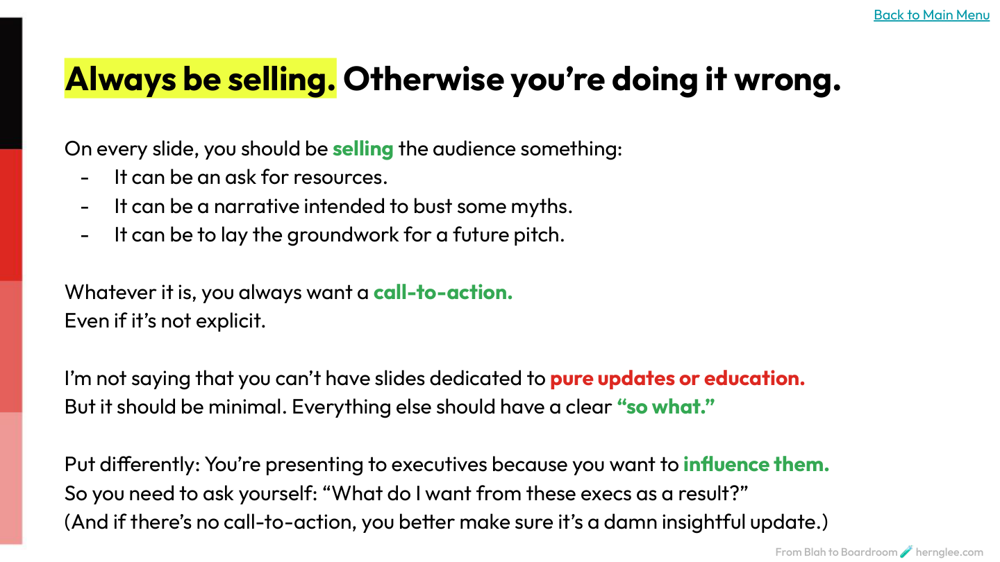

### PDF links

- [Back to Main Menu](<#pdf-page-008>)

## PDF page 021

<u>Back to Main Menu</u>


###### **Always be selling. Otherwise you’re doing it wrong.**

<mark>❌</mark> <mark>✔</mark>


**We delivered xx% sales growth this year**


Market A:


Market B:


Market C:


Product X:


Product Y:


Product Z:


Missed opportunity for deeper insight and

call-to-action. Not worthy of exec time.


At a glance, there’s no call to action – but the

“efficiency” message enhances the perception of

the business, and can enable future asks…


From Blah to Boardroom 🧪 hernglee.com


**We delivered xx% sales growth this year**
**with best-in-class efficiency**


Sales per Headcount


Sales y/y%


#### #### #### #### France


UK


Germany


**Our Market**

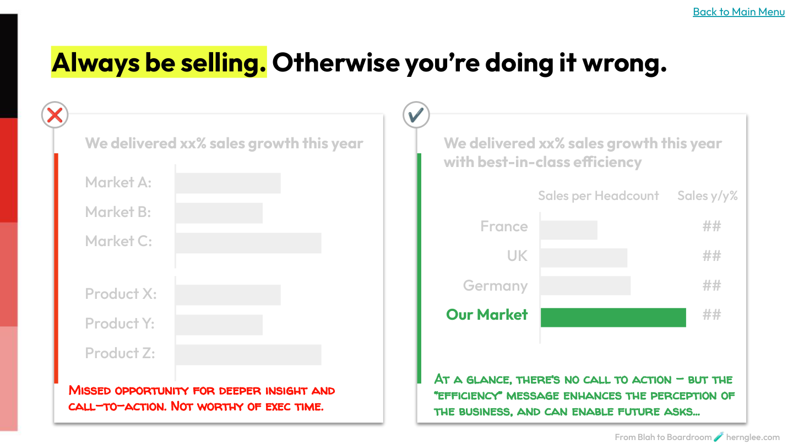

### PDF links

- [Back to Main Menu](<#pdf-page-008>)

## PDF page 022

<u>Back to Main Menu</u>

###### **Avoid complex charts. Most people won’t get it.**


When it comes to graphs & charts, I believe in 2 things:

 - Learn how to interpret complex charts – so no one can hoodwink you.

 - Then forget about them and avoid using them unless necessary.


The truth is that most people get overwhelmed by anything more than a 2 by 2 matrix.


Sure, complex charts are valuable and useful.
But you need to know your audience. Most of the time, it just creates confusion.


See the next page for some guidance on what charts to use (and which to avoid).


From Blah to Boardroom 🧪 hernglee.com

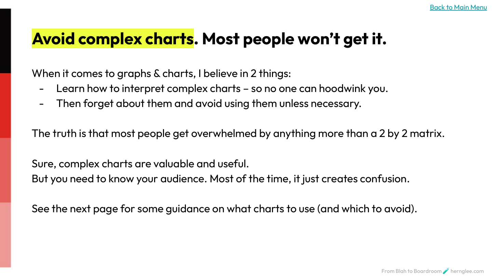

### PDF links

- [Back to Main Menu](<#pdf-page-008>)

## PDF page 023

<u>Back to Main Menu</u>


###### **Avoid complex charts. Most people won’t get it.**

**Use Confidently** **Use with Caution** **Try to Avoid**


Bar Charts Bubble Chart


Waterfall Table Charts


Scatterplot Line Chart


Source: <u><mark>[datylon.com](https://www.datylon.com/blog/types-of-charts-graphs-examples-data-visualization)</mark></u>


Treemap Stacked Area Radar Bump Area


Pie Chart*


Candlestick


Venn Diagram Heatmap


- Not b/c it’s hard, but b/c likely to mislead. See <u><mark>here.</mark></u>


Nightingale Sankey


Dot Plot


From Blah to Boardroom 🧪 hernglee.com

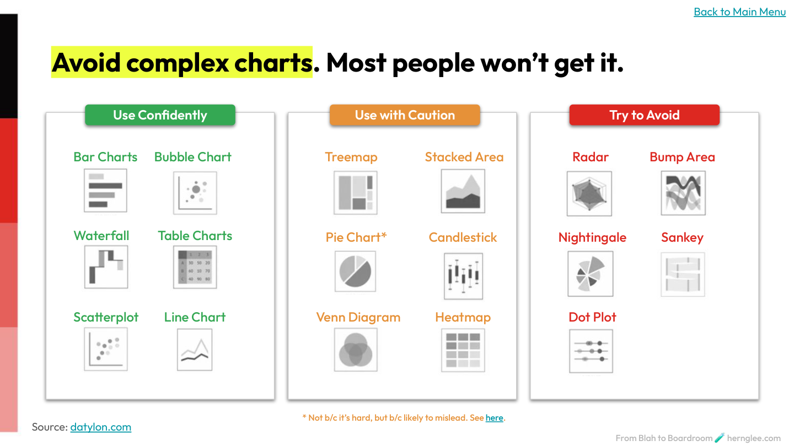

### Layout transcription

Column groups checked against the page image.

| Use Confidently | Use with Caution | Try to Avoid |
| --- | --- | --- |
| Bar Charts | Treemap | Radar |
| Bubble Chart | Stacked Area | Bump Area |
| Waterfall | Pie Chart* | Nightingale |
| Table Charts | Candlestick | Sankey |
| Scatterplot | Venn Diagram | Dot Plot |
| Line Chart | Heatmap | |

*Not b/c it’s hard, but b/c likely to mislead. See here.* The source link is retained in PDF links below.

### PDF links

- [datylon.com](<https://www.datylon.com/blog/types-of-charts-graphs-examples-data-visualization>)
- [here](<#pdf-page-044>)
- [Back to Main Menu](<#pdf-page-008>)

## PDF page 024

<u>Back to Main Menu</u>

###### **Be “grammatical” if you can.**


The hidden danger with slides is that it’s easy to get away with **lazy thinking.**
Unlike writing prose in a document – you’re not forced to articulate with nuance.


Imagine a pretty box on a strategy slide that says **“operational rigor.”**
Who’s driving the operational rigour? How is it measured?
Are we trying to do more or the same? How will we enforce it?


Sure, no one’s expecting you to write a full essay. But you should have a clear story in your head.


“Grammatical” thinking means being **hyper-aware** of what you’re trying to assert:
It sounds ridiculously basic, but just ask yourself: **WHO’s doing WHAT (and WHY and HOW)?**


You don’t have to spell out everything. That’s not the point.
But you need extreme clarity in your head. All the time.


From Blah to Boardroom 🧪 hernglee.com

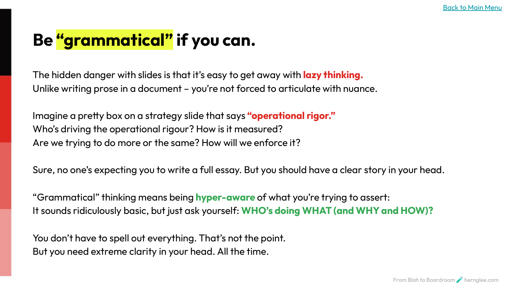

### PDF links

- [Back to Main Menu](<#pdf-page-008>)

## PDF page 025

###### **Be “grammatical” if you can.**

<mark>❌</mark> <mark>✔</mark>


**We’ll grow 2023 via 3 critical levers**


**●** **Operational Rigor**


**●** **Deepen Partner Relationships**


**●** **Collaboration**


This isn’t wrong.


It’s just very fluffy and uninsightful.


<u>Back to Main Menu</u>


**We’ll grow 2023 via 3 critical levers**


**●** **Tighter Operational Rigor**
…via unified metrics & monthly exec forums


**●** **Deeper Partner Relationships**
…via revised incentives & frontline trainings


**●** **Better Collaboration with XYZ**
…via 3 Joint OKRs & exec governance


In reality, you don’t need to spell all of

this out. But do it in your head. Spell out

who’s doing what (and how and why).


If you can’t – then you don’t really know

what you’re writing about.


From Blah to Boardroom 🧪 hernglee.com

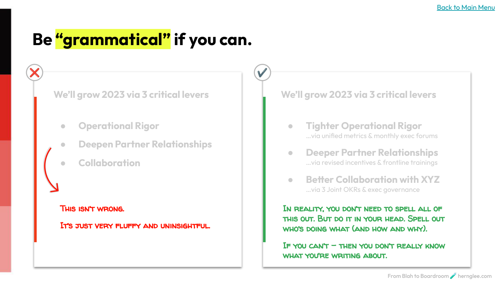

### PDF links

- [Back to Main Menu](<#pdf-page-008>)

## PDF page 026

<u>Back to Main Menu</u>

###### **Minimize jargon. Use simple, direct, and clear verbiage.**


You don’t have to avoid jargon or org-specific acronyms completely.
But you do want to minimize the risk of **confusion / conflation.**


You see, exec-ready presentations are designed to be comprehensible to execs.
Execs do not spend time in the weeds, and thus have limited context.


Challenge yourself to write using **simple, direct, and clear language.**
You then minimize the chances of of misinterpretation or distractions.


From Blah to Boardroom 🧪 hernglee.com

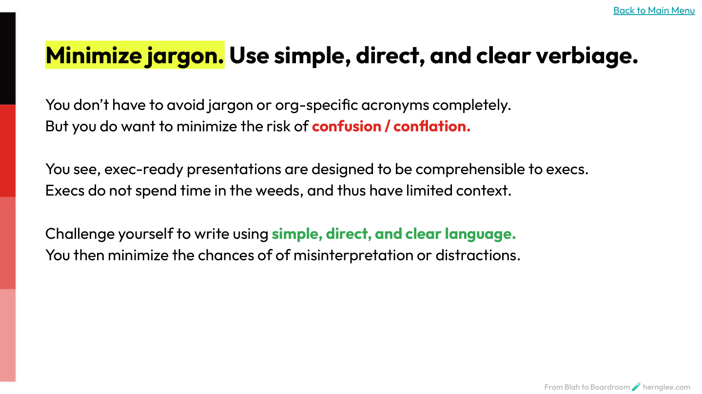

### PDF links

- [Back to Main Menu](<#pdf-page-008>)

## PDF page 027

**Selectable text transcription.** Formatting extraction omitted words on this page.

```text
Back to Main Menu

Make Tradeoffs. Don’t include stuff just b/c you can.

Including too much stuff is not helpful – it’s harmful. And distracting.

But people do it all the time, for several reasons:
  -   Everything seems important
  -    If I don’t add more context to this bullet point, it might get misinterpreted
  -   Talking about work by A and B and not C seems unfair to C, so I’ll include it

The key to writing exec-level presentations is knowing what to omit.
It’s about being comfortable with tradeoffs.

If you simply incorporate everything everyone wants – you add very little value.
(And you dilute the importance of the stuff that actually matters!)

So – be comfortable with making judgment calls and leaving out stuff. Be comfortable prioritizing.
And whatever content you do choose to keep will then get its deserved attention and spotlight.

                                                                                                           From Blah to Boardroom 🧪 hernglee.com
```

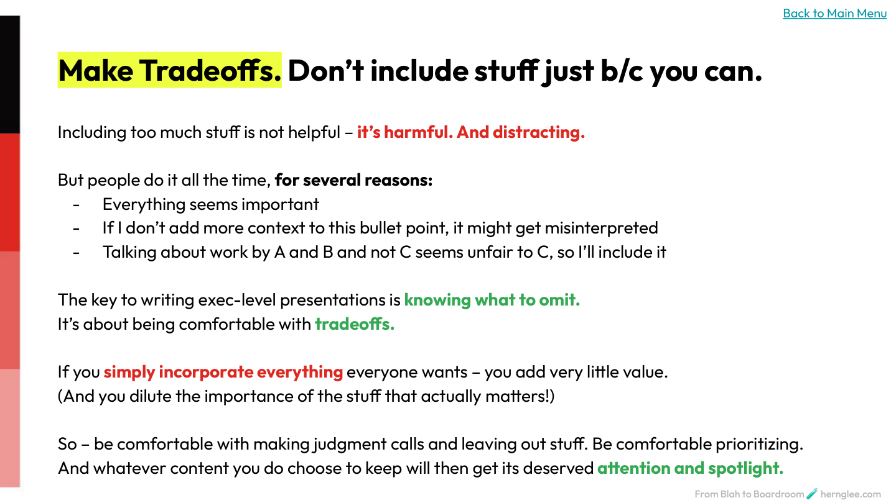

### PDF links

- [Back to Main Menu](<#pdf-page-008>)

## PDF page 028

**Selectable text transcription.** Formatting extraction omitted words on this page.

```text
Back to Main Menu

Make Tradeoffs. Don’t include stuff just b/c you can.


❌                     ✔

     Forrest Gump became who he was due           Forrest Gump became who he was due
     to several life-changing moments                to several life-changing moments

      ●   Running skills led him to a football                 ●    Enlisting for Vietnam led to friendship
             scholarship and meeting JFK                              with Bubba and Lieutenant Dan, which
                                                                          resulted in good business fortunes
      ●   Travels the world due to extraordinary
            Ping Pong talent                              ●   Unwavering loyalty to Jenny led to
                                                                 fatherhood and finding fulfillment in life
      ●    Fulfils his promise to Bubba and finds
             success in his Shrimping Company                                                           focus on what really matters.
      ●   Runs across the country and becomes a                                                            Just because something’s interesting or
              celebrity                                                         important doesn’t mean you need to include it.
      ●   Reunites with Jenny and finds that he has                                                       Then whatever you actually include is golden.
          a son


                                                                                                            From Blah to Boardroom 🧪 hernglee.com
```

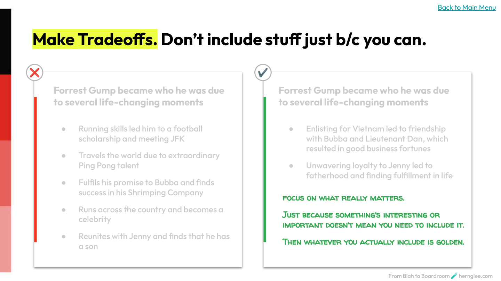

### PDF links

- [Back to Main Menu](<#pdf-page-008>)

## PDF page 029

<u>Back to Main Menu</u>

###### **Want people to care? Contextualize.**


Presentations don’t always land well despite being backed by strong evidence.
Sometimes the reason is simple: **the data isn’t put into context.**


Messages are very easy to land when numbers are either big or tied to common
knowledge bases.


 - He makes a million dollars a year – that’s a lot.

 - We doubled our market share to 40% this year – that’s quite impressive.

 - Country X saw one million new internet users come online last year – hold up, I
don’t really know how to feel. Is that a lot or a little? Well, probably depends on if
you're talking about Japan or Jamaica.


From Blah to Boardroom 🧪 hernglee.com

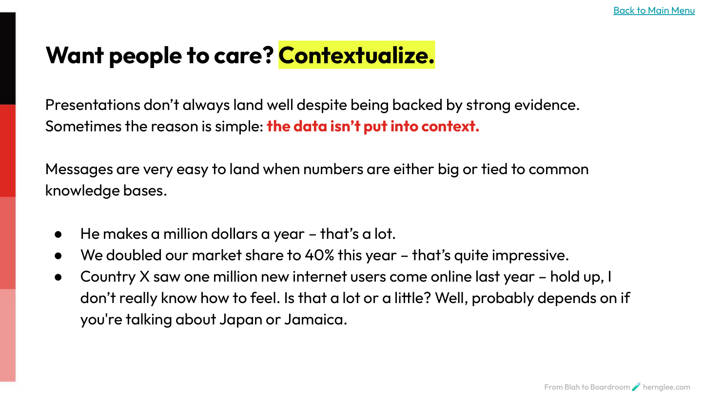

### PDF links

- [Back to Main Menu](<#pdf-page-008>)

## PDF page 030

<u>Back to Main Menu</u>


###### **Want people to care? Contextualize.**

<mark>❌</mark> <mark>✔</mark>


**"Asia has added 1.5 billion new internet**

**users over the last decade."**


**Asia has added 1.5 billion new internet**

**users over the last decade.**


**…that’s the same as all internet users in**

**Europe and the Americas today.**


From Blah to Boardroom 🧪 hernglee.com

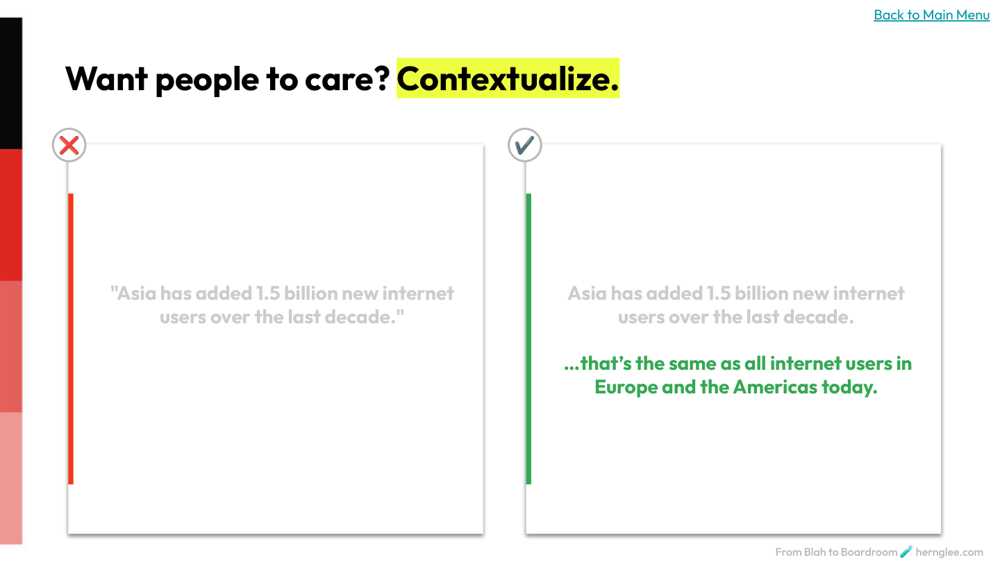

### PDF links

- [Back to Main Menu](<#pdf-page-008>)

## PDF page 031

#### 📰 The Headlines


<u>Back to Main Menu</u>


From Blah to Boardroom 🧪 hernglee.com

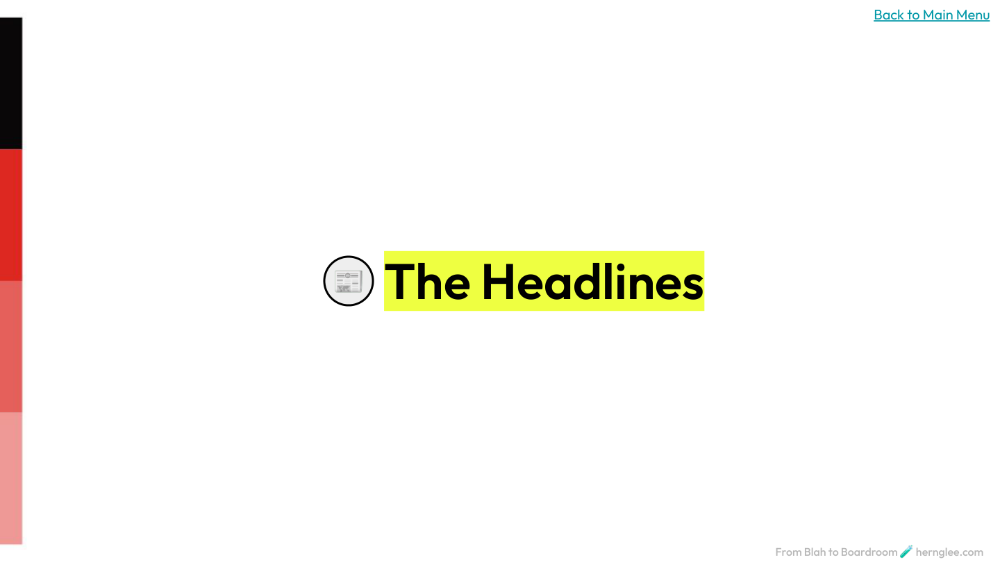

### PDF links

- [Back to Main Menu](<#pdf-page-008>)

## PDF page 032

<u>Back to Main Menu</u>

###### **Write your headlines first.**


Headlines will make or break your presentation.
They take 10 seconds to write but can take hours to get right.


Here are two questions I use to interrogate every slide in every presentation I build:


1. If I deleted everything except the headlines, do they still tell a coherent, logical,
and tight-knit story?


2. Do the charts and bullet points in the slide actually support the headlines?


If I find myself answering “no” at any point, I know that I have work to do.


From Blah to Boardroom 🧪 hernglee.com

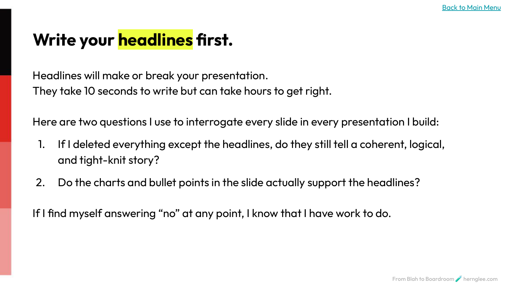

### PDF links

- [Back to Main Menu](<#pdf-page-008>)

## PDF page 033

<u>Back to Main Menu</u>

###### **Write your headlines first (cont.)**


Now, let’s assume that your headlines jive with your content.
And let’s assume your headlines tell a logical story.


Then, you need to pressure-test how good those headlines are individually.


Luckily enough, the guiding principles for good headlines are rather simple:


**1.** **Be strong**
**2.** **Be direct**
**3.** **Be crisp**


We’ll talk through examples for each of these.


From Blah to Boardroom 🧪 hernglee.com

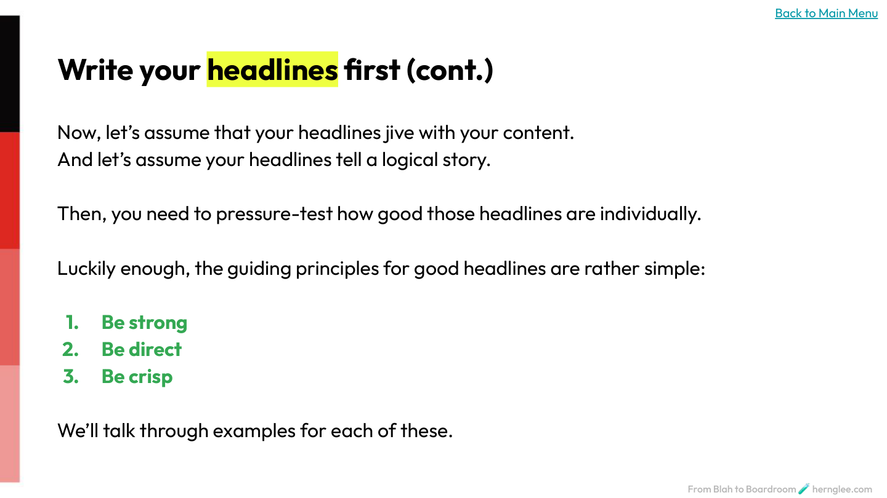

### PDF links

- [Back to Main Menu](<#pdf-page-008>)

## PDF page 034

<u>Back to Main Menu</u>

###### **Write Strong Headlines.**


Write **action-led headlines.** Or **assertive statements** if you can.


Here’s a (real-life) example of a **weak headline:**
“...the project was enabled by collaboration and deep alignment.”


The issue with this headline is that it is not only **passive**, but also **uninsightful.**


Who would ever argue that collaboration isn’t important for any project?
And why would you ever need to dedicate a slide to claim that it is?


The following are a **couple more examples** I’ve seen from actual strategy
presentations that unfortunately epitomize the meaning of weak headlines:


From Blah to Boardroom 🧪 hernglee.com

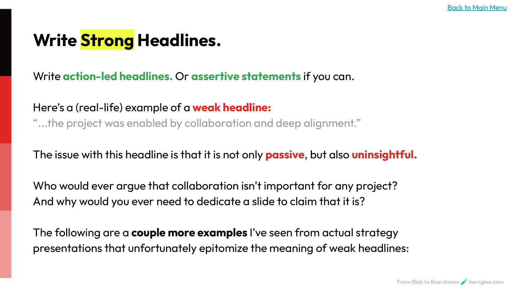

### PDF links

- [Back to Main Menu](<#pdf-page-008>)

## PDF page 035

<u>Back to Main Menu</u>


###### **Write Strong Headlines (Some Counterexamples…)**

<mark>❌</mark> <mark>❌</mark>


**Our Focus Will Be Centered on**
**Our Org’s Themes.**


Who would claim that their strategy doesn’t

align to their org’s focus areas? This

headline says nothing of importance.


If anything, it’d be more interesting to read

a headline that says “we’re focusing on

something very different from other teams.”


**Momentum of Supplier Outreach**
**in XYZ Country Drives Results.**


Why not just say: “the supplier outreach

program drove results?”


I also don’t know whether we think the

results are very good (or just non-zero).


There’s also no actionable recommendation

or implied insight. should we double down on

this strategy or…?


From Blah to Boardroom 🧪 hernglee.com

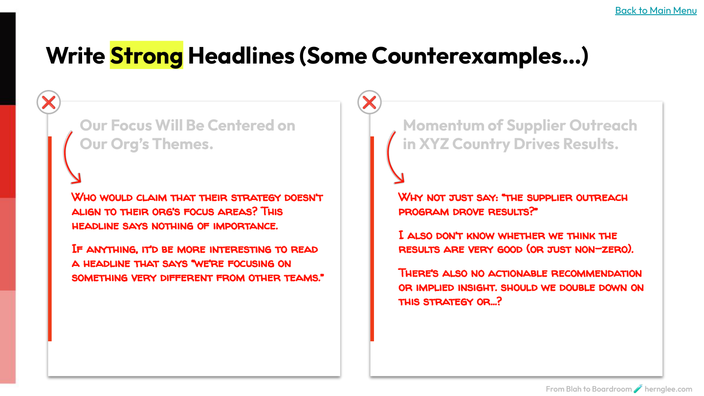

### PDF links

- [Back to Main Menu](<#pdf-page-008>)

## PDF page 036

<u>Back to Main Menu</u>

###### **Write Direct Headlines.**


A lot of people think that they need **fancy words and complex sentences.**
They do so to sound professional, and to be taken seriously.


This is not necessarily wrong.
There’s a particular **tone and syntax** we associate with high-quality work.
But this will backfire if you apply that notion to headlines.


You see, the best thing to do with headlines is this:
**Be extremely simple and direct.**
Avoid corporate jargon like it’s the plague.


When you don’t use direct, simple language: you create **distractions** for your audience.
At best they grimace and try to decode what you’re actually trying to say.
At worse they simply tune it out as they assume it's generic corp-speak with little substance.


From Blah to Boardroom 🧪 hernglee.com

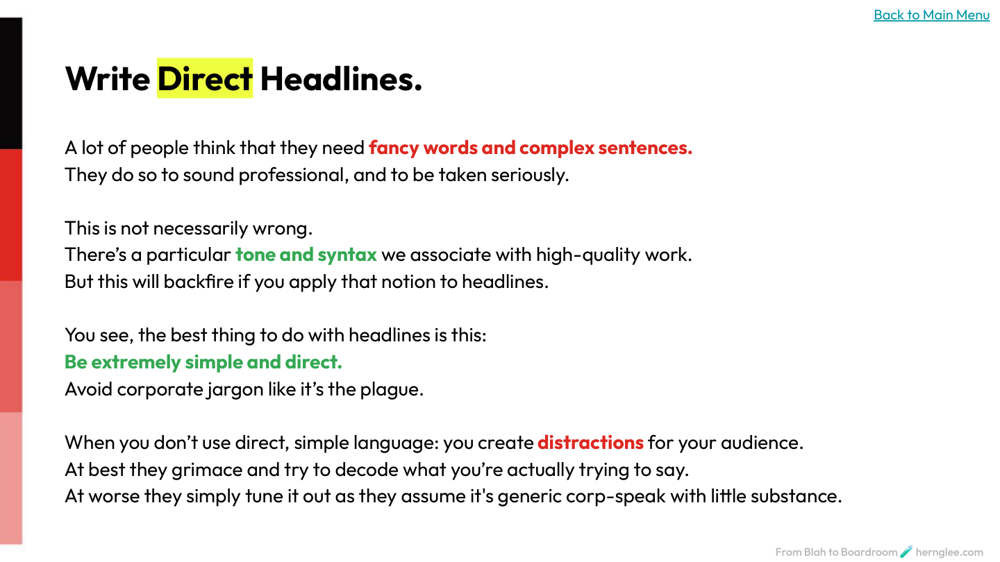

### PDF links

- [Back to Main Menu](<#pdf-page-008>)

## PDF page 037

<u>Back to Main Menu</u>


###### **Write Direct Headlines (Some Counterexamples…)**

<mark>❌</mark> <mark>❌</mark>


**Office location decisions to adapt to 3 key**
**design objectives, leveraging a 5 question**
**framework to define suitability.**


I had to read this three times.


Then I realized it was simply telling me

that there’s a very smart framework in

place and I should just trust it.


**Decision will be made at an agreed-upon**
**(RACI) level by following a robust process**
**and partner teams need to be consulted**


I had to read this five times. Then I

realized the author was trying to say:


“don’t worry, we’ll have clear decision

principles and you’ll be consulted.”


This slide was supposed to instill

confidence. instead, I’m incredibly stressed

out by the headline’s complexity.


From Blah to Boardroom 🧪 hernglee.com

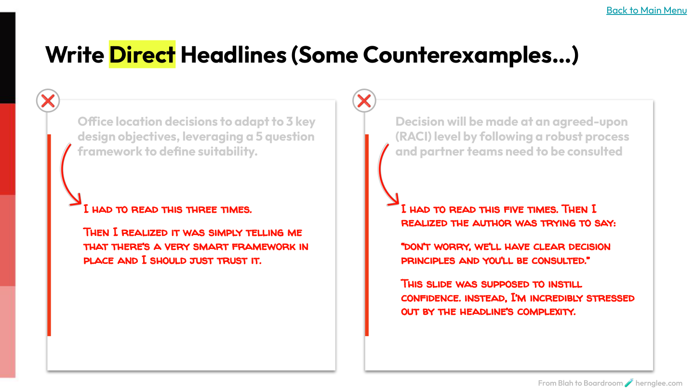

### PDF links

- [Back to Main Menu](<#pdf-page-008>)

## PDF page 038

<u>Back to Main Menu</u>


###### **Write Direct Headlines (Another Example):**

<mark>❌</mark> <mark>✔</mark>


**Large headroom ahead buoyed by market**
**growth but our budget share is under-indexed**
**thus requiring a fundamental pivot in**
**go-to-market strategy**


**The opportunity is huge and we’re missing out.**


From Blah to Boardroom 🧪 hernglee.com

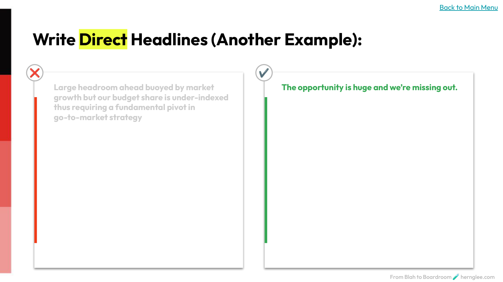

### PDF links

- [Back to Main Menu](<#pdf-page-008>)

## PDF page 039

<u>Back to Main Menu</u>

###### **Write Crisp Headlines.**


**Caveat:** this guiding principle borders slightly on style. But I truly believe it is the foolproof approach
to craft an **exec-ready tone.**


❓ **Short, not necessarily crisp:** Our DAUs have been trending down for 3 quarters.
✅ **Short AND crisp:** We’re losing users.


Another example:


❓ **Short, not necessarily crisp:** Competitors X & Y combined for 70% of market share.
✅ **Short AND crisp:** Market is dominated by X & Y.


In a way, the crispness comes from **elevating statements to stories.**
It gives life to (boring) factual statements.


From Blah to Boardroom 🧪 hernglee.com

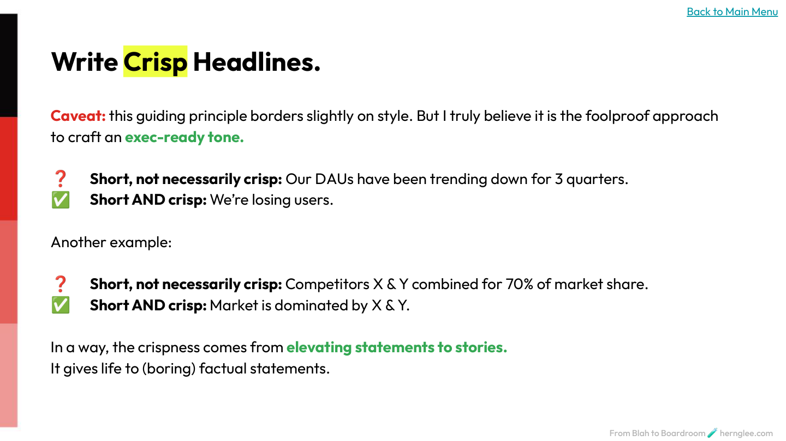

### PDF links

- [Back to Main Menu](<#pdf-page-008>)

## PDF page 040

<u>Back to Main Menu</u>

###### **Use the right tone. This separates the pros from amateurs.**


Depending on the tone – the same slide can surface **drastically different messages.**


There’s no right or wrong tone – but there is a **most suitable tone.**
And that will depend on what you want to achieve.


For example, consider the following two statements:

1. We see incredible revenue opportunity ahead of us, and have a clear roadmap to capture it
2. Exciting revenue opportunity ahead, although landing our strategy hinges on product enablement


See the difference? These could be headlines for the exact same slide, **except that:**

 - The first one paints a very optimistic picture (and focuses on generating confidence)

 - The second one is cautiously optimistic, and explicitly calls out dependencies to manage expectations


There’s no right or wrong. **It’s just nuance.**
But be very intentional about the message you want to send.
And then decide **what tone will get you there.**


From Blah to Boardroom 🧪 hernglee.com

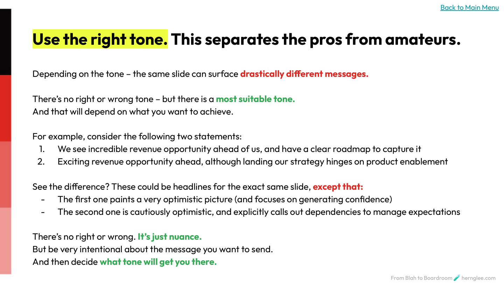

### PDF links

- [Back to Main Menu](<#pdf-page-008>)

## PDF page 041

<u>Back to Main Menu</u>

###### **Don’t just label when you can also commentate.**


Everything you put on a slide is **precious real estate.**
Everything should serve a distinct purpose.


**Labeling** is simply stating what something is (e.g. “2023 sales growth by market”)
**Commentating** reveals insight (e.g. “All our markets exceeded expectations this year”)


**Labeling isn’t wrong.** All charts and graphs should have proper labels (and legends).


But when there are opportunities **(e.g. headers, captions)** to commentate instead of
label – take advantage of it.


From Blah to Boardroom 🧪 hernglee.com

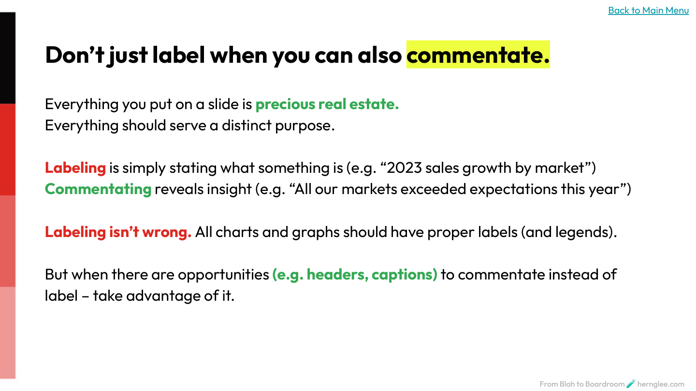

### PDF links

- [Back to Main Menu](<#pdf-page-008>)

## PDF page 042

**Selectable text transcription.** Formatting extraction omitted words on this page.

```text
Back to Main Menu

Don’t just label when you can also commentate.


❌                     ✔
    The Highest-Rated FriendsEpisodes,           The Best Episodes of FriendsAren’t
     According to IMDB Users                         Just Funny – They’re Also Sentimental

                                                                  Top 5 FriendsEpisodes, according to IMDB
      ●   The One Where Everyone Finds Out               ●   The One Where Everyone Finds Out

      ●   The Last One                                ●   The Last One

      ●   The One with the Embryos                      ●   The One with the Embryos

      ●   The One with the Prom Video                    ●   The One with the Prom Video

      ●   The One with the Rumor                        ●   The One with the Rumor


     Never mistake labels for headlines. They’re          Much better. Much more interesting.
     not insightful and weak.


                                                                                                            From Blah to Boardroom 🧪 hernglee.com
```

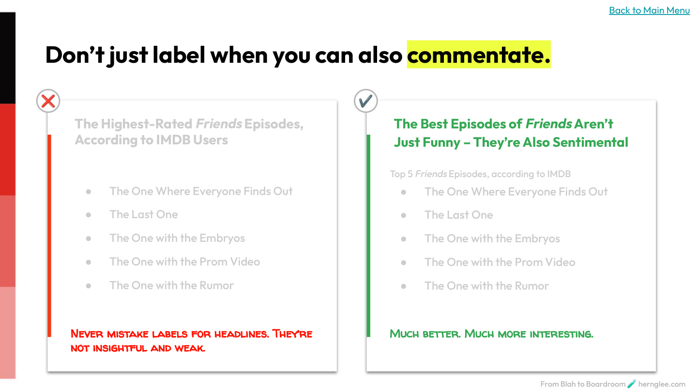

### PDF links

- [Back to Main Menu](<#pdf-page-008>)

## PDF page 043

#### 📊 The Visuals


<u>Back to Main Menu</u>


From Blah to Boardroom 🧪 hernglee.com

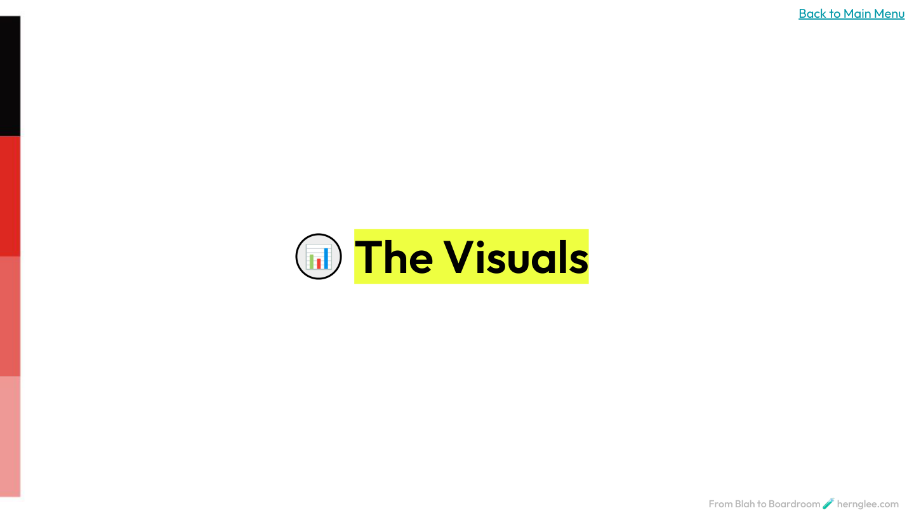

### PDF links

- [Back to Main Menu](<#pdf-page-008>)

## PDF page 044

<u>Back to Main Menu</u>

###### **Be VERY careful with circles.**


**Avoid pie charts.** And be very careful with **concentric circles.**


Here’s why: Humans are just bad at interpreting things like **pie slices** or **circular areas.**


**Take pie charts as an example:**
The relative sizes of pie slices are just very hard to conceptualize.
A slice that is 2x the size of another will somehow come out looking much bigger.


**Concentric circles are similar.**
While it makes perfect sense to show relative market sizes using a small circle within a bigger one:
It is difficult for most people to **accurately grasp the ratio** . You’re better off **using rectangles.**


**So, just keep it simple.** Minimize the potential risk of misinterpretation. Use bar charts.


From Blah to Boardroom 🧪 hernglee.com

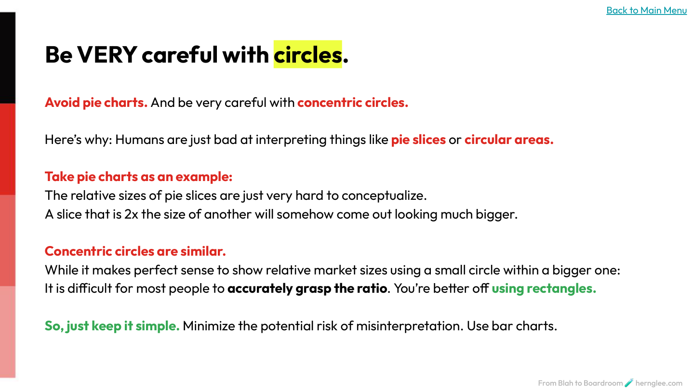

### PDF links

- [Back to Main Menu](<#pdf-page-008>)

## PDF page 045

<u>Back to Main Menu</u>


###### **Be VERY careful with circles.**

<mark>❌</mark> <mark>✔</mark>


Don’t use pie charts. It just leads to

misleading interpretations.


Oh, and for god’s sake – definitely don’t

use 3d pie charts. It make things worse.


There’s no reason why you can’t use a

simple bar chart to convey the same

message clearly and unequivocally.


From Blah to Boardroom 🧪 hernglee.com


Toy Story 1


Toy Story 2


Toy Story 3


Toy Story 4


51%


24%


16%


9%

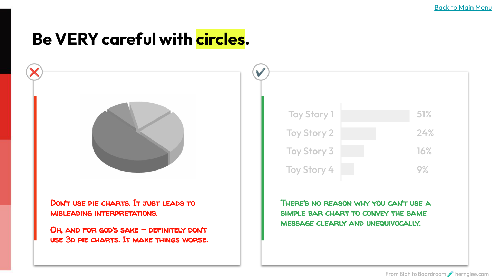

### PDF links

- [Back to Main Menu](<#pdf-page-008>)

## PDF page 046

###### **Be VERY careful with circles.**

<mark>❌</mark> <mark>✔</mark>


Addressable
Market: $20M


Our Share ($5M)


<u>Back to Main Menu</u>


Addressable
Market ($20M)


100% clear. no risk of misinterpretation.
Our Share:

$5M


Addressable Market ($20M)


Player

XYZ
($7M)


We only have 25% of the market: But feels

much bigger due to the visual.


Unless your goal is to mislead intentionally:

otherwise don’t use concentric circles.


Our
Share
($5M)


From Blah to Boardroom 🧪 hernglee.com

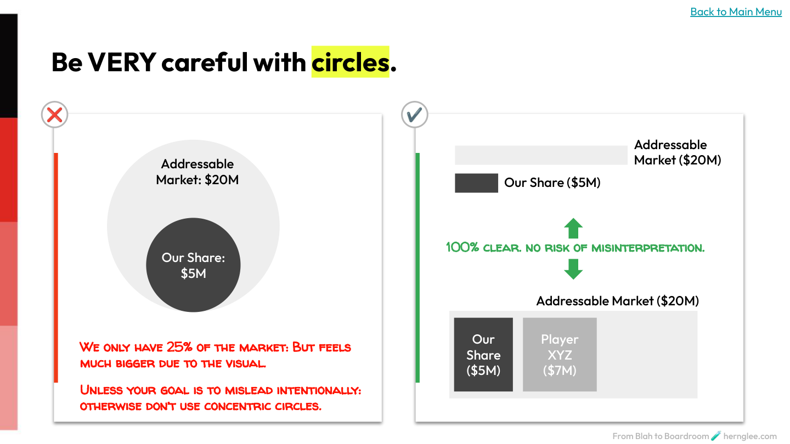

### PDF links

- [Back to Main Menu](<#pdf-page-008>)

## PDF page 047

<u>Back to Main Menu</u>

###### **Don’t let ugly tables cheapen your awesome work.**


Tables are simple. There’s no way to mess them up, right?


It turns out that **tables are ugly by default.** But you need to use them.
So if you don’t beautify them – the rest of your slide will suffer.


Yes, this has nothing to do with content or material.
It’s simply **aesthetics.**


But you invested so much effort into building your content already.
Why not use clean-looking tables to minimize **distractions?**


From Blah to Boardroom 🧪 hernglee.com

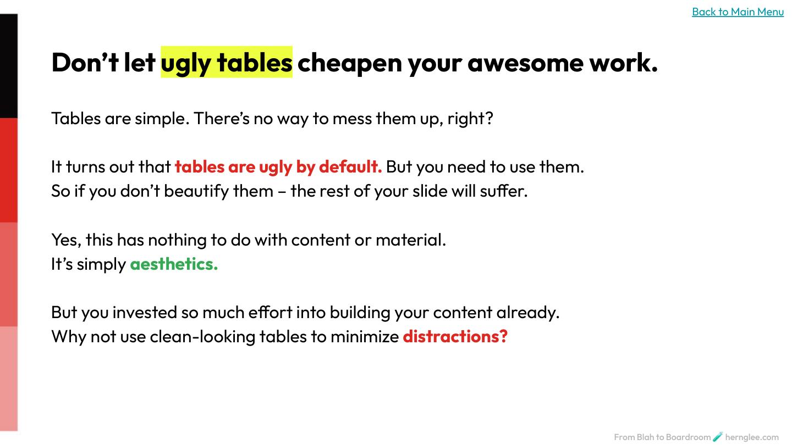

### PDF links

- [Back to Main Menu](<#pdf-page-008>)

## PDF page 048

<u>Back to Main Menu</u>


###### **Don’t let ugly tables cheapen your awesome work.**

<mark>❌</mark> <mark>✔</mark>


There’s nothing “wrong” with these tables…


A B C


Revenue $300 $450 $88

Costs $200 $400 $77

Total $100 $50 $11


A B

Clicks # #


Views # #


Likes # #


BUT: they’re not “nice.”

Which means unnecessary distractions.


**FAMILY** **STAFF** **FUNDS** **COSTS** **RISKS**


**Corleone** Lorem ipsum # $ $ xx

**Tattaglia** Lorem ipsum # $ $ xx

**Barzini** Lorem ipsum # $ $ xx

**Cuneo** Lorem ipsum # $ $ xx


From Blah to Boardroom 🧪 hernglee.com


**Widgets Sold by Markets**


Argentina 100


Brazil 300


Chile 250


Peru 450


Ecuador 75


**Total** **1175**


minimalist tables

tend to work well.


reduce distractions

as much as you can.

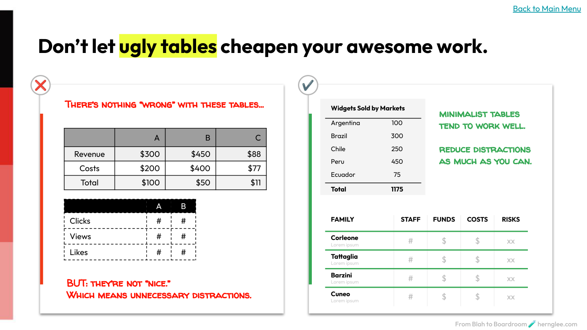

### Layout transcription

Column groups checked against the page image.

**Left examples.** “There's nothing ‘wrong’ with these tables...”

| | A | B | C |
| --- | --- | --- | --- |
| Revenue | $300 | $450 | $88 |
| Costs | $200 | $400 | $77 |
| Total | $100 | $50 | $11 |

| | A | B |
| --- | --- | --- |
| Clicks | # | # |
| Views | # | # |
| Likes | # | # |

“But: they're not ‘nice.’ Which means unnecessary distractions.”

**Right examples.** “Minimalist tables tend to work well. Reduce distractions as much as you can.”

| Widgets Sold by Markets | |
| --- | --- |
| Argentina | 100 |
| Brazil | 300 |
| Chile | 250 |
| Peru | 450 |
| Ecuador | 75 |
| Total | 1175 |

| FAMILY | STAFF | FUNDS | COSTS | RISKS |
| --- | --- | --- | --- | --- |
| Corleone<br>Lorem ipsum | # | $ | $ | xx |
| Tattaglia<br>Lorem ipsum | # | $ | $ | xx |
| Barzini<br>Lorem ipsum | # | $ | $ | xx |
| Cuneo<br>Lorem ipsum | # | $ | $ | xx |

### PDF links

- [Back to Main Menu](<#pdf-page-008>)

## PDF page 049

<u>Back to Main Menu</u>

###### **Use callout boxes. Help your audience follow along.**


Have a chart or table that contains **multiple messages?**
Just use callout boxes & labels, and keep everything on one slide.


You’ll get to keep your overall presentation **tight.**
And you’ll ensure that **the linkage** between the messages isn’t lost.


**Alternative** is to use pseudo-animations, i.e. creating multiple slides with the same
chart, with each having a different section highlighted.


**Sometimes this works.** But it also depends on if you’re presenting live and whether you
get to <u>control the flow.</u> Much easier to make it foolproof by keeping it to one slide.


From Blah to Boardroom 🧪 hernglee.com

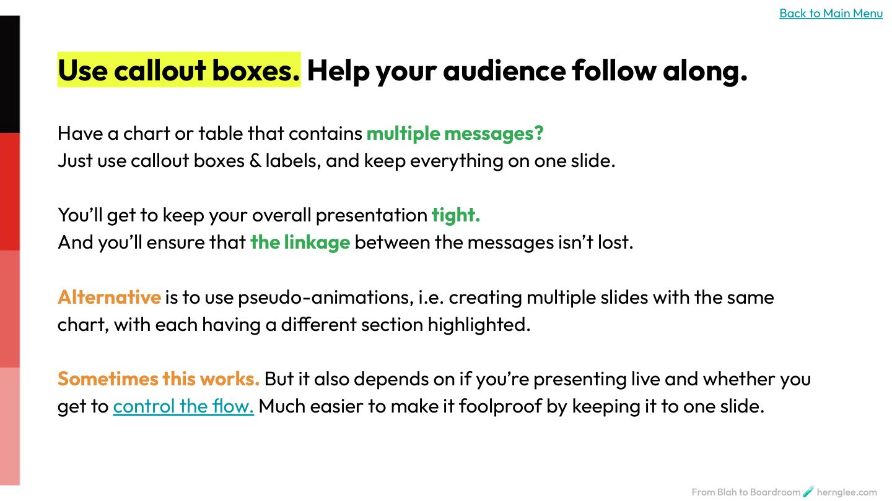

### PDF links

- [control the flow.](<#pdf-page-016>)
- [Back to Main Menu](<#pdf-page-008>)

## PDF page 050

**Selectable text transcription.** Formatting extraction omitted words on this page.

```text
Back to Main Menu

Use callout boxes. Help your audience follow along.


❌                     ✔


        FAMILY            STAFF   FUNDS   COSTS    RISKS                    FAMILY            STAFF   FUNDS   COSTS    RISKS
                                                                                                                                                    1
          Corleone            Lorem ipsum         #      $      $       xx                        CorleoneLorem ipsum         #      $      $       xx
                                                                                                          2
           Tattaglia            Lorem ipsum         #      $      $       xx                           TattagliaLorem ipsum         #      $      $       xx
                                                                                                                   3
           Barzini            Lorem ipsum         #      $      $       xx                           BarziniLorem ipsum         #      $      $       xx

         Cuneo            Lorem ipsum         #      $      $       xx                     CuneoLorem ipsum         #      $      $       xx


      ●   Corleone family has insufficient funds              ●1   Corleone family has insufficient funds

      ●    Tattaglia’s costs are out of control                 ●2    Tattaglia’s costs are out of control

      ●   Barzini is facing unprecedented risks               ●3    Barzini is facing unprecedented risks


                                                                                                            From Blah to Boardroom 🧪 hernglee.com
```

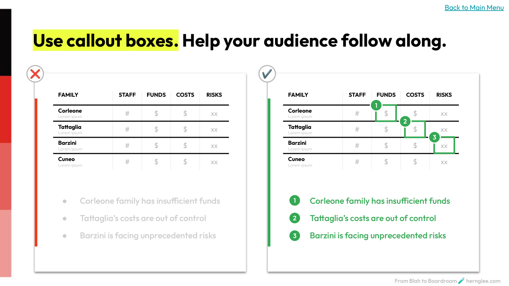

### PDF links

- [Back to Main Menu](<#pdf-page-008>)

## PDF page 051

<u>Back to Main Menu</u>

###### **Use signposts. Help your audience follow along.**


A long presentation that has multiple sections (and sub-sections) isn’t bad.
But it can be very difficult for the audience to follow along, especially live.


If the audience doesn’t know if they’re in the first 10% or last 30% of the narrative:
That creates **confusion.** Which creates **distractions.**


Thankfully, you can solve this easily with **signposting.**
Think of it as a progress bar.
Your audience will then have a clear mental map of where you are.


From Blah to Boardroom 🧪 hernglee.com


### PDF links

- [Back to Main Menu](<#pdf-page-008>)

## PDF page 052

###### **Use signposts. Help your audience follow along.**

<mark>❌</mark> <mark>✔</mark>


Strategy
Overview


Market
Deep-Dive


<u>Back to Main Menu</u>


Resourcing

Asks


1-1 1-2 1-3


2-1 2-2 3-1


3-2 3-3 3-4


3-5 4-1 4-2


Lengthy presentation with no indication of

which section / sub-section you’re in


Use simple signposts on the top right

corner to help your audience follow along


From Blah to Boardroom 🧪 hernglee.com


### PDF links

- [Back to Main Menu](<#pdf-page-008>)

## PDF page 053

<u>Back to Main Menu</u>


###### **Avoid Generic Icons. They Cheapen Everything.**

Nice icons can be the icing on the cake of a great slide.
Generic icons **cheapen everything** in your slide.


What’s a generic icon? I can’t describe it, but I know it when I see it.


 - I consider these **generic icons:**


 - While these are **slightly better:** [(source)](https://www.freepik.com/free-vector/collection-illustrated-business-icons_2631991.htm)


- **Emojis** can also work well, with a bit of packaging:


🎬 📩 🔓


- In general: if you’ve seen it before, it’s probably a generic icon.


From Blah to Boardroom 🧪 hernglee.com


### PDF links

- [source](<https://www.freepik.com/free-vector/collection-illustrated-business-icons_2631991.htm>)
- [Back to Main Menu](<#pdf-page-008>)

## PDF page 054

<u>Back to Main Menu</u>


###### **Avoid Generic Icons. They Cheapen Everything.**

<mark>❌</mark> <mark>✔</mark>


**Here are my favorite Agatha Christie**
**Novels:**


 - Murder on the Orient Express


 - The Murder of Roger Ackroyd


 - Witness for the Prosecution


 - Death on the Nile


 - And Then There Were None


**My favorite Agatha Christie Novels all**
**involve completely unexpected twists:**


🚆● Murder on the Orient Express


🗡● The Murder of Roger Ackroyd


⚖● Witness for the Prosecution


🌊● Death on the Nile


🧮● And Then There Were None


These icons aren’t bad. They just feel cheap. You don’t need proprietary icons.

Use emojis. It just feels nicer.


From Blah to Boardroom 🧪 hernglee.com


### PDF links

- [Back to Main Menu](<#pdf-page-008>)

## PDF page 055

<u>Back to Main Menu</u>

###### **Sometimes, a color is worth a thousand words.**


Whatever color scheme you use is fine.
But be careful with **Green**, **Yellow** / **Orange,** **Red** .


These colors tend to suggest **universally accepted connotations.**

 - **Green** = upside, growth, good progress, achievements, etc.

 - **Yellow** / **Orange** = work-in-progress, tentativeness, uncertainty, not good enough, etc.

 - **Red** = risk, inadequate, warning, danger, gap, etc.


So use them intentionally – they can add useful context to your slides.
But the opposite is true: if you use them inconsistently, they can mislead or confuse.


From Blah to Boardroom 🧪 hernglee.com


### PDF links

- [Back to Main Menu](<#pdf-page-008>)

## PDF page 056

<u>Back to Main Menu</u>


###### **Sometimes, a color is worth a thousand words.**

<mark>❌</mark> <mark>✔</mark>


**We delivered some big wins in 2023,**
**although there were misses as well**


 - We signed **the biggest deal** in 3 years


 - Customer satisfaction **improved**


 - We hit **6 out of 10 OKRs**


 - We saw **limited customer churn** despite
facing staffing challenges


Confusing coloring. Some even contradict

the intended message.


**We delivered some big wins in 2023,**
**although there were misses as well**


 - We signed **the biggest deal** in 3 years


 - We **minimized customer churn** despite
facing staffing challenges


 - CSAT **improved by 5pts (goal = +10pt)**


 - We hit **6 out of 10 OKRs**


Much less confusing, and much easier to

understand the intended sentiment behind

the bullet points.


From Blah to Boardroom 🧪 hernglee.com


### PDF links

- [Back to Main Menu](<#pdf-page-008>)

## PDF page 057

**Selectable text transcription.** Formatting extraction omitted words on this page.

```text
Back to Main Menu

💡 Was This Useful?


                              Connect with me on LinkedIn

                            Read my free weekly newsletter for
                                 high performers in tech


                                                                                                           From Blah to Boardroom 🧪 hernglee.com
```


### PDF links

- [LinkedIn](<https://www.linkedin.com/in/hernglee/>)
- [weekly newsletter ers in tech](<https://www.hernglee.com/read/>)
- [Back to Main Menu](<#pdf-page-008>)
