# Next Steps for the Superstar Analyst (Beta Copy)

Author: Herng Lee.

Source file: `Next Steps for the Superstar Analyst (Beta Copy).pdf`. 52 PDF pages.

Source SHA-256: `2720719fc1b00ca49c1477890ef77c63f0a5b84c76d85e5aa9cd1f6e963226e3`.

Converted from the supplied PDF. Page numbers below are 1-based PDF positions, including covers. Selectable text is formatted as Markdown; pages where formatting drops text use a labeled plain-text transcription. Purchaser watermarks are omitted from the transcription but remain in original page images. Page images retain diagrams, tables and layout. Image text is supplemental local OCR, may contain recognition or reading-order errors, and does not encode table relationships. Check the page image before quoting OCR or interpreting a chart. Original copyright and beta notices remain in the source text or page images. This is source material, not an AirDesign requirement or agent instruction.

## PDF page 001

**Selectable text transcription.** Formatting extraction omitted words on this page.

```text
< BETA COPY >


 © HERNGLEE.COM
```

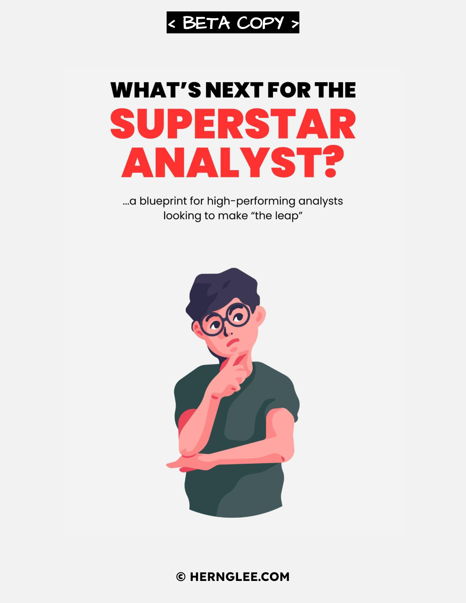

### Image text (OCR 1)

Image bounds in PDF points (left, top, right, bottom): `82.9, 89.7, 529.1, 801.5`. Lines below follow OCR order.

```text
WHAT'SNEXTFORTHE
SUPERSTAR
ANALYST?
.….a blueprint for high-performing analysts
looking to make “the leap"
© HERNGLEE.COM
```

## PDF page 002

#### ABOUT THE AUTHOR

**Hi there! This is Herng.** By day I work as a strategist at Google (coming up on nearly

a decade), and by night I write original content based on my learnings from work.


[Read more of my work at: www.hernglee.com/read](http://www.hernglee.com/read)


© hernglee.com Next Steps for the Superstar Analyst 2


### PDF links

- [www.hernglee.com/read](<http://www.hernglee.com/read>)

## PDF page 003

#### ABOUT THIS “BETA” COPY

If you’re reading this: thank you in advance for your time as an early reader!


**This is a “beta” copy** and I’d love to get your feedback. It will help me polish this

blueprint further, and make it even more useful for superstar analysts.


(And also for those in the making!)


**So I have one favor to ask:** After you finish reading, would you take 5 seconds and

<u>[answer one question](https://subscribepage.io/blueprint-feedback)</u> for me?


Thank you again for taking the time – I really appreciate it. If you have more thoughts to

share, I’d love to hear from you! You can contact me by:


 - [Emailing me at herng@hernglee.com](mailto:herng@hernglee.com) (I try to reply to every email I receive)


 - [Dropping me a note via Linkedin](https://www.linkedin.com/in/hernglee/)


Thanks again and read on!


© hernglee.com Next Steps for the Superstar Analyst 3

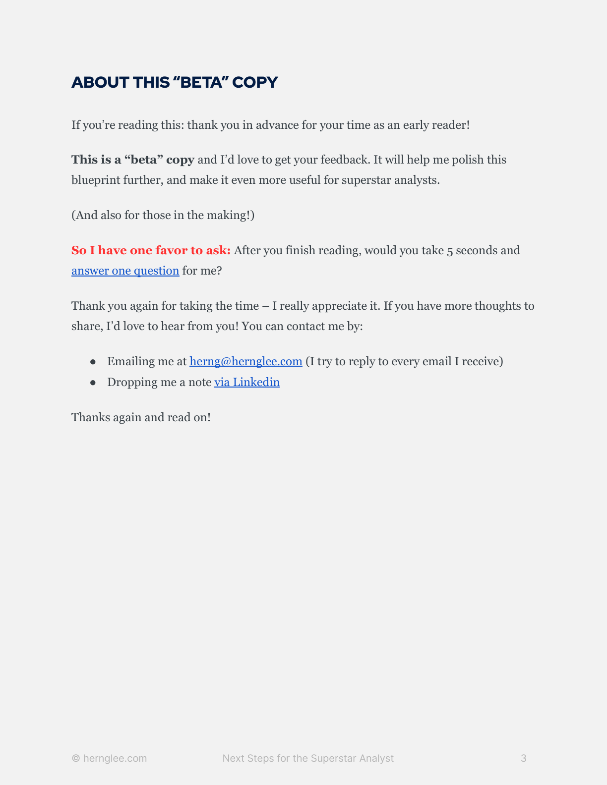

### PDF links

- [answer one question](<https://subscribepage.io/blueprint-feedback>)
- [herng@hernglee.com](<mailto:herng@hernglee.com>)
- [via Linkedin](<https://www.linkedin.com/in/hernglee/>)

## PDF page 004

#### WHAT IS “THE BLUEPRINT?”

Quick question: What do the following 3 people have in common?


 - Your manager


 - Tim Cook


 - Myself


**Here’s my answer:** Each one of us was the most junior business analyst in the room

at some point in our respective careers.


●●●


Why I wrote this blueprint


Over my last 8+ years at Google, I have had the good fortune of working alongside (and

observing) talented and passionate colleagues with accelerated careers.


And in many instances, they went from being the most junior person in the room, to

becoming trusted business leaders and/or people managers.


This fascinates me. None of their growth happened overnight.


(But at the same time, if you blink – you just might miss it.)


So when I look at these colleagues (and reflect on my on growth journey as well), it

makes me wonder:


 - What skills did they build up over the years?


 - When exactly does this transformation occur?


 - How do they make themselves ready for the eventual “leap?”


There’s a lot of useful material teaching people how to thrive as a business analyst.


But how do people become more than “just” a superstar analyst?


© hernglee.com Next Steps for the Superstar Analyst 4

## PDF page 005

Thus began my attempt to deconstruct “the blueprint.”


●●●


What this is (and isn’t)


Career growth (and career growth acceleration) requires a lot of things. Some are

controllable – some less so. But they’re equally necessary. I’m not denying that.


**But this blueprint is about what’s controllable.** I’m not interested in talking

about how to game the system, how to endlessly promote yourself, how to play politics,

how to shop around different companies and positions…


I’m not saying they don’t play a role in your career. It’s just not what I’m interested in

writing about.


Instead, we’re going to focus on growth and skill-building. We’ll explore things like:


 - How to make people around you better


 - How to develop “gravitas” (and why it matters)


 - How to uplevel your comms skills to be taken seriously


 - How to sharpen your thinking so you can engage senior leaders


This blueprint is about stealing with pride. It’s also about reverse-engineering. My goal

is to take what I’ve observed and learned over the years, and deconstruct it for the

reader.


I am still very much on my own learning journey – but I am incredibly excited to share.


●●●


One key callout before we begin


What is a superstar analyst?


© hernglee.com Next Steps for the Superstar Analyst 5

## PDF page 006

The criteria will vary depending on industry and company, but there are a few things I

consider table-stakes for a **high-performing business analyst:**


(This is not an exhaustive list. They’re simply areas I’ve written about in the past.)


 - [Tackles ambiguity](https://www.hernglee.com/blog/ambiguity/) with ease


 - [Harbors a strong point of view](https://www.hernglee.com/blog/strong-pov-site/)


 - [Possesses a strong bullsh*t radar](https://www.hernglee.com/newsletter/bs-at-work-site/)


 - [Practices impeccable email hygiene](https://www.hernglee.com/blog/email-tips/)


 - [Operates as more than just a data monkey](https://www.hernglee.com/blog/data-wizard/)


 - [Knows how to contextualize](https://www.hernglee.com/popular-contextualize/) so people care


Some of these things translate to the next level or career stage. Some of these things

might not.


As the saying goes: “What got you here won’t get you there.”


**This blueprint is about getting us there.** But let me be clear: even mastering some

of these “basics” is no small feat. Some take many years to master.


This blueprint is also about intentionality. Because the skillsets that we’ll talk about

don’t just require intentional _practice_ - they require intentional _effort_ to seek out such

“practice” opportunities.


And thus the hardest thing about career growth is this: you don’t know what you don’t

know. And if you don’t know what “good” looks like – it’s hard to set the right goalposts.

And it’s hard to seek out the right growth opportunities. And it’s hard to grow.


But as long as you know what you’re looking for – then there’s a path ahead.


This blueprint is not intended to solve everything. But it does intend to turn some

“unknown unknowns” into “known unknowns.”


I hope you enjoy it! Let’s get started.


© hernglee.com Next Steps for the Superstar Analyst 6

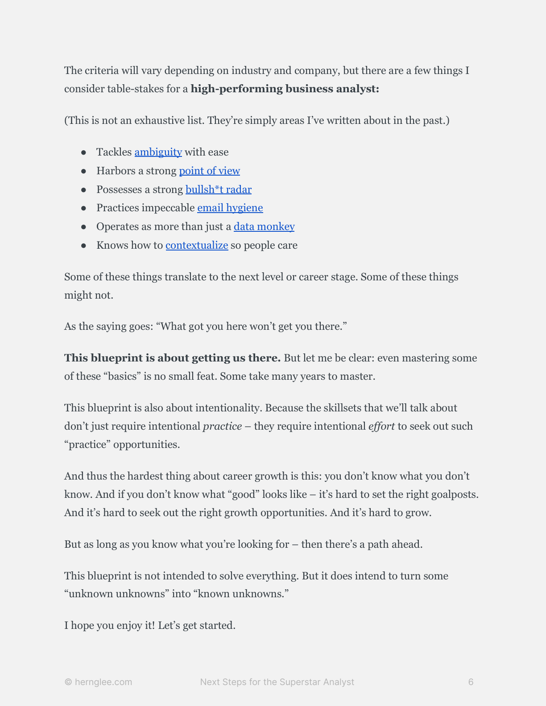

### PDF links

- [ambiguity](<https://www.hernglee.com/blog/ambiguity/>)
- [point of view](<https://www.hernglee.com/blog/strong-pov-site/>)
- [bullsh*t radar](<https://www.hernglee.com/newsletter/bs-at-work-site/>)
- [email hygiene](<https://www.hernglee.com/blog/email-tips/>)
- [data monkey](<https://www.hernglee.com/blog/data-wizard/>)
- [contextualize](<https://www.hernglee.com/popular-contextualize/>)

## PDF page 007

#### TABLE OF CONTENTS (LINKS ARE CLICKABLE)

ABOUT THE AUTHOR.................................................................................................................. 2


**WHAT IS “THE BLUEPRINT?”................................................................................................4**


Why I wrote this blueprint.............................................................................................4


What this is (and isn’t)..................................................................................................... 5


One key callout before we begin.................................................................................. 5


**…KNOW HOW TO CHALLENGE LEADERS EFFECTIVELY.......................................... 9**


Why does challenging matter?................................................................................... 10


So how do we do it?.........................................................................................................12


📌 #1 The mindset you need........................................................................................12


A story about my ego...................................................................................................... 14


📌 #2 The verbiage you can use.................................................................................15


Other Verbiage to Use (But Very Carefully)............................................................ 17


Closing................................................................................................................................20


**…POSSESS POLISHED COMMUNICATION SKILLS...................................................... 21**


Polished comms: what it is and isn’t.........................................................................21


📌 #1 Use verbal cues to hack yourself...................................................................22


📌 #2 Signpost when you talk....................................................................................24


📌 #3 Focus on principles, not tactics.....................................................................26


Closing................................................................................................................................ 28


**…KNOW HOW TO ASK THE “RIGHT” QUESTIONS...................................................... 29**


The ABCDE framework................................................................................................ 30


📌 A is for Action / Anticipation..................................................................................31


📌 B is for Beliefs............................................................................................................ 32


📌 C is for Conditions.................................................................................................... 33


📌 D is for Disambiguation..........................................................................................34


© hernglee.com Next Steps for the Superstar Analyst 7

## PDF page 008

📌 E is for Everything Else.......................................................................................... 35


Closing.................................................................................................................................35


**…LIVE AND BREATHE “FIRST PRINCIPLES” THINKING...........................................37**


Where first-principles thinking comes in..............................................................37


An example of first-principles thinking..................................................................38


How to hone this skill....................................................................................................40


📌 #1 Ask "why" a lot. Then ask "why" again........................................................ 40


📌 #2 Break things down. Then apply pattern recognition..............................41


📌 #3 Bring people along the journey...................................................................... 41


Closing................................................................................................................................ 42


**…KNOW WHAT CONSTITUTES A PROPER “STRATEGY.”.......................................... 43**


What is a strategic plan?...............................................................................................43


The framework.................................................................................................................44


📌 #1: HOW will we get there?....................................................................................45


📌 #2: WHO is on the hook?........................................................................................46


📌 #3: WHAT outcomes?.............................................................................................. 47


📌 #4: WHY are we doing this?..................................................................................48


📌 #5: WHEN will we get there?................................................................................49


📌 #6: WHICH segment?..............................................................................................50


Closing................................................................................................................................. 51


Last, But Not Least…....................................................................................................................52


© hernglee.com Next Steps for the Superstar Analyst 8

## PDF page 009

_To be more than “just” an analyst, you…_

#### …KNOW HOW TO CHALLENGE LEADERS EFFECTIVELY.


For many years I worked in a strategy & operations org, where one of our mantras was

to “champion and challenge” our business partners (who were senior leaders of various

sales orgs).


Championing was straightforward. It required us to advocate passionately on behalf of

our sales teams and enable our business partners to succeed. We would do things like:


 - Advocate passionately on behalf of our respective sales teams


 - Operationalize and our business partners’ agenda


 - Build strategies to enable business growth


Challenging, on the other hand, was less straightforward. In general, we were much

more junior than our business partners, and we lacked formal authority. We were

always consulted, but we were rarely decision-makers.


Some people struggled with this dynamic. They found it much easier to simply go along

with their business partners and execute their agenda. They were great champions – but

not always the best challengers.


Some people, on the other hand, were great challengers. It did not take away from their

ability to support and enable their business partners; it only made them much more

respected within the business.


Here is my attempt at deconstructing how they did it.


© hernglee.com Next Steps for the Superstar Analyst 9

## PDF page 010

Why does challenging matter?


Quiz time: Does the following describe a champion or challenger?


 - You’re on “the same team” as your stakeholder (or business partner)


 - Your incentives and objectives are highly aligned with them


 - You do everything you can to help them succeed


 - You are supportive, passionate, and empathetic


Whatever you answered – you were right. And also wrong. Because you cannot achieve

these things by only being a champion (nor only being a challenger). They are

fundamentally interdependent.


Most people inherently understand the **upsides of championing.** They also are wary

of the **downsides of challenging.**


(So they champion a lot – and shy away from challenging. See below.)


© hernglee.com Next Steps for the Superstar Analyst 10

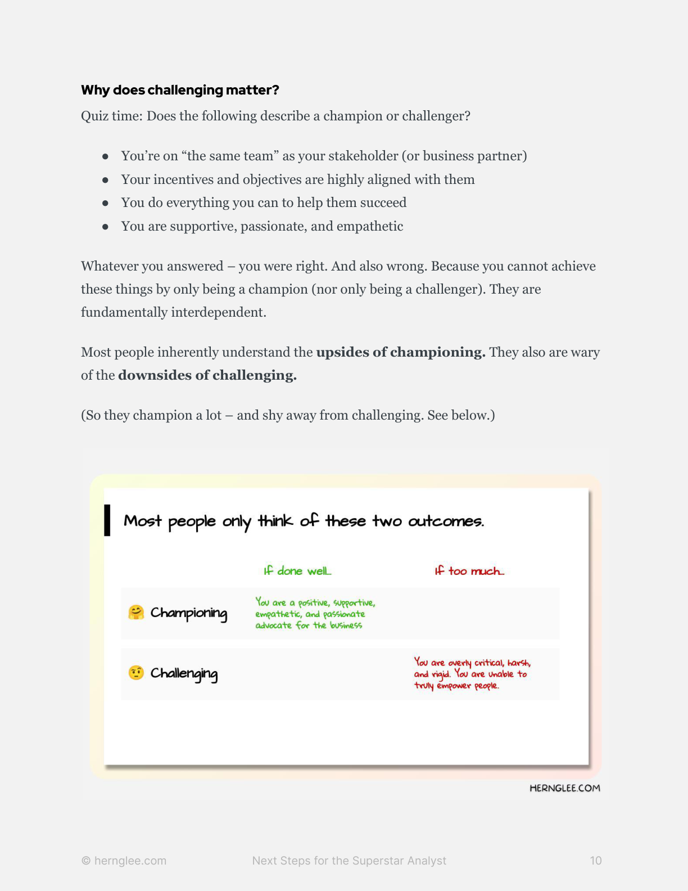

### Image text (OCR 1)

Image bounds in PDF points (left, top, right, bottom): `73.5, 398.8, 541.5, 710.8`. Lines below follow OCR order.

```text
Most people only think of these two outcomes.
If done well..
If too much...
You are a positive, supportive,
Championing
empathetic, and passionate
advocate for the business
You are overly critical, harsh,
Challenging
and rigid. You are Unable to
truly empower people.
HERNGLEE.COM
```

## PDF page 011

What people often miss, however, are the downsides of over-championing, and the

upsides of intentional challenging.


 - **Downsides of over-championing:** You become a yes-person, and you enable


an echo chamber. Your lack of critical and constructive feedback, while

well-intentioned, is bad for the business. You do not help people get better.


**●** **Upsides of healthy challenging:** Your honest, candid, and objective feedback


can help the business (and people) do better. You hold people to a higher bar, and

help them unlock their potential further.


See the illustration below.


© hernglee.com Next Steps for the Superstar Analyst 11

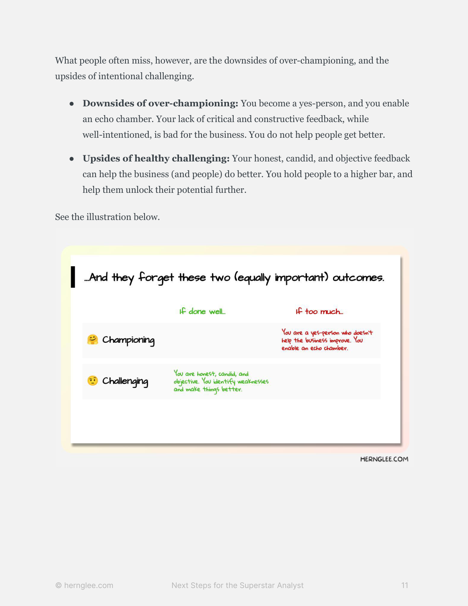

### Image text (OCR 1)

Image bounds in PDF points (left, top, right, bottom): `73.5, 298.3, 541.5, 610.3`. Lines below follow OCR order.

```text
...And they forget these two (equally important) outcomes.
If done well.
If too much..
You are a yes-gerson who doesn't
Championing
help the business imgrove. You
enable an echo chamber.
You are honest, candid, and
Challenging
objective. You identify weaknesses
and make things better.
HERNGLEE.COM
```

## PDF page 012

So how do we do it?


Becoming an effective challenger is hard. It can feel unnatural for many people –

especially if you’re conflict-averse.


(But this is what separates people who can simply execute well from those who become

trusted advisors – and therefore receive more trust and bigger responsibilities.)


Challenging senior leaders effectively is a broad topic. But in this chapter, I want to just

focus on two specific things.


The first is **the mindset** - most people are stuck here. Without the right mindset,

challenging senior leaders will feel like an uphill battle.


The second is **the verbiage** we can leverage when we need to disagree with senior

leaders. Language matters a ton when it comes to navigating these situations.


Let’s start by talking about the mindset.


●●●


📌 #1 The mindset you need


Here’s a hard truth to swallow for the superstar analyst: the reason you got _here_ might

actually be stopping you from getting _there._


Here’s why I say this.


Imagine someone in the early stages of their career: they’re bound to make many

mistakes. And so over the next few years, their goal is simple: cut down on (literally)

rookie mistakes as much as possible.


For instance, their goals might be to:


 - Produce error-free data


© hernglee.com Next Steps for the Superstar Analyst 12

## PDF page 013

- Present to people without confusing them


 - Write slides that don’t contradict each other


 - Give factual answers when questioned by people


Over time, people learn – and they make fewer mistakes. And they get rewarded for it

with promotions and other feedback mechanisms.


That’s great. Except now they subconsciously equate “looking good” or “sounding smart”

with actually delivering impact.


And it’s hard to blame people for this. I remember early on in my career, I would often

hear feedback such as:


_●_ _“To really build a case for your promotion: you have to nail this important_


_presentation”_


_●_ _“You did really well this past quarter: you presented to this audience and it_


_landed really well”_


_●_ _“Your analysis was very solid and there were no objections to your conclusion”_


The feedback wasn’t necessarily wrong. But for a junior analyst who is less discerning, it

creates an unintentional side effect of essentially implying: _A good outcome is where_

_you don’t get challenged or questioned._


To be more dramatic about it: it almost trains people to perceive conflict or

disagreement as a symbol of failure. And it trains people to mistake harmony or

consensus as the holy grail.


(Case in point: I have seen people put “reached alignment with xyz stakeholders” as one

of their key achievements. These are very capable people – but it perhaps does speak to

how they’ve been conditioned to operate.)


And so, for the superstar analyst who is now expected to challenge (and therefore face

conflict or disagreement) – it feels highly unnatural. It’s the complete antithesis of how


© hernglee.com Next Steps for the Superstar Analyst 13

## PDF page 014

they’ve been trained. It’s the complete opposite of what they’ve been told “good” looks

like.


So if you want to be an effective challenger – the mindset matters. And it starts with

recognizing one thing: **you’re optimizing for business impact. Not your ego.**


●●●


A story about my ego


Many years ago, I went into a meeting to present a piece of work to a senior leader.


It did not go well. The leader was not impressed, and fired off multiple rounds of

criticism. My attempt to get him to see my point of view saw no avail either.


Feeling rather dejected after the meeting, I told a good friend of mine at work about this.

The first thing that he said to me was this:


_“What level are you? And what level is this leader? Was your goal to go into that_

_meeting and perfectly “handle” them? Is that really what you were optimizing for?”_


Many years later, I have already forgotten what that presentation was about, but I will

never remember that little pep talk from my friend. It was a turning point for me.


Because I finally realized the real reason I felt so frustrated after that meeting. And it

was not because my efforts went to waste. It was not because I was worried about the


business missing out on an opportunity.


Rather, it was all about my ego.


Here’s why. I saw the forum as my time to shine, and an opportunity to demonstrate

how I could impress and handle people much more senior than myself. I saw the


meeting as a referendum on me, as my personal showcase.


© hernglee.com Next Steps for the Superstar Analyst 14

## PDF page 015

And that’s why I took it so personally: the criticism of the work had very little to do with

me as a person – but my ego clouded me from seeing that.


Because I did not see the presentation as a way to help the business get closer to the

right decision. I did not see it as a means to an end. Instead, I (selfishly) saw delivering

an objection-free presentation as _the end_ .


●●●


Here’s why I bring up this story in the context of challenging leaders.


It turns out that your ego can get in the way from both sides. It can prevent you from

**handling** constructive criticism (like in my example). And it can definitely prevent you

from **delivering** constructive criticism and challenging others effectively.


(Because you’ll be worried about whether you’re making others “look bad.”)


But once you realize you’re not challenging people _per se_, but rather their _point of view_

- you’ll feel much more empowered to genuinely challenge, and push the business

towards a better place.


Assuming you’re bought into the mindset shift – let’s now talk about **the toolkit.**


●●●


📌 #2 The verbiage you can use


There’s no magic formula when it comes to challenging senior folks. Everybody needs to

develop his or her own style and find what they’re comfortable with.


However, there is language we can leverage to make this process easier on ourselves, as

we slowly build up our reputation and find the voice that we’re comfortable with.


Here are some of my personal favorites:


© hernglee.com Next Steps for the Superstar Analyst 15

## PDF page 016

✔️ **“Let me know if I’m missing something, but…”**


Here’s why I like it. I find that this phrase suggests the right amount of humility,

without acting like a pushover without an original point of view.


It also subtly acknowledges that the senior person naturally has much more visibility

over the wider business. Therefore, I’m essentially _giving_ myself permission to make an

argument without having to ensure I have the exact same context.


**Example:** _“Let me know if I’m missing any context here, but I worry that signing this_

_deal will send the wrong message to our customers (and here’s why).”_


✔️ **“Let me know if I should be thinking about this differently, but…”**


Similar construct as above. Again, this allows you to put your baggage aside when you’re

about to deliver a contrarian point of view.


✔️ **“Can I try pitching you on this idea of…”**


I used to work closely with a stakeholder who was rather headstrong in his opinions. I

was not always successful in trying to convince him to see the other side.


I remember one particular meeting where I felt that my analysis was being

misinterpreted to fit a misleading narrative. I wanted to tread lightly, as it was a

contentious topic.


So as he finished delivering his point, I said,


“Can I pitch you on another way we can take this?”


I figured this was a nifty way of being respectful while still getting a chance to defend my

point. In a way, I was seeking permission to disagree with him (and who would

realistically say “no” to my request?).


© hernglee.com Next Steps for the Superstar Analyst 16

## PDF page 017

Now, to be fair, I’ve completely forgotten the outcome of that meeting, but I do

remember my stakeholder reacting surprisingly well to my proposition and giving me

the opportunity to change his mind.


✔️ **“I’m struggling a little with this point about…”**


You can use this phrase with both your peers and senior leaders. Because you make it

clear that you’re not fully onboard yet with the point being made, but you’re pointing the

finger at yourself, instead of explicitly negating other people’s views.


Furthermore, you imply that you actually do want to understand the other person’s

point – it’s just that you’re still working on it (and humbly asking for help).


**Example:** _“I’m struggling a little to understand how this strategy will scale, given the_

_addressable market seems pretty capped based on XYZ datapoints.”_


When you do this well, this is what your stakeholder will hear:


_"I’m not disagreeing with you outright. I’m really trying to understand the rationale_

_behind your suggestion. Here’s where I’m stuck, and I'd love for us to figure out_

_together why there’s a disconnect.”_


●●●


Other Verbiage to Use (But Very Carefully)


On the other hand, here are a couple phrases that you should either intentionally avoid,


or use only very sparingly (and usually not with senior audiences).


But depending on your comfort level and the scenarios you deal with, they may


occasionally come in handy.


© hernglee.com Next Steps for the Superstar Analyst 17

## PDF page 018

First up:


🤔 **“Could you help me understand…”**


This is useful but you want to tread carefully. If you do not have a relationship with your

audience, this may actually backfire as it comes off as a bit patronizing. Otherwise, it’s

not a bad way to get your objectors to elaborate on their pushback and substantiate it.


For instance:


_●_ _"Could you help me understand why you think this example is an outlier?"_


_●_ _"Could you help me understand the biggest risk you see in this proposal?"_


When I need the other person to elaborate a bit more on their objection, What I also

find it useful occasionally to ask:


_●_ _“Just to make sure I heard you correctly, you’re saying that …”_


_●_ _“Just playing back what you said, are you saying your concern is that…”_


After all, people like affirmation (even if they don’t know it), and so when they hear their

point of view being repeated, most people have the natural urge to expound further.


This is usually always helpful: it’s hard to meaningfully respond to a one-sentence

objection (“no, your scenario is too optimistic”), but it’s slightly easier when people give

you a bit more to work on so you can engage better.


🤔 **“Just playing devil’s advocate here, but…”**


I want us to think of this phrase as a pacifier: use it earlier on in your career (if you

must), but wean off it as soon as possible.


To be clear, there’s nothing wrong with the phrase per se: it’s a useful crutch to rely on

when we feel less confident in our voice.


© hernglee.com Next Steps for the Superstar Analyst 18

## PDF page 019

But that’s also precisely the issue – it’s a defense mechanism that shuts out everybody

else in the room.


After all, you’re essentially saying:


_●_ _"I’m going to make my point, and I don’t care if you disagree with me because_


_my point was meant to be contrarian anyway."_


So instead of constructive debate, you might just end up generating eyerolls.


My suggestion is to keep it simple: acknowledge that you have a different opinion, but

then simply make your point.


Over time, people will respect that you not only have your own point of view, but that

you also have enough confidence to not have bubble-wrapped it from dissent.


🤔 **“Maybe we can take a step back…”**


There is definitely a time and a place to gently remind people that they’re going down a

rabbit hole and missing the big picture.


But the trade-off is that these well-intentioned catchphrases tend to be so overused that

almost everybody knows what you really mean behind all the sugarcoating. You’re

basically saying the other person is in the weeds and not realizing it.


It may be a valid point, but it doesn’t stop people from feeling patronized and getting

defensive.


To counter this, sometimes I might switch things up a bit and say something like:


_“...agree that these are important questions to ensure we can actually operationalize_

_this plan; however, if I park the tactical execution on the side for a second, can we talk_

_about whether this strategy alone will help us achieve XYZ goal?”_


© hernglee.com Next Steps for the Superstar Analyst 19

## PDF page 020

Notice the words I’ve dropped in to hint at the fact that we need to uplevel the

conversation: _tactical, execution, operationalize._


Of course, your goal is not to babysit people’s egos. But if you can minimize knee-jerk

reactions and improve the chances of your message landing, why not?


●●●


Closing


It is worth calling out that most people struggle with not challenging enough – hence the


importance of this chapter. But I have also worked with people who are known to be

fiery challengers and contrarian by default. Whether intentional or not, I do not know.


What I know, however, is this. Too much championing does not work. Too much

challenging is equally counterproductive. The learning journey is all about finding the


right balance, so you (and the business) get the best of both worlds.


© hernglee.com Next Steps for the Superstar Analyst 20

## PDF page 021

_To be more than “just” an analyst, you…_

#### …POSSESS POLISHED COMMUNICATION SKILLS.


Here’s a question: What does it mean to sound “polished?”


(And how do people get there?)


Polished comms: what it is and isn’t


Over the years, regardless of the team I was on – it was always readily apparent to me

when somebody possessed much more polished communication skills than others.


And whenever these people spoke, they’d be able to:


 - …make complex situations simpler


 - ..pull people out of a rabbit hole and push the group towards action


 - …get other people to actually listen AND engage with what they say


And here’s the cool thing: the people that possessed this ability were not always the


most senior ones in the room.


But whenever they spoke – people listened.


●●●


Polished comms is not about sounding smart. It’s not about learning corpspeak and


buzzwords. It’s also not about being right all the time.


Rather, it’s about making things clearer, simpler, more actionable, or more factual


whenever you speak. It’s about setting direction for others. It’s about saving time for

everybody.


It could be all of the above.


© hernglee.com Next Steps for the Superstar Analyst 21

## PDF page 022

And for the superstar analyst looking to uplevel? Your ability to do this often determines


whether you gain enough trust to be in the room for important discussions.


Here’s another important (but overlooked) fact: When it comes to verbal

communication skills, the feedback loop is often very weak.


In other words, we often don’t know that we’re struggling. After all, few people are


honest enough to candidly tell us things like:


_●_ _Your response was too complicated; I just want a simple answer._


_●_ _Your email was too long; I lost patience and didn't read it._


_●_ _You said so many things; I can't tell which ones matter._


_●_ _You wasted half the meeting presenting slides I don't care about._


And therefore we keep making the same mistakes, over and over again. And we fail to

realize that our messages aren’t landing until much, much later.


But that need not be the case.


In this chapter, we’ll talk about 3 things anyone can do to maximize the effectiveness of

their verbal comms to become more polished.


●●●


📌 #1 Use verbal cues to hack yourself.


Most people are too long-winded when they speak. They refuse to lead with the

conclusion.


(The reason is simple. It feels unnatural and illogical. It feels like you've built the roof


first before building the floor.)


So if the question goes:


 - "How confident are you that we can hit our sales target this quarter?"


© hernglee.com Next Steps for the Superstar Analyst 22

## PDF page 023

They'll say:


 - _We have visited and revisited all our clients to ask for budget..._


 - _We have also sought out market intel to understand macro trends..._


 - _We analyzed the data to seek out more opportunities..._


 - _...and we still don't think we can make up the remaining gap._


This is extremely logical. Yet unfortunately extremely frustrating for the listener, who is

in limbo while waiting for you to cut to the chase.


Of course, in the responder's defense: many things are difficult to summarize with a


short answer. Many things are of the "yes, but..." or "no, except that..." variety. You don't


want to mislead people by saying something that hasn't been qualified or caveated.


I get it.


But leading with the conclusion is how you make sure people actually listen. No one has


the patience for a long-winded buildup (unless you're a character in an Agatha Christie


novel).


Thankfully, the fix is simple. Just use verbal cues to "hack" yourself. For instance, the

go-to phrase I use for myself is:


**_“The tl;dr* is this…”_** <sup>**_1_**</sup>


When I start a sentence with "The TLDR is this," it forces me to lead with the conclusion

(to put my interlocutor at ease), but also signal that what I'm saying is over-simplified

( _"so please don't cut me off before I give you sufficient context"_ ).


Then I proceed with my caveats, my rationale, or other supporting detail.


Your magic phrase doesn't have to be "tl;dr." For instance, you can say:


**_"Short answer is [abc]. Long answer is [xyz]."_**


1 tl;dr = too long; didn't read


© hernglee.com Next Steps for the Superstar Analyst 23


## PDF page 024

Sometimes I even switch it up. I might say something like:


_"The answer is yes, but with a_ **_tiny asterisk._** _We believe we can meet the_

_quota, but contingent upon X feature launching in time. Let me also take a_

_minute to talk you through the details so you have a better sense of our_


_confidence levels."_


If you don't lead with the conclusion, your reader is left with an unscratched itch. Even if

you help them scratch that itch at the end of your spiel – it will not have been a pleasant

experience.


So use verbal cues to force yourself to lead with the conclusion (but also signal to the


listener that there's more nuance). It'll make a world of difference.


●●●


📌 #2 Signpost when you talk.


Signposting involves using a variety of cues to help your reader or listener follow along

much more easily. And it comes naturally when we write. For instance:


 - We use headers, sub-headers, and other titles to help the reader follow along


 - We use formatting ( **bolding**, _italics,_ coloring _)_


 - We use explicit verbiage to signal intention, e.g.


    - For context...


    - Up until this point, this was true. However...


    - In short...


    - Contrary to...


However, when it comes to speaking: people forget to signpost all of a sudden.


After all, everything makes sense in their heads. They don't realize the listener needs

some help to follow along.


Here are two things I do to avoid this mistake.


© hernglee.com Next Steps for the Superstar Analyst 24

## PDF page 025

The first (and simplest) is to stick to this **three-step process:**


1. Tell them what you’re going to tell them...

2. Tell them...

3. Tell them what you’ve told them.


Doing so does wonders. For instance, I might say something like:


 - _I'd like to take the next 2 minutes to flag an issue we've been facing this past_


_quarter, and give you an example of how it hurts our business..._


 - _(I then deliver my spiel...)_


 - _The example I've given you illustrates how not fixing this small thing could_


_cause us lots of $ in the long run. My ask to this group is that we prioritize_


_solving this within the next 30 days._


The second thing I do is to give the "meta-message" up front.


For instance, I start by saying things like:


 - _"I don't need any action from you; I just want to share to give you more context_


_in case helpful."_


 - _"I don't need you to help me problem-solve; I just want to think out loud and_


_bounce ideas off you."_


 - _"I'd like to explore whether you are the right person to partner together on this,_


_which is why I'd like to give you the full context first."_


When I do this, my audience immediately knows what part of their brain to switch on.

They also know whether they need to chime in with questions.


It is astounding to me how many people engage in a conversation by simply jumping


into their spiel, with no mention of **why** the listener should care.


A patient listener will listen on without interrupting – but half of his mindspace will be

spent wondering:


 - _...Are they explaining this b/c they plan to ask me for a favor?_


© hernglee.com Next Steps for the Superstar Analyst 25

## PDF page 026

- _...Are they sharing this because they want my help in brainstorming?_


 - _...Are they sharing this b/c they simply want to keep me in the loop?_


A less patient listener will zone out. Or they'll ask a bunch of questions that they never


would've asked if they knew of your true intention.


And it becomes a waste of time for both sides.


Note that this also applies if you're in a group meeting. For instance:


 - _"I'd like to share one issue that is specific to my business for now, but could be a_


_hidden risk in the future for others in the room."_


All of a sudden people in the room know why they should care.


On the other hand, if you're not able to signpost your own message and justify why


others should listen to you, you should ask yourself: " _Why am I even speaking?_ "


You might then realize you didn't really have to take up other people's time.


And this is equally valuable: not only did you preserve other people's time, you also


avoided saying low-value-add stuff. That makes other things you actually say that _much_


_more_ impactful.


●●●


📌 #3 Focus on principles, not tactics.


Common pitfall that trips a lot of people up (myself included):


**Debating tactical decisions, rather than principles.**


Here's an example. Imagine that you're discussing with a colleague how to best design


seller incentives for a sales org.


Tactical questions would include:


© hernglee.com Next Steps for the Superstar Analyst 26

## PDF page 027

- Do we announce the incentives via email or at a live townhall?


 - Do we track payouts in real-time or at a fixed cadence?


 - Who is on point for the escalation channel?


Tactical questions aren't unimportant. But they're tactical and (often) secondary. And

they can't come at the expense of establishing fundamental principles. Otherwise you'll


get nowhere.


What are principles-based questions? Examples:


 - What trade-off's do our incentives create?


 - Do the incentives jive with our org principles?


 - Have we optimized for fairness & transparency?


So what do we do if we (or others) are over-fixating on tactics? Here’s an easy trick:


**Label, explicitly.**


For instance, if you sense someone going down a rabbit hole in a meeting, you can say

things like:


_I'd love to come back to this point you raised just now, because it does_


_matter for execution. However, could I suggest we park_ **_tactical_** _decisions_

_aside first, and discuss...._


You can also say stuff like:


_I'd love to_ **_take a step back_** _and discuss the bigger picture here..._


Of course, sometimes tactical decisions are important – in which case you can

pre-qualify what you're saying, so people know that you're fully aware (and that you

don't intend to distract):


This is a rather **tactical point,** but I wanted to flag it to this group because


it is rather time-sensitive...


© hernglee.com Next Steps for the Superstar Analyst 27

## PDF page 028

Labeling is important, and extremely helpful.


(Just make sure you do it carefully – after all, you don't want to come off as

condescending or dismissive.)


●●●


Closing


Polished verbal communication skills don’t occur overnight. But it determines whose

voice gets heard, and whose messages actually land.


The best thing we can do, therefore, is to keep asking for feedback, and to keep

practicing. It will pay off.


© hernglee.com Next Steps for the Superstar Analyst 28

## PDF page 029

_To be more than “just” an analyst, you…_

#### …KNOW HOW TO ASK THE “RIGHT” QUESTIONS.


When you’re an analyst, problem-solving tends to be fairly linear.


For instance:


 - The brief is often clear


 - The data is often accessible


 - The stakeholder set is often simple


 - The implied actions are usually straightforward


But as you become more senior, this tends to become less and less true. All of a sudden,

[you might be getting problem statements that are highly ambiguous. This is when the](https://www.hernglee.com/blog/ambiguity/)

importance of **asking good questions** comes into play.


(This is what makes someone more than just a high-performing analyst.)


A common saying goes: _There are no stupid questions._ While that is true, there are

ineffective questions. There are distracting questions. And then there are irrelevant

questions.


You get the point. When you deal with complex or undefined problem statements,


knowing how to ask the right questions is how you start untangling a hairy situation.


In fact, because you’re increasingly dealing with senior stakeholders, the approach of

throwing everything against the wall (e.g. exhausting all the questions that come to


mind) will no longer work.


You have to be highly intentional, focused, and strategic about what questions you ask

(and don’t ask).


That’s what this chapter is all about.


●●●


© hernglee.com Next Steps for the Superstar Analyst 29

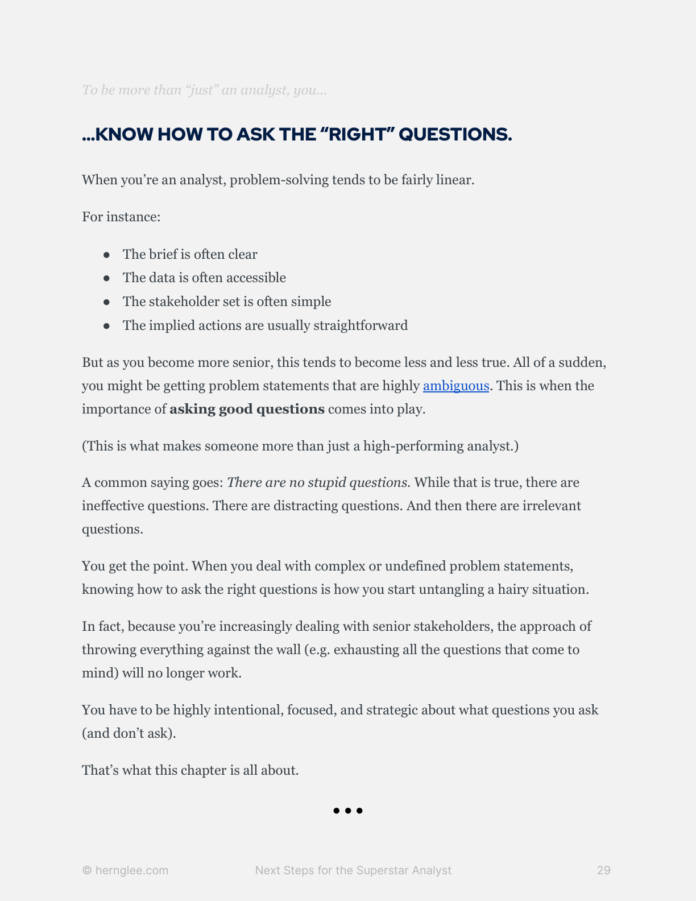

### PDF links

- [ambiguous](<https://www.hernglee.com/blog/ambiguity/>)

## PDF page 030

The ABCDE framework


Here’s the thing: we’ve probably all been told at one point or another to make our

questions more “strategic.” But no one has really told us what exactly makes a question


strategic (and something else less so).


I certainly found this to be a bit annoying. So over time, I started developing my own


mental framework.


Let me be clear: there’s no magic formula for asking brilliant questions; in fact, that’s


not the right mindset at all. You should not expect to run a discussion driven solely by

million-dollar questions; that’s just not how it works.


What you do want, however, is to be intentional about the types of questions you ask –

and _index_ towards high-quality questions.


Tactical questions are important and necessary, but they have a time and a place. It’s all

about balance. Here’s a framework to leverage to make sure you’re asking the right


_portfolio_ of questions to achieve your project goals:


© hernglee.com Next Steps for the Superstar Analyst 30

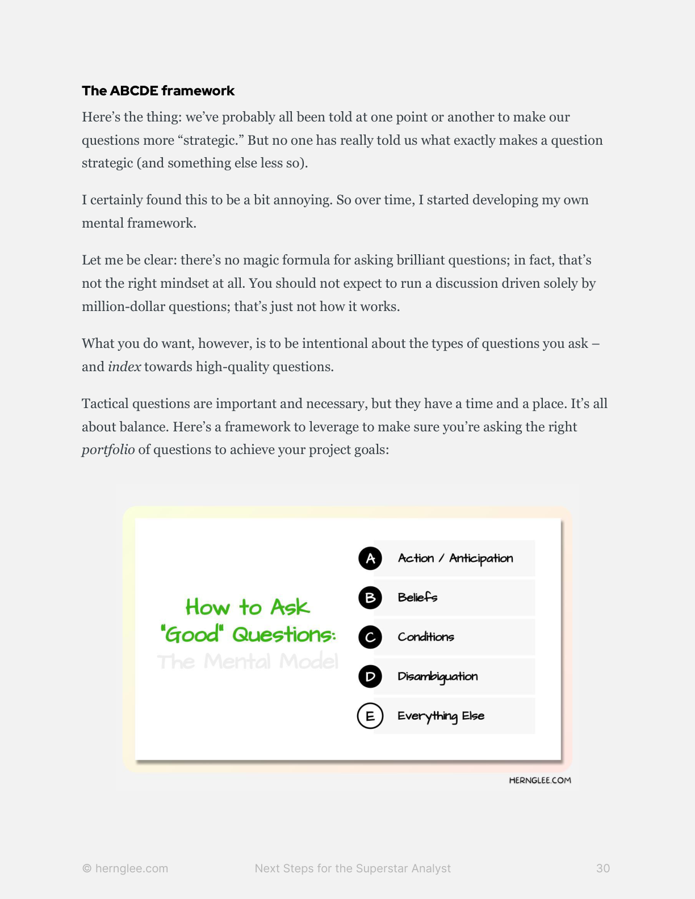

### Image text (OCR 1)

Image bounds in PDF points (left, top, right, bottom): `102.8, 426.2, 509.2, 696.2`. Lines below follow OCR order.

```text
A
Action / Anticipation
B
Beliefs
How to Ask
"Good" Questions:
Conditions
The Mental Model
Disambiguation
E
Everything Else
HERNGLEE.COM
```

## PDF page 031

●●●


Let’s use an example.


Imagine that a business case is being developed to lobby Product leadership to

invest in a new product feature.


The business case is still being built, but you have just now been pulled in to


provide a point of view, as the team wants to consult you before the proposal gets

taken to leadership.


**What kind of questions would you ask?**


📌 A is for Action / Anticipation


Let’s start with the first type of questions.


Strategy is useless if it cannot land. Good questions try to **anticipate** the key steps

required to land something, and/or push people towards **action.**


These types of questions make sure that strategy work doesn’t remain detached from


reality, and that a strategy can turn into an actionable plan.


They can also help cut through fluff and spot bullsh*t, e.g. when big words and colorful

boxes are used on a slide but with very little thought put towards execution.


Some good examples of **anticipating / action-oriented questions** are as follows:


 - _“Which senior leaders need to be fully on board with our proposal, and what is_


_our socialization strategy?”_


 - _“Our proposal says that customers are churning due to the lack of this feature;_


_do we have evidence (and if not, what are our plans to do so)?”_


 - _“What is the revenue at risk if this doesn’t go through, and what is our Plan B?”_


© hernglee.com Next Steps for the Superstar Analyst 31

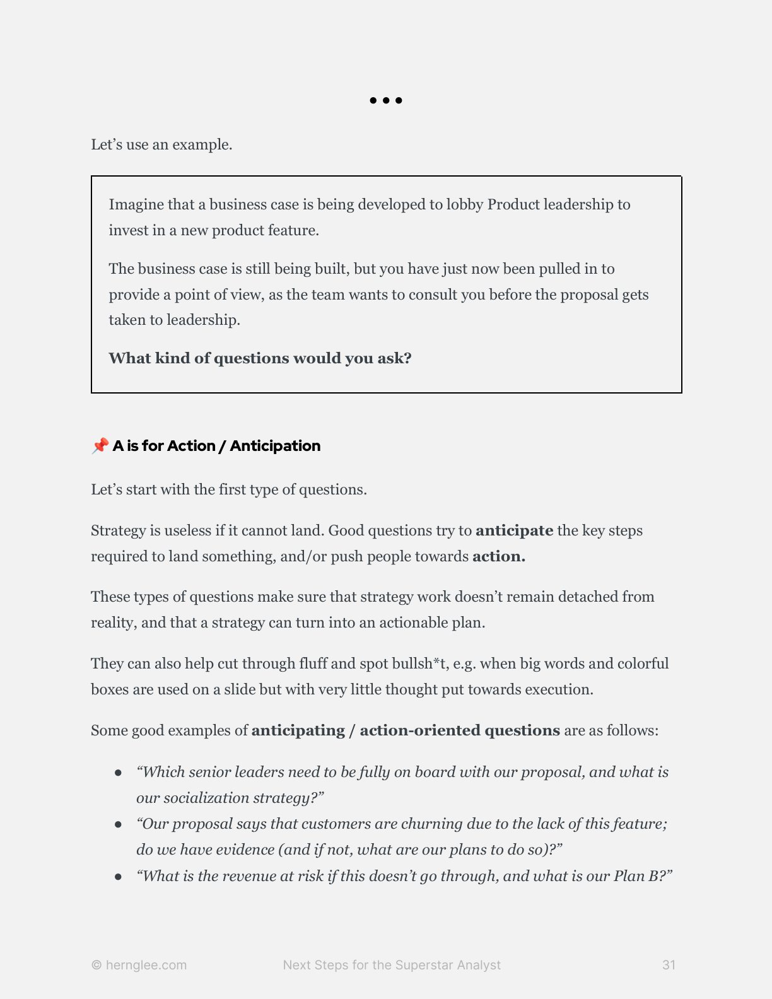

## PDF page 032

There is a fine line, of course: if you bias too much towards action-oriented questions,


you might occasionally find yourself obsessing over tactical and operational details. That

we don’t want.


Similarly, if you think too far ahead when the foundational strategy is yet to be


solidified, you run the risk of putting the cart before the horse. Therefore, these types of


questions are extremely valuable when they are on point – but they do not need to be

bountiful.


And a good meeting can become a great one when there are at least a couple questions


that force people to think about what it’ll _actually_ take to bring the plan to life.


📌 B is for Beliefs


The second type of questions has to do with **beliefs.** These are questions that seek to


tease out where people stand, and what hypotheses they’re holding.


[These questions get people to talk about not just the facts, but their points of view. This](https://www.hernglee.com/blog/strong-pov-site/)

then becomes a great way to drive productive debate. For instance, you might ask:


 - _“How strongly do we believe that this is the biggest opportunity for us to invest_


_in, and not something else?”_


 - _“How do we think our top customers would react if we were to build this feature_


_and indirectly start competing with them?”_


 - _“How much confidence do we have that this particular user trend is here to_


_stay? How strong is our evidence?”_


These types of questions are incredibly useful for another reason: they give you an


opportunity to evaluate the confidence level of a given argument.


Anything can look nice on paper – even the voiceover can be well-rehearsed – but if you

know the right questions to ask, you can tease out so much more nuance and better


gauge how much faith to put into the work.


© hernglee.com Next Steps for the Superstar Analyst 32

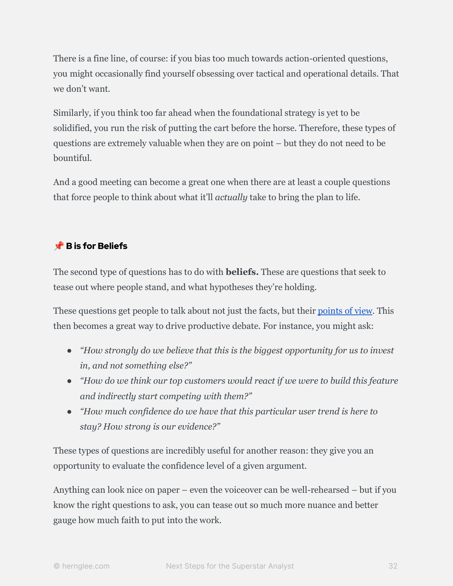

### PDF links

- [points of view](<https://www.hernglee.com/blog/strong-pov-site/>)

## PDF page 033

For instance, I have seen presentations that appeared confidence-inspiring at first, but


all it took was a couple **belief-oriented** questions to reveal that the presenter had not

thought through her arguments, and that the work had to be taken with a grain of salt.


📌 C is for Conditions


The third type of questions are **conditions-based.** This means that you are using

hypothetical questions to pressure-test the logical robustness of a given presentation.


For instance:


 - You might ask about **counterfactual** scenarios: _“If we choose not to build this_


_feature, how likely is it that we can partner with someone to achieve the same_

_result, but more effectively?”_


 - You might ask about **dependencies** : “ _What is the success of this product launch_


_contingent upon?_ ”


 - You might even create **hypothetical** scenarios: _“What if we could only launch_


_this new feature in one market – what guiding principles would we pursue, and_


_what objectives would we optimize for?”_


 - You can **pressure-test:** _“What risks or challenges do we foresee that could_


_render our analysis inaccurate?”_


 - And of course, you can always go back to first principles and challenge the


**assumptions** : _“What assumptions are we implicitly making about our users?_

_What are the three things we absolutely have to believe for these projections to_

_pan out?”_


Conditions-based questions are a double-edged sword.


© hernglee.com Next Steps for the Superstar Analyst 33

## PDF page 034

Sure, these questions can help us sharpen our thinking. But they can also be distracting:


you might find yourself bringing the group down a rabbit hole if your hypothetical

questions don’t help sharpen, well, hypotheses.


📌 D is for Disambiguation


The fourth type of questions we’ll talk about has to do with **disambiguation.** These

kinds of questions are important – but note that they start becoming less “strategic.”


Disambiguation-driven questions simply seek to clarify or fact-find. There’s nothing


wrong with these questions: you just want to make sure that (a) you’re not exclusively


asking these types of questions and that (b) if you struggle for airtime in a meeting, you

probably don’t want to prioritize these types of questions.


Here are some examples:


 - _“What data source did we use to project market growth for the next 5 years?”_


 - _“Which slides are we planning to take to our official meeting with the VP?”_


 - _“When we say we want to build this feature for top customers, what’s the_


_definition of top customers?”_


Again, let me be clear: there’s nothing wrong with these questions. They are more than


valid. In fact, they could just be a lead-in to what we call “the question behind the


question.” For instance:


 - **On data sources for market growth:** Perhaps we find the market growth


projections too optimistic, which would fundamentally affect our business case.


Therefore, it becomes imperative to pressure-test the growth assumptions.


 - **On which slides to take to a VP meeting:** While this is a tactical question, it


can easily lead to a discussion around what proof points and what tone we want

to deliver in order to maximize the chances of landing our materials.


© hernglee.com Next Steps for the Superstar Analyst 34

## PDF page 035

- **On the definition of top customers:** While this appears to be a very specific


question, it is a natural lead-in to a question around where we expect to see

impact, and what part of our portfolio we are trying to solve for. This is critical for


us to establish whether we can justify our business case.


So there you have it: we don’t have to fixate on _only_ asking “strategic” questions.

Disambiguation-driven questions can often be critical.


But again, it’s about balance: live meetings are a precious opportunity to tackle issues


that are inefficient to tackle offline, and the more time you spend on clarification, the


less time you have for actual discussion.


So don’t be afraid of asking basic questions: they are definitely necessary. But just be

mindful of the balance you’re striking, and ask yourself whether your questions were the


best use of everyone’s time.


📌 E is for Everything Else


The last type of question is a catch-all bucket: it’s everything else that doesn’t fit into the


other four.


It’s not to say that these types of questions are never important. But the spirit of the

ABCDE model is this: if you plan to raise a question that doesn’t fall into the first four

buckets – you want to ask yourself _why_ you’re asking it (and that it’s a good use of


everyone’s time).


It’s all about intentionality.


Closing


Some of the best colleagues (and leaders) I’ve worked with don’t come into meetings


with predetermined answers.


© hernglee.com Next Steps for the Superstar Analyst 35

## PDF page 036

Rather, they listen, and they ask sharp and intentional questions.


And somehow, for everyone else, simply thinking through their questions has the effect

of making things clearer than before. Even if there aren’t immediate answers yet.


When it comes to asking good questions: that’s the aspiration!


© hernglee.com Next Steps for the Superstar Analyst 36

## PDF page 037

_To be more than “just” an analyst, you…_

#### …LIVE AND BREATHE “FIRST PRINCIPLES” THINKING.


As an analyst, I loved problem-solving – but only if the problems were straightforward.

Once they became ambiguous, I would find myself getting frustrated.


In fact, I remember telling one of my managers (in full seriousness) that we need to

train our stakeholders to come up with better problem statements.


(I was also very proud of that recommendation at the time.)


My frustration wasn’t unjustified – but it was quite emblematic of how I was used to


operating. I was used to receiving a relatively well-defined problem statement, knocking

it out of the park, submitting it (as if it were homework) – and then rinse and repeat.


But this only gets you so far.


●●●


Where first-principles thinking comes in


[As the years went on, I would gradually learn the importance of dealing with ambiguity.](https://www.hernglee.com/blog/ambiguity/)

And I would also discover how experienced business leaders approach unfamiliar


problems.


It turns out that almost all of them are rigorous **first-principles thinkers.** This allows

them to jump into unfamiliar territory, ask the right questions to orient themselves

quickly, and even set direction for others.


What is first-principles thinking exactly?


© hernglee.com Next Steps for the Superstar Analyst 37

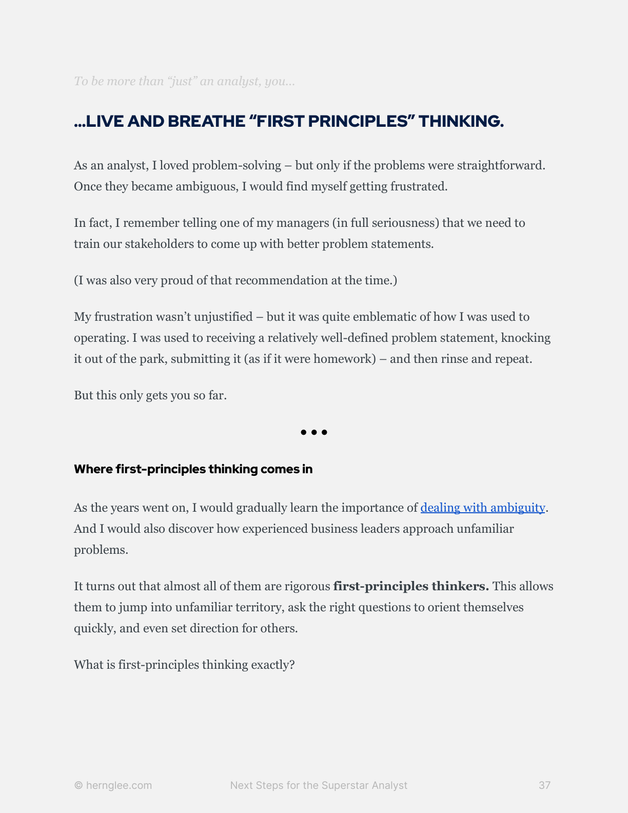

### PDF links

- [dealing with ambiguity](<https://www.hernglee.com/blog/ambiguity/>)

## PDF page 038

It means you approach problems by starting with fundamental truths or assumptions.


You don’t _assume_ too much. You're able to break down a problem into its basic

components, and then reconstruct it from the ground up.


Being first-principles driven also means that you are trained to challenge assumptions


and identify biases, ensuring there is airtight logic behind every decision (to protect the


integrity of anything downstream).


And this is critical – if you want to be able to reason your way out of highly ambiguous

or complex situations.


●●●


An example of first-principles thinking


Let’s use an example to illustrate the beauty of first-principles thinking. Imagine that

you own an ice cream shop, but a store manager runs the business for you.


One day, your store manager comes to you with a proposal: he wants to develop five new


unique ice cream flavors, and is looking for your approval (and money).


At a glance, this seems like a reasonable proposal. But if you were

first-principles-driven, you might engage in the following conversation:


**You:** OK, what are we trying to achieve by developing new ice cream flavors?


**Store Manager:** Well, we want to invest in new flavors because it’ll help us attract new

customers.


**You:** How do we know that?


**Store Manager:** I also run a pizza shop on the side, and whenever we come out with


new flavors, we see first-time customers show up.


**You:** But does that translate to the world of ice cream?


© hernglee.com Next Steps for the Superstar Analyst 38

## PDF page 039

**Store Manager:** Fair point. Maybe, maybe not.


**You:** Fine. And why are we trying to attract new customers?


**Store Manager:** …to make more money, of course?


**You:** Even if new flavors do attract new customers, why would that make us more


money?


**Store Manager:** Because more customers means more sales?


**You:** For how long? How do we know these new customers will keep coming back?


**Store Manager:** Fair point, we don’t. But we can look at some of our past customer


surveys to gain some insight.


**You:** Fine. And why do we want more sales?


**Store Manager:** Because it’ll bring more profits?


**You:** How do we know that? New flavors tend to have lower profit margins. What if a


lot of our existing customer base starts opting for lower-margin flavors instead?


**Store Manager:** Fair point; let me rephrase. I’ll go back and run the projections to see

if we’ll take a hit on overall margins. But I want to emphasize also that the goal is not

necessarily to make more money in the short-term, but rather to tap into an older


demographic who prefer less sugar intake.


**You:** OK, now we’re talking. But why are we trying –


**Store Manager:** …to attract these older folks right? Say no more, I get it now. Well,

we’re losing a lot of business to the store across the street, because many parents prefer


its low-calorie selection and would rather take their kids there. If we can attract these


parents with our healthier new flavors, we’ll more than make back our money from the

additional ice cream they buy for the kids. You know what – I need to redo this plan. Let

me pitch you again in a week.


© hernglee.com Next Steps for the Superstar Analyst 39

## PDF page 040

●●●


How to hone this skill


Here's what it looks like when someone is adept at first-principles thinking.


 - They enjoy the freedom to do things their way. They simply align on guiding


principles with their stakeholders, and are trusted to find a way to get there.


 - They are not intimidated by new challenges, as they can break down situations


into simpler components, and then problem-solve using pattern recognition.


 - They tend to get more opportunities. And when they deliver, they prove


themselves further – and get even more.


So how do we get there? Here are my personal tips.


📌 #1 Ask "why" a lot. Then ask "why" again.


Start by asking "why" a lot. Ask yourself what assumptions you've made behind every

claim or decision. Most of the time we bake implicit assumptions into what we're saying

without realizing it's simply a function of lazy thinking.


For example, in our ice cream shop example: innovating on new flavors seemed like a


no-brainer – why would a business not want to differentiate itself and please its

customers? Seems like a rather trivial point to examine.


But of course, as we untangled the rationale further, we uncovered lazy thinking – and


realized that we need to question some fundamental assumptions. Otherwise every


action downstream could be deeply misguided.


To be clear: there's nothing wrong with jumping to conclusions sometimes. After all,

that's the value of experience. But the more you can demonstrate your ability to


© hernglee.com Next Steps for the Superstar Analyst 40

## PDF page 041

challenge assumptions, the sharper a thinker you become, and the more problems you


can crack. And the more trust you'll gain.


📌 #2 Break things down. Then apply pattern recognition.


People who are adept at breaking problems down into smaller building blocks tend to


thrive in the face of ambiguity. They train themselves to deconstruct problems until

they're able to recognize patterns.


For instance, you might not know how to build a car. And you might not know how to


build an engine. But you know it involves turning energy from one form to another –


and that's a concept that's way more palatable.


Then all of a sudden, at least you have something to grasp at.


People who are good at solving problems know how to simplify and identify patterns.


This helps them gain the trust they need to take on new challenges without always


having demonstrated the corresponding track record.


📌 #3 Bring people along the journey.


I mentioned earlier that at one point in my career I was used to simply taking briefs,


executing, and reporting back great results. And then rinse and repeat.


That's good, but not great – for two reasons.


The first is that when you work in a vacuum, you’re relegated to working on only certain

types of projects – usually those that are well-defined and ringfenced. You’ll miss out on


more complex projects, which tend to require a highly dynamic and iterative approach.


The second is that you miss out on a chance to sharpen your thinking. When you push

yourself to bring people along the journey, it serves as a great forcing mechanism for


© hernglee.com Next Steps for the Superstar Analyst 41

## PDF page 042

you to think through the meta-strategy behind your decisions and ensure there is the


utmost clarity.


You get to explain why you made certain judgment calls, what assumptions you used,

and what evidence you leveraged. And you can check if biases unbeknownst to you


seeped through.


If you don’t push yourself to articulate the _why_ behind your _how –_ you miss out on a

great opportunity to become a more rigorous thinker.


So, here’s a better way of working: Keep the people that matter (e.g. your stakeholders


or managers) in the loop – not on tactical updates, but rather how your decision


principles are evolving due to new developments.


Then people who matter know **how** you approached a tricky problem, in addition to

**what** you delivered at the end. This also gives them the confidence that whatever


success you delivered is likely replicable. You’ll gain more trust as a result.


●●●


Closing


First-principles thinking isn’t the silver bullet to everything – but it is something that I


see some of the best leaders do all the time at Google. It allows them to context-switch at


ease. It also allows them to make sound decisions at the 20,000-foot-level.


And for the superstar analyst looking to gain further trust and handle more complex


problem statements – this is a critical muscle to build.


© hernglee.com Next Steps for the Superstar Analyst 42

## PDF page 043

_To be more than “just” an analyst, you…_

#### …KNOW WHAT CONSTITUTES A PROPER “STRATEGY.”


As a junior analyst, you don’t always get to play a part in decision-making. But as you


gain more experience and trust, you will find yourself increasingly expected to help


shape decisions and build out actionable strategies for others.


But when it comes to strategy-building: this is not necessarily a muscle everybody has.


Strategy-building can sound complex and daunting. We’re not here to trivialize that. But


most situations at work simply require somebody to think rigorously through a few


questions, and to put pen to paper. That alone helps incredible value already.


But not everyone knows how to do that.


So in this chapter, we’ll talk about practical approaches that help anyone write a


strategic plan at work. We’re not interested in complicated frameworks or jargon. We’re


more interested in how to set direction for the team and get sh*t done.


●●●


What is a strategic plan?


For those of us that do not sit in (or even near) the C-Suite – let’s forget about fancy


textbook definitions for a second.


Instead, let’s keep it simple. A strategic plan at its core is simply this: **a document that**

**defines what an org plans to do to achieve its goals.**


The litmus test is also simple: if you swap out the org’s current leader with someone


new, that new person should be able to read this document and know immediately

which buttons to push to enable the team to succeed.


© hernglee.com Next Steps for the Superstar Analyst 43

## PDF page 044

The definition seems trivial, but it’s not. Because I have seen too many instances where


people mistake the following content as strategies:


 - Team mantras or team values


 - Team vision or “narrative”


 - A list of metrics & OKRs


None of these materials are inherently wrong: but they are either tangential or


incomplete when it comes to strategic plan-building.


At best, they distract. At worst, they confuse or mislead.


And as someone trying to become more than “just” a superstar analyst – you need to


watch out for this trap. And you need to call it out when you see this conflation


happening. That is one of the best ways to drive rigor and accountability for your org.


So in the following section, we’ll go through the “building blocks” that make up a proper

strategic plan.


The framework


You run a company that allows people to book spaceships to Jupiter – on demand.


(It’s called Juber btw. No relation to Uber.)


Now, Juber is growing, and you need to build a strategic plan for next year. How


do you get started?


© hernglee.com Next Steps for the Superstar Analyst 44

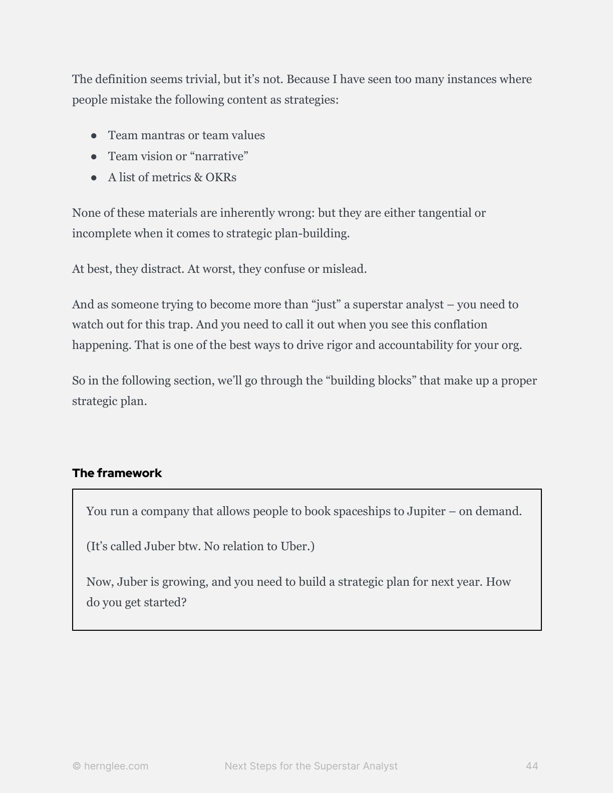

## PDF page 045

Writing a strategic plan can appear daunting at first – where do you start? My


suggestion is to kick things off using the **5W & 1H framework** .


It’s not rocket science (not pun intended) – but it does the trick.


Let’s tackle these questions one by one. Oh, and if you’d like to get the following in a


[simple cheat sheet – you can download it for free here.](https://www.hernglee.com/strategy/)


📌 #1: HOW will we get there?


Establishing outcomes and objectives is often the easy part. Articulating the HOW – i.e.


the levers you’re going to pull in order to get there – is where the rubber hits the road.


And if you cannot be specific about what actions to take – you do not have a plan.


So, in the context of Juber, we might ask ourselves the following questions:


© hernglee.com Next Steps for the Superstar Analyst 45

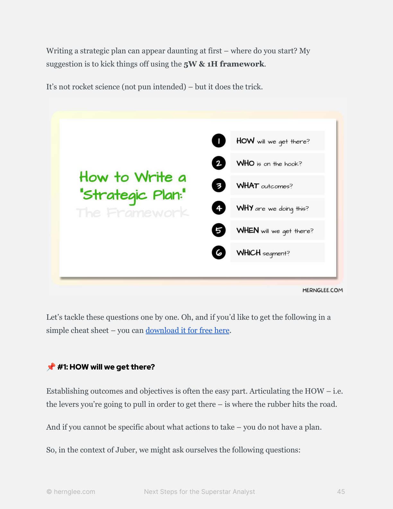

### Image text (OCR 1)

Image bounds in PDF points (left, top, right, bottom): `73.5, 149.9, 541.5, 461.9`. Lines below follow OCR order.

```text
HoW will we get there?
2
WHO is on the hook?
How to Write a
3
WHAT outcomes?
"Strategic Plan:"
The Framework
4
WHY are we doing this?
5
WHEN will we get there?
WHICH segment?
HERNGLEE.COM
```

### PDF links

- [download it for free here](<https://www.hernglee.com/strategy/>)

## PDF page 046

**#1: HOW will we get there?**


**Questions to Ask** **Answers that get us closer to “strategy”**


**What marketing levers do we**
**pull?**


**What strategic partnerships**
**do we need?**


**What product changes**
**should we prioritize?**


**How do we drive repeat**
**customers?**


**What pricing changes do we**
**need to make?**


📌 #2: WHO is on the hook?


We’ll double our user acquisition campaign
budgets this year.


We need to sign deals that give us direct access
to our intended user segment.


Our spaceship matching algorithm breaks often
and needs to be fixed ASAP.


We need to re-design our user experience and
incentive system.


We need to invest further in business experiments
to optimize our pricing.


A plan is only as good as its actionability and accountability.


It’s not good enough to just establish the levers required to deliver desired outcomes.


You need to specify WHO is on the hook to pull those levers. And you want to think


through how to drive that accountability and governance.


Oh, and if you need support (and you likely will) – ask for it. Explicitly. Make those


dependencies crystal clear.


Given that, here are some “WHO” questions to consider:


© hernglee.com Next Steps for the Superstar Analyst 46

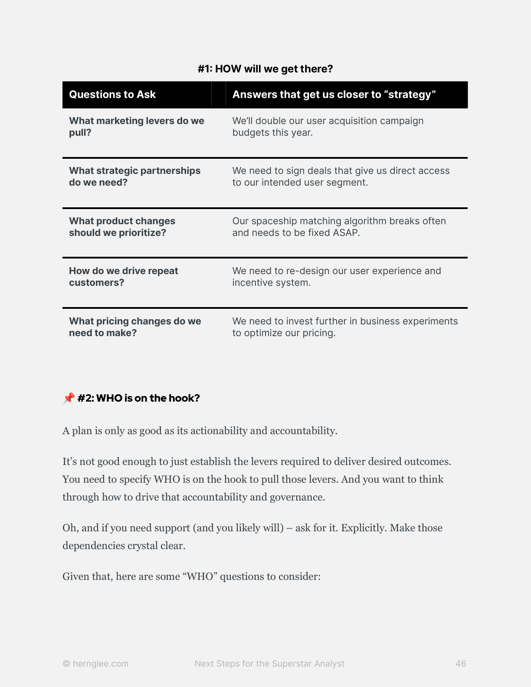

### Table transcription 1

Cell relationships below follow PDF positions.

| Questions to Ask | Answers that get us closer to “strategy” |
| --- | --- |
| What marketing levers do we pull? | We’ll double our user acquisition campaign budgets this year. |
| What strategic partnerships do we need? | We need to sign deals that give us direct access to our intended user segment. |
| What product changes should we prioritize? | Our spaceship matching algorithm breaks often and needs to be fixed ASAP. |
| How do we drive repeat customers? | We need to re-design our user experience and incentive system. |
| What pricing changes do we need to make? | We need to invest further in business experiments to optimize our pricing. |

## PDF page 047

**#2: WHO is on the hook?**


**Questions to Ask** **Answers that get us closer to “strategy”**


**What incremental resourcing**
**is needed?**


**How will we drive proper**
**governance?**


**Which executives need to**
**sign off on this plan?**


**Who will take on ownership**
**of the key OKRs?**


**What dependencies do we**
**have on others?**


📌 #3: WHAT outcomes?


Our ask: +X% more engineering staffing, and +Y%
more marketing budgets.


We will review five northstar metrics on a monthly
basis via a cadenced exec forum.


We have 3 executives and their teams who need
to endorse and fund this plan.


Each executive sponsor will own one OKR, while
one joint OKR will be co-owned.


Secret feature launch is highly dependent on
funding being secured before Q1.


Here’s the thing. A plan can sound fantastic on paper, but if its success (or lack thereof)

can’t be measured – it’s not really a plan.


This leads us to asking “WHAT” questions in order to figure out (a) what “good” looks


like and (b) how we’d measure it. Both are equally critical.


So for example:


© hernglee.com Next Steps for the Superstar Analyst 47

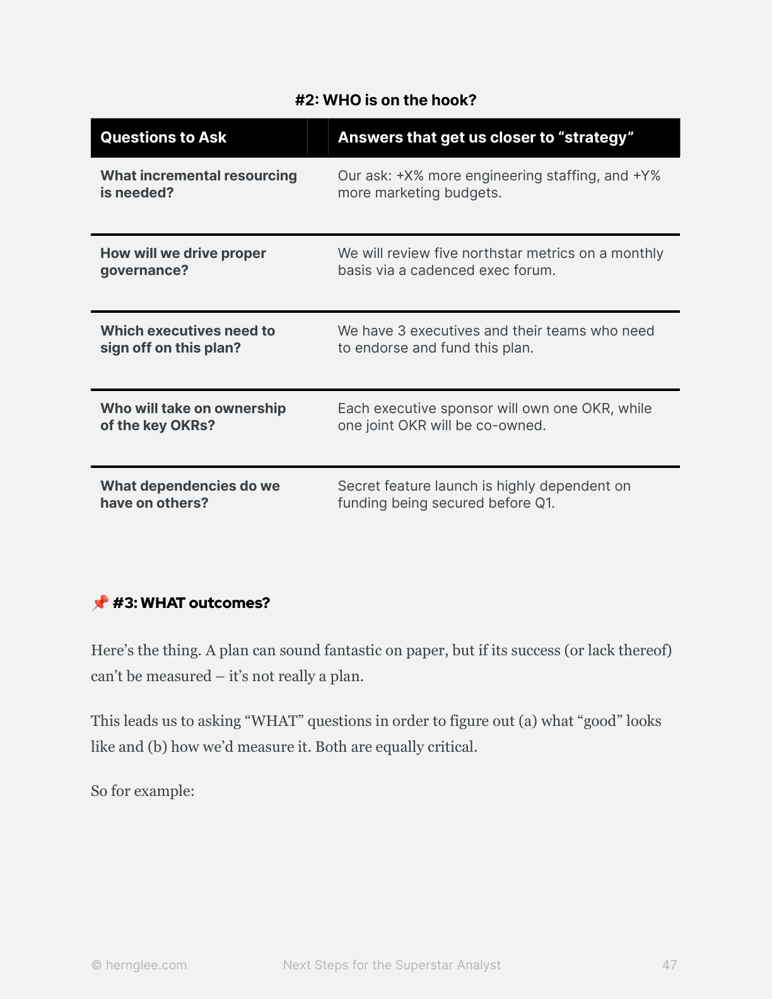

### Table transcription 1

Cell relationships below follow PDF positions.

| Questions to Ask | Answers that get us closer to “strategy” |
| --- | --- |
| What incremental resourcing is needed? | Our ask: +X% more engineering staffing, and +Y% more marketing budgets. |
| How will we drive proper governance? | We will review five northstar metrics on a monthly basis via a cadenced exec forum. |
| Which executives need to sign off on this plan? | We have 3 executives and their teams who need to endorse and fund this plan. |
| Who will take on ownership of the key OKRs? | Each executive sponsor will own one OKR, while one joint OKR will be co-owned. |
| What dependencies do we have on others? | Secret feature launch is highly dependent on funding being secured before Q1. |

## PDF page 048

**#3: WHAT outcomes?**


**Questions to Ask** **Answers that get us closer to “strategy”**


**What are the key metrics of**
**success to track?**


**What does “good” look like**
**for these key metrics?**


**What are the qualitative**
**metrics we’ll track?**


**What leading indicators will**
**we track?**


**What input metrics are**
**important to track?**


📌 #4: WHY are we doing this?


Retention, repeat purchases, active users, and
average ticket size are our northstars.


In order to breakeven in 5 years, we need to reach
XX% in the above metrics this year.


We will focus on improving industry reputation and
customer satisfaction.


We will focus on tracking and optimizing free trial
sign-ups and activation rates.


In order to gain share fast: we will track the # of
travel agencies pitched by our sales team.


A good strategy seeks to answer the fundamental WHY. It attempts to answer: “what is


the goal behind the goal?“


Asking “WHY” is important. Equally important is asking “WHY NOT.” Strategy is about


trade-off’s. Deprioritization is equally important as prioritization – provided that you


have thought through the rationale.


Here are some “WHY” questions to keep in your pocket:


© hernglee.com Next Steps for the Superstar Analyst 48

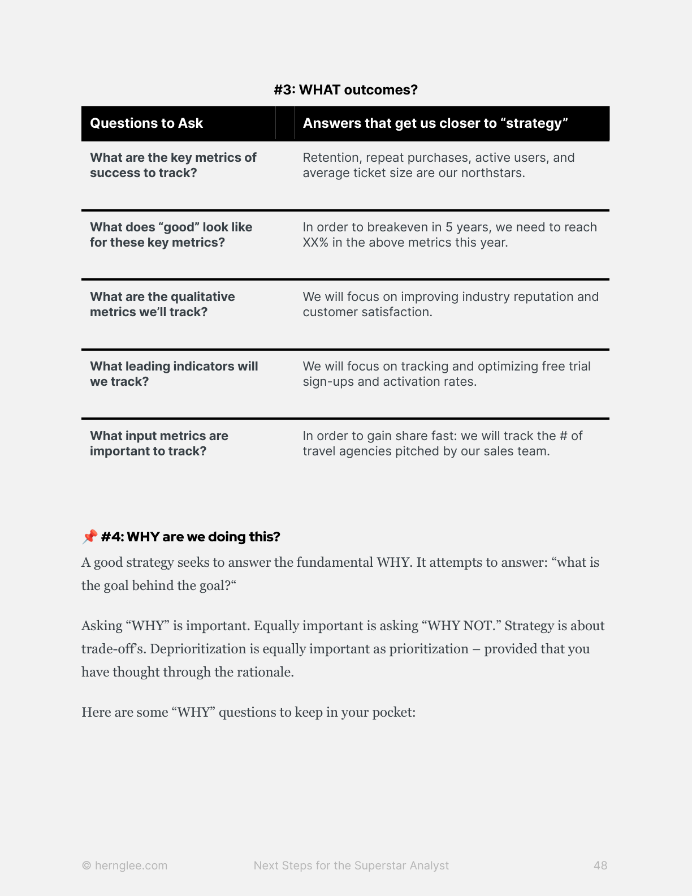

### Table transcription 1

Cell relationships below follow PDF positions.

| Questions to Ask | Answers that get us closer to “strategy” |
| --- | --- |
| What are the key metrics of success to track? | Retention, repeat purchases, active users, and average ticket size are our northstars. |
| What does “good” look like for these key metrics? | In order to breakeven in 5 years, we need to reach XX% in the above metrics this year. |
| What are the qualitative metrics we’ll track? | We will focus on improving industry reputation and customer satisfaction. |
| What leading indicators will we track? | We will focus on tracking and optimizing free trial sign-ups and activation rates. |
| What input metrics are important to track? | In order to gain share fast: we will track the # of travel agencies pitched by our sales team. |

## PDF page 049

**#4: WHY are we doing this?**


**Questions to Ask** **Answers that get us closer to “strategy”**


**Why is user growth the key**
**goal this year?**


**Why is keeping churn at**
**<20% the right goal?**


**Why are we tracking**
**customer satisfaction?**


**Why are we not fixing our**
**payments experience?**


**Why would we not expand to**
**new markets?**


📌 #5: WHEN will we get there?


Space-travelers are loyal and sticky to an app. We
need to gain share before window closes.


This is based on the results of competitive
benchmarking.


Our research shows word-of-mouth to be
extremely critical in new user acquisition.


Analysis shows that despite the issues we’ve
faced, it has the least impact on retention.


Local regulation makes our business only
profitable in select countries.


A good strategy is time-bound; time is money after all. This also improves


accountability.


This is especially important when your efforts do not necessarily materialize right away.


This forces you also to think through the right leading indicators – and how you’ll


leverage them to assess progress accordingly.


(By the same token – watch out when people seek to take credit for lagging indicators


from previous efforts.)


Useful “WHEN” questions thus include:


© hernglee.com Next Steps for the Superstar Analyst 49

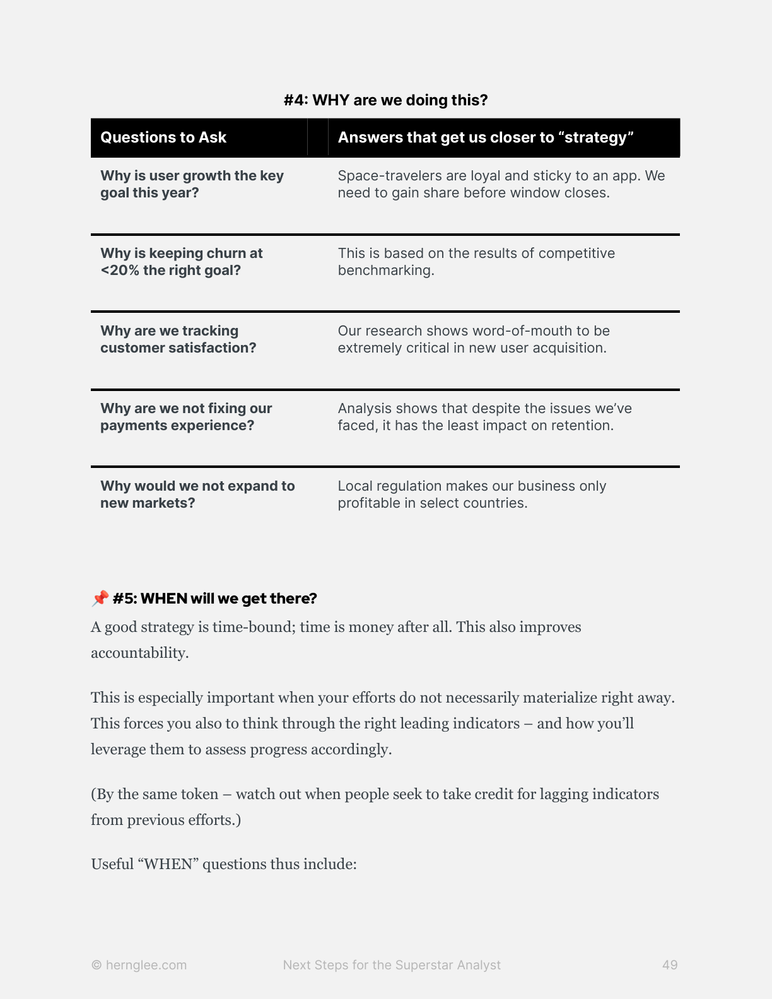

### Table transcription 1

Cell relationships below follow PDF positions.

| Questions to Ask | Answers that get us closer to “strategy” |
| --- | --- |
| Why is user growth the key goal this year? | Space-travelers are loyal and sticky to an app. We need to gain share before window closes. |
| Why is keeping churn at <20% the right goal? | This is based on the results of competitive benchmarking. |
| Why are we tracking customer satisfaction? | Our research shows word-of-mouth to be extremely critical in new user acquisition. |
| Why are we not fixing our payments experience? | Analysis shows that despite the issues we’ve faced, it has the least impact on retention. |
| Why would we not expand to new markets? | Local regulation makes our business only profitable in select countries. |

## PDF page 050

**#5: WHEN will we get there?**


**Questions to Ask** **Answers that get us closer to “strategy”**


**When will we reach our**
**growth targets?**


**What checkpoints will we**
**set along the way?**


**How long does it take to staff**
**our open roles?**


**What tailwinds could**
**accelerate our plan?**


**What dependencies could**
**delay our growth plans?**


📌 #6: WHICH segment?


We plan to achieve XX% user growth within the
next 18 months.


We will set quarterly active user and retention
metric milestones to ensure we are on track.


We need to triple our hiring speed, otherwise we
will not be able to staff according to plan.


Regulation in 3 markets may turn in our favor and
allow us to move faster than expected.


Our biggest risks are our accounts receivable, as
well as our upcoming insurance renewal.


A good strategy is precise and nuanced. Rarely should it be one-size-fits-all.


So figure out where you want to focus. Prioritize (and deprioritize) accordingly. Being


surgical (which is just a fancy way of saying being incredibly precise and targeted) when


it comes to strategy-building is critical.


Good questions include the following:


© hernglee.com Next Steps for the Superstar Analyst 50

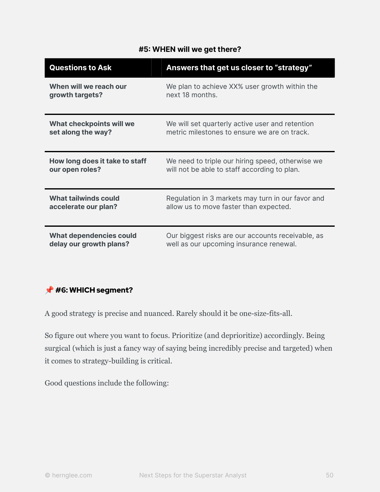

### Table transcription 1

Cell relationships below follow PDF positions.

| Questions to Ask | Answers that get us closer to “strategy” |
| --- | --- |
| When will we reach our growth targets? | We plan to achieve XX% user growth within the next 18 months. |
| What checkpoints will we set along the way? | We will set quarterly active user and retention metric milestones to ensure we are on track. |
| How long does it take to staff our open roles? | We need to triple our hiring speed, otherwise we will not be able to staff according to plan. |
| What tailwinds could accelerate our plan? | Regulation in 3 markets may turn in our favor and allow us to move faster than expected. |
| What dependencies could delay our growth plans? | Our biggest risks are our accounts receivable, as well as our upcoming insurance renewal. |

## PDF page 051

**#6: WHICH segment?**


**Questions to Ask** **Answers that get us closer to “strategy”**


**Which user segments should**
**we focus on?**


**Should we prioritize certain**
**markets?**


**What types of trips are most**
**profitable for us?**


**What part of our user funnel**
**requires focus?**


**How do we prioritize**
**retention vs. acquisition?**


Closing


We will focus on growing average ticket sizes for
luxury spaceship riders.


Our monetisation metrics heavily lag competitors
in 3 markets; need to prioritize.


Drunk spaceship bookings are an underserved
segment; this will be our big bet.


We are losing half our users before the insurance
booking page; need to optimize.


We will focus on retention as analysis shows we
get 5x ROI from investing in it (vs. acquisition).


Building a thorough strategic plan is hard. But the ability to do so is the difference


between a high-performing analyst, versus someone who is trusted to set direction for


other people and lead.


So leverage this framework, and experiment with these types of questions at your next


strategic planning session.


You may not have all the answers right away. But sometimes you can deliver incredible


value already just by asking the right questions and helping the team think in the right


direction.


© hernglee.com Next Steps for the Superstar Analyst 51

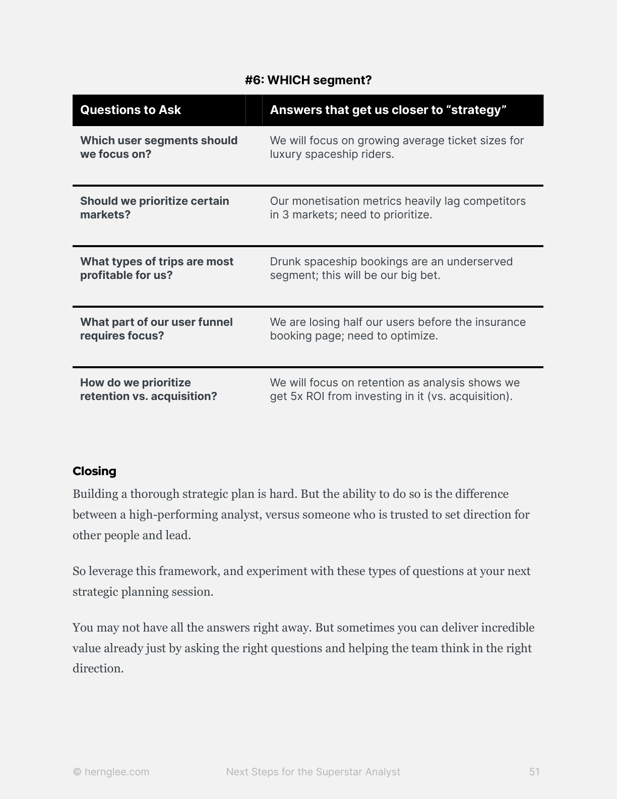

### Table transcription 1

Cell relationships below follow PDF positions.

| Questions to Ask | Answers that get us closer to “strategy” |
| --- | --- |
| Which user segments should we focus on? | We will focus on growing average ticket sizes for luxury spaceship riders. |
| Should we prioritize certain markets? | Our monetisation metrics heavily lag competitors in 3 markets; need to prioritize. |
| What types of trips are most profitable for us? | Drunk spaceship bookings are an underserved segment; this will be our big bet. |
| What part of our user funnel requires focus? | We are losing half our users before the insurance booking page; need to optimize. |
| How do we prioritize retention vs. acquisition? | We will focus on retention as analysis shows we get 5x ROI from investing in it (vs. acquisition). |

## PDF page 052

#### Last, But Not Least…

[Could you take 5 seconds and answer one question](https://subscribepage.io/blueprint-feedback) for me? The feedback you provide

allows me to create better and more relevant content 🙂


🧠 [I also write a weekly newsletter](https://www.hernglee.com/popular-posts/) for high-performing individual contributors

(ICs) in tech and beyond. Subscribe for free to get it directly in your inbox.


You might also enjoy my other original content:


  - <u>[How to Build Kickass Slides](https://hernglee.gumroad.com/l/slide-science)</u> (50-page PDF)


  - <u>[Demystifying Strategy & Operations](https://hernglee.gumroad.com/l/stratops)</u> (60-page PDF)


[Thank you for reading! I hope you found this guide helpful. Drop me a note](https://www.linkedin.com/in/hernglee/) on


LinkedIn and let me know your feedback.


© hernglee.com Next Steps for the Superstar Analyst 52

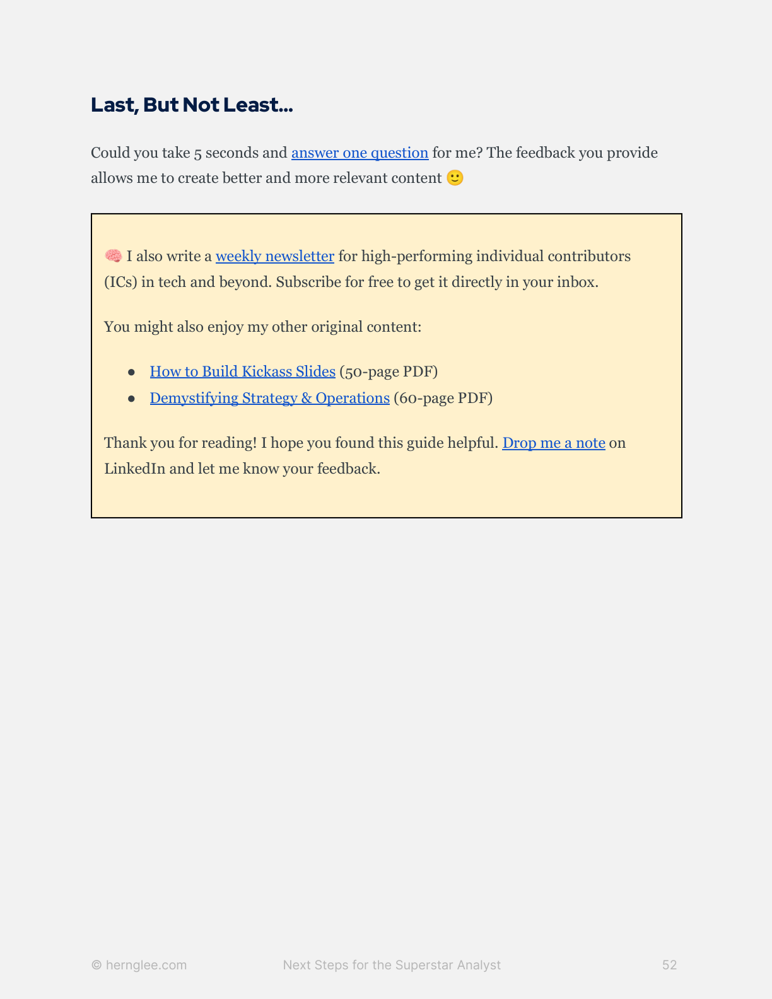

### PDF links

- [answer one question](<https://subscribepage.io/blueprint-feedback>)
- [weekly newsletter](<https://www.hernglee.com/popular-posts/>)
- [How to Build Kickass Slides](<https://hernglee.gumroad.com/l/slide-science>)
- [Demystifying Strategy & Operations](<https://hernglee.gumroad.com/l/stratops>)
- [Drop me a note](<https://www.linkedin.com/in/hernglee/>)
