# Packs

`ts-packwerk docs --out` writes this page from every `pack.yml`, and `ts-packwerk docs --check` fails when it is stale.

```mermaid
flowchart TD
  subgraph p_layer_app["app"]
    p_apps_api_src["apps/api/src"]
    p_apps_web_src["apps/web/src"]
  end
  subgraph p_layer_legacy["legacy"]
    p_apps_api_src_legacy_decks["apps/api/src/legacy-decks"]
  end
  subgraph p_layer_feature["feature"]
    p_apps_api_src_account["apps/api/src/account"]
    p_apps_api_src_aira["apps/api/src/aira"]
    p_apps_api_src_doom["apps/api/src/doom"]
    p_apps_api_src_mcp["apps/api/src/mcp"]
    p_apps_api_src_oauth["apps/api/src/oauth"]
    p_apps_api_src_usage["apps/api/src/usage"]
    p_apps_web_src_aira["apps/web/src/aira"]
    p_apps_web_src_connect["apps/web/src/connect"]
    p_apps_web_src_core["apps/web/src/core"]
    p_apps_web_src_credits["apps/web/src/credits"]
    p_apps_web_src_decks["apps/web/src/decks"]
    p_apps_web_src_doom_editor["apps/web/src/doom-editor"]
    p_apps_web_src_editor["apps/web/src/editor"]
    p_apps_web_src_export["apps/web/src/export"]
    p_apps_web_src_present["apps/web/src/present"]
    p_apps_web_src_pricing["apps/web/src/pricing"]
    p_apps_web_src_settings["apps/web/src/settings"]
  end
  subgraph p_layer_shared["shared"]
    p_apps_web_src_design["apps/web/src/design"]
    p_apps_web_src_editing["apps/web/src/editing"]
  end
  subgraph p_layer_platform["platform"]
    p_apps_api_src_platform["apps/api/src/platform"]
    p_apps_web_src_components["apps/web/src/components"]
    p_apps_web_src_copy["apps/web/src/copy"]
    p_apps_web_src_lib["apps/web/src/lib"]
  end
  p_packages_document_src_doom["packages/document/src/doom"]
  p_packages_mcp["packages/mcp"]
  p_apps_api_src --> p_apps_api_src_account
  p_apps_api_src --> p_apps_api_src_aira
  p_apps_api_src --> p_apps_api_src_doom
  p_apps_api_src --> p_apps_api_src_legacy_decks
  p_apps_api_src --> p_apps_api_src_mcp
  p_apps_api_src --> p_apps_api_src_oauth
  p_apps_api_src --> p_apps_api_src_platform
  p_apps_api_src --> p_apps_api_src_usage
  p_apps_api_src_account --> p_packages_mcp
  p_apps_api_src_account --> p_apps_api_src_doom
  p_apps_api_src_account --> p_apps_api_src_oauth
  p_apps_api_src_account --> p_apps_api_src_platform
  p_apps_api_src_aira --> p_packages_mcp
  p_apps_api_src_aira --> p_apps_api_src_account
  p_apps_api_src_aira --> p_apps_api_src_platform
  p_apps_api_src_aira --> p_apps_api_src_usage
  p_apps_api_src_doom --> p_apps_api_src_platform
  p_apps_api_src_legacy_decks --> p_apps_api_src_doom
  p_apps_api_src_legacy_decks --> p_apps_api_src_platform
  p_apps_api_src_mcp --> p_packages_mcp
  p_apps_api_src_mcp --> p_apps_api_src_account
  p_apps_api_src_mcp --> p_apps_api_src_doom
  p_apps_api_src_mcp --> p_apps_api_src_platform
  p_apps_api_src_oauth --> p_apps_api_src_platform
  p_apps_api_src_usage --> p_apps_api_src_account
  p_apps_api_src_usage --> p_apps_api_src_platform
  p_apps_web_src --> p_apps_web_src_aira
  p_apps_web_src --> p_apps_web_src_components
  p_apps_web_src --> p_apps_web_src_connect
  p_apps_web_src --> p_apps_web_src_copy
  p_apps_web_src --> p_apps_web_src_decks
  p_apps_web_src --> p_apps_web_src_design
  p_apps_web_src --> p_apps_web_src_doom_editor
  p_apps_web_src --> p_apps_web_src_editing
  p_apps_web_src --> p_apps_web_src_editor
  p_apps_web_src --> p_apps_web_src_export
  p_apps_web_src --> p_apps_web_src_lib
  p_apps_web_src --> p_apps_web_src_present
  p_apps_web_src --> p_apps_web_src_settings
  p_apps_web_src_aira --> p_apps_web_src_components
  p_apps_web_src_aira --> p_apps_web_src_copy
  p_apps_web_src_aira --> p_apps_web_src_editor
  p_apps_web_src_aira --> p_apps_web_src_lib
  p_apps_web_src_components --> p_apps_web_src_copy
  p_apps_web_src_components --> p_apps_web_src_lib
  p_apps_web_src_connect --> p_apps_web_src_components
  p_apps_web_src_connect --> p_apps_web_src_copy
  p_apps_web_src_connect --> p_apps_web_src_decks
  p_apps_web_src_credits --> p_apps_web_src_components
  p_apps_web_src_credits --> p_apps_web_src_copy
  p_apps_web_src_credits --> p_apps_web_src_editor
  p_apps_web_src_credits --> p_apps_web_src_lib
  p_apps_web_src_credits --> p_apps_web_src_settings
  p_apps_web_src_decks --> p_apps_web_src_components
  p_apps_web_src_decks --> p_apps_web_src_copy
  p_apps_web_src_decks --> p_apps_web_src_editing
  p_apps_web_src_decks --> p_apps_web_src_editor
  p_apps_web_src_decks --> p_apps_web_src_lib
  p_apps_web_src_design --> p_apps_web_src_components
  p_apps_web_src_design --> p_apps_web_src_copy
  p_apps_web_src_design --> p_apps_web_src_editing
  p_apps_web_src_design --> p_apps_web_src_lib
  p_apps_web_src_doom_editor --> p_apps_web_src_aira
  p_apps_web_src_doom_editor --> p_apps_web_src_components
  p_apps_web_src_doom_editor --> p_apps_web_src_copy
  p_apps_web_src_doom_editor --> p_apps_web_src_decks
  p_apps_web_src_doom_editor --> p_apps_web_src_design
  p_apps_web_src_doom_editor --> p_apps_web_src_editing
  p_apps_web_src_doom_editor --> p_apps_web_src_editor
  p_apps_web_src_doom_editor --> p_apps_web_src_lib
  p_apps_web_src_doom_editor --> p_apps_web_src_present
  p_apps_web_src_editing --> p_apps_web_src_components
  p_apps_web_src_editing --> p_apps_web_src_copy
  p_apps_web_src_editor --> p_apps_web_src_components
  p_apps_web_src_editor --> p_apps_web_src_copy
  p_apps_web_src_editor --> p_apps_web_src_design
  p_apps_web_src_editor --> p_apps_web_src_editing
  p_apps_web_src_editor --> p_apps_web_src_export
  p_apps_web_src_editor --> p_apps_web_src_lib
  p_apps_web_src_export --> p_apps_web_src_components
  p_apps_web_src_export --> p_apps_web_src_copy
  p_apps_web_src_export --> p_apps_web_src_editing
  p_apps_web_src_present --> p_apps_web_src_components
  p_apps_web_src_present --> p_apps_web_src_copy
  p_apps_web_src_present --> p_apps_web_src_editing
  p_apps_web_src_present --> p_apps_web_src_editor
  p_apps_web_src_present --> p_apps_web_src_lib
  p_apps_web_src_pricing --> p_apps_web_src_components
  p_apps_web_src_pricing --> p_apps_web_src_decks
  p_apps_web_src_settings --> p_apps_web_src_components
  p_apps_web_src_settings --> p_apps_web_src_copy
  p_apps_web_src_settings --> p_apps_web_src_decks
  p_apps_web_src_settings --> p_apps_web_src_lib
```

| Pack | Layer | Public | Dependencies | Tables |
| --- | --- | --- | --- | --- |
| `apps/api/src` | app | index.ts | apps/api/src/account, apps/api/src/aira, apps/api/src/doom, apps/api/src/legacy-decks, apps/api/src/mcp, apps/api/src/oauth, apps/api/src/platform, apps/api/src/usage | none |
| `apps/api/src/account` | feature | account-route.ts, account.ts, caller-log.ts, session-cookie.ts | packages/mcp, apps/api/src/doom, apps/api/src/oauth, apps/api/src/platform | session.account, session.access, session.code, session.sent, session.caller_log |
| `apps/api/src/aira` | feature | aira-closing.ts, aira-route.ts, aira-usage-route.ts, aira.ts, anthropic-transport.ts | packages/mcp, apps/api/src/account, apps/api/src/platform, apps/api/src/usage | session.aira_turn, session.aira_ask |
| `apps/api/src/doom` | feature | deck-findings.ts, deck-followers.ts, deck-list.ts, deck-pictures.ts, doom-deck.ts, doom-route.ts, doom-start.ts, media.ts, original.ts | apps/api/src/platform | deck.doom, deck.doom_edit, deck.doom_node, deck.media, deck.original_delete |
| `apps/api/src/legacy-decks` | legacy | deck-watch.ts, findings-route.ts, saved.ts, undo.ts | apps/api/src/doom, apps/api/src/platform | deck.saved, deck.once |
| `apps/api/src/mcp` | feature | mcp.ts | packages/mcp, apps/api/src/account, apps/api/src/doom, apps/api/src/platform | none |
| `apps/api/src/oauth` | feature | agent-key.ts, clients.ts, consent.ts, discovery.ts, grants.ts, tokens.ts | apps/api/src/platform | session.oauth_client, session.oauth_grant, session.oauth_token |
| `apps/api/src/platform` | platform | answer.ts, deck-answer.ts, font-route.ts, forward-secret.ts, image-fetch.ts, listen.ts, local-original-store.ts, mail.ts, original-store.ts, pool.ts, provision.ts, r2-original-store.ts, resource.ts, schema.ts, secrets.ts, start-origins.ts, start-settings.ts | none | none |
| `apps/api/src/usage` | feature | aira-ledger.ts, credits-route.ts, credits.ts | apps/api/src/account, apps/api/src/platform | session.aira_ledger, session.credits, session.credit_history |
| `apps/web/src` | app | none | apps/web/src/aira, apps/web/src/components, apps/web/src/connect, apps/web/src/copy, apps/web/src/decks, apps/web/src/design, apps/web/src/doom-editor, apps/web/src/editing, apps/web/src/editor, apps/web/src/export, apps/web/src/lib, apps/web/src/present, apps/web/src/settings | none |
| `apps/web/src/aira` | feature | aira-loop.ts, aira-panel.tsx, aira-prompts.ts, aira-usage.ts, aira-wire.ts, usage-ring.tsx | apps/web/src/components, apps/web/src/copy, apps/web/src/editor, apps/web/src/lib | none |
| `apps/web/src/components` | platform | ai-elements/chain-of-thought.tsx, ai-elements/conversation-follow.ts, ai-elements/conversation.tsx, ai-elements/message.tsx, ai-elements/prompt-input.tsx, ai-elements/tool.tsx, ui/announcer.tsx, ui/button.tsx, ui/card.tsx, ui/collapsible.tsx, ui/context-menu.tsx, ui/dialog.tsx, ui/dropdown-menu.tsx, ui/input.tsx, ui/popover.tsx, ui/select.tsx, ui/skeleton.tsx, ui/slider.tsx, ui/sonner.tsx, ui/status-pill.tsx, ui/switch.tsx, ui/textarea.tsx, ui/toast.tsx | apps/web/src/copy, apps/web/src/lib | none |
| `apps/web/src/connect` | feature | oauth-authorize.tsx | apps/web/src/components, apps/web/src/copy, apps/web/src/decks | none |
| `apps/web/src/copy` | platform | account-copy.ts, adjust-tone-copy.ts, aira-copy.ts, appearance-copy.ts, body-copy.ts, border-copy.ts, box-copy.ts, color-copy.ts, color-name-copy.ts, connect-copy.ts, connection-copy.ts, credits-copy.ts, design-copy.ts, doom-editor-copy.ts, effects-copy.ts, element-copy.ts, fill-copy.ts, format-copy.ts, frame-copy.ts, geometry-copy.ts, guide-copy.ts, identity-copy.ts, link-copy.ts, notes-copy.ts, opacity-copy.ts, option-copy.ts, picture-copy.ts, placeholder-copy.ts, present-copy.ts, product-copy.ts, selection-colors-copy.ts, settings-copy.ts, shape-copy.ts, shortcut-copy.ts, slide-list-copy.ts, slide-number-copy.ts, template-style-copy.ts, text-copy.ts, toolbar-copy.ts, transition-copy.ts, undo-copy.ts, unshown-copy.ts, usage-copy.ts | none | none |
| `apps/web/src/core` | feature | none | none | none |
| `apps/web/src/credits` | feature | credits-cards.tsx, limit-panel.tsx, use-credits.ts | apps/web/src/components, apps/web/src/copy, apps/web/src/editor, apps/web/src/lib, apps/web/src/settings | none |
| `apps/web/src/decks` | feature | agent-logos.ts, airdesign-mark.tsx, danger-dialog.tsx, deck-glyph.tsx, deck-notice.tsx, deck-time.ts, decks-shell.tsx, delete-account.tsx, home.tsx, move-deck.ts, not-found-page.tsx, screens/deck-moved-toast.tsx | apps/web/src/components, apps/web/src/copy, apps/web/src/editing, apps/web/src/editor, apps/web/src/lib | none |
| `apps/web/src/design` | shared | appearance-presets.ts, color-choices.ts, color-names.ts, color-picker.tsx, control-views.ts, controls/color.tsx, controls/link.tsx, controls/picture-adjust.tsx, controls/text.tsx, controls/union.tsx, corners-control.ts, crop-change.ts, design-change.ts, effects-list.ts, eyedropper.ts, fill-image.ts, fill-slots.ts, frame-panel.ts, node-names.ts, opacity-control.ts, panel-arrangement.ts, panel-folds.ts, panel-order.ts, panel.ts, preset-icons.ts, rebase.ts, selected-weight.ts, selection-colors.ts, served-faces.ts, site-names.ts, spacing-units.ts, text-style-edit.tsx, trait-controls.ts, trait-edit.ts, typed-number.ts, weight-step.ts | apps/web/src/components, apps/web/src/copy, apps/web/src/editing, apps/web/src/lib | none |
| `apps/web/src/doom-editor` | feature | doom-editor.tsx, node-props.ts | apps/web/src/aira, apps/web/src/components, apps/web/src/copy, apps/web/src/decks, apps/web/src/design, apps/web/src/editing, apps/web/src/editor, apps/web/src/lib, apps/web/src/present | none |
| `apps/web/src/editing` | shared | canvas-slide.ts, canvas-source.ts, command-store.ts, commit-edit.ts, design-rows.ts, device-copy.ts, element-move.ts, exported-parts.ts, fill-plan.ts, frame-boxes.ts, group-boxes.ts, icon-redraw.ts, index-deck.ts, indexed-register.ts, layer-clipboard.ts, live-repaint.ts, notes-edit.ts, numbered-text.ts, paint-css.ts, paint-structure.ts, painted-picture.ts, patch-images.ts, picture-file.ts, picture-fill.ts, slide-edit.ts, slide-floor.ts, slide-layout.ts, slide-paint.ts, undo-list.ts | apps/web/src/components, apps/web/src/copy | none |
| `apps/web/src/editor` | feature | adjust-tone.tsx, agent-panel.tsx, auto-layout-removal.ts, canvas-zoom.ts, deck-colors.ts, design-panel-art.ts, design-panel.tsx, editor-chrome.tsx, editor-frame.tsx, editor-grid.tsx, editor-icons.tsx, editor-key-ownership.ts, editor-shell.tsx, editor-toolbar.tsx, element-title-actions.tsx, frame-fit-action.ts, gallery-deck.ts, grid-drop.ts, group-actions.ts, icon-search.tsx, inserts.ts, kept-panel.ts, layer-join.ts, live-design-panel.tsx, notes-bar.tsx, painted-ahead.ts, panel-fields.ts, panel-switch.tsx, picture-picker.ts, picture-preview.tsx, pointer-tool.ts, remove-auto-layout.tsx, resizable-panel.tsx, revenue-slide.tsx, screens/editor-view.tsx, selection-colors-section.tsx, shape-grid.tsx, shape-tool.tsx, slide-guides.ts, slide-sidebar.tsx, slide-thumb.tsx, template-style-card.tsx, tone-link.ts, tone-scope.ts, use-canvas-room.ts, use-deck-paint.ts, use-deck-status.ts, use-undo.ts, view-bar.tsx, zoom-menu.tsx | apps/web/src/components, apps/web/src/copy, apps/web/src/design, apps/web/src/editing, apps/web/src/export, apps/web/src/lib | none |
| `apps/web/src/export` | feature | chosen-parts.ts, export-control.tsx, export-deck.ts, export-options.ts | apps/web/src/components, apps/web/src/copy, apps/web/src/editing | none |
| `apps/web/src/lib` | platform | class-names.ts | none | none |
| `apps/web/src/present` | feature | notes-on.ts, present-button.tsx, present-keys.ts, present-layer.tsx, slide-shows.ts, use-leaving.ts, use-present.ts | apps/web/src/components, apps/web/src/copy, apps/web/src/editing, apps/web/src/editor, apps/web/src/lib | none |
| `apps/web/src/pricing` | feature | none | apps/web/src/components, apps/web/src/decks | none |
| `apps/web/src/settings` | feature | account-load.ts, account-page.tsx, account-profile.tsx, agents-page.tsx, screens/usage-tab.tsx, settings-controls.tsx, settings-frame.tsx, settings-page.tsx, settings-routes.ts, settings-sample.ts, usage-page.tsx | apps/web/src/components, apps/web/src/copy, apps/web/src/decks, apps/web/src/lib | none |
| `packages/document/src/doom` | none | index.ts | none | none |
| `packages/mcp` | none | runtime: packages/mcp/src/index.ts; evals: packages/mcp/src/evals.ts | none | none |
