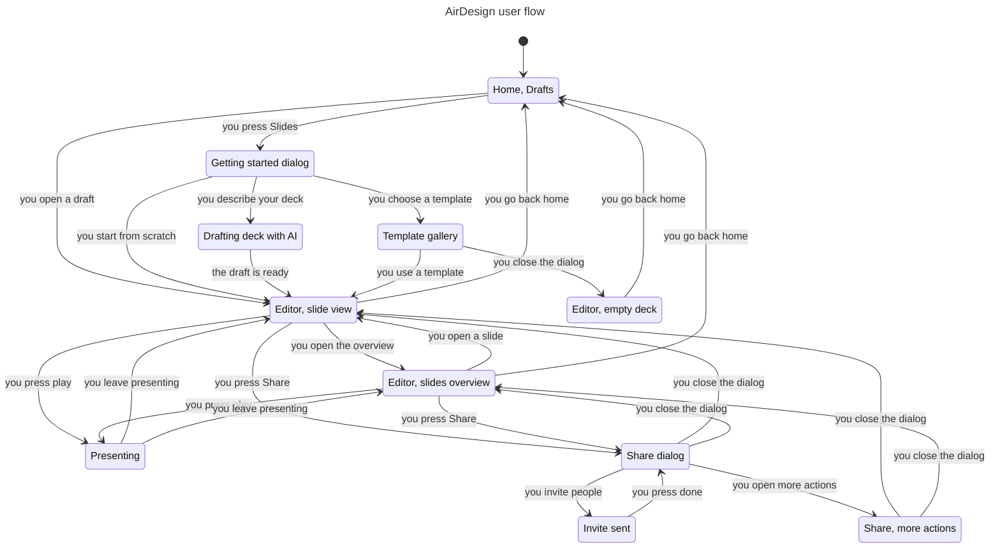

# User flow

Checked with TLA+ (TLC). Rules that hold: presenting shows nothing on top, canvas and inspector layout agree, Share needs a slide, a template never drops your work, leaving focus mode keeps the canvas, removing every slide ends presenting.

