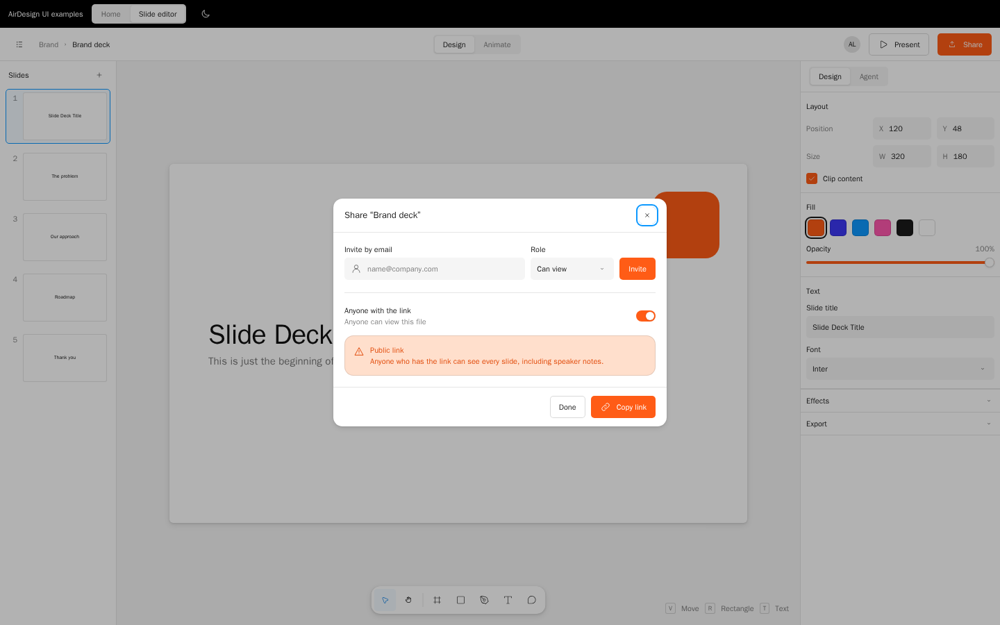
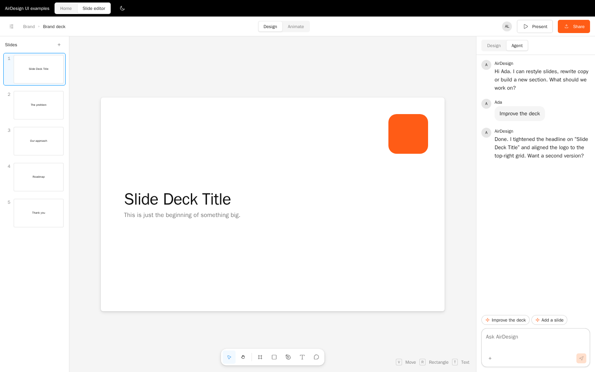

# Examples

Two mock screens built only from `@airdesign/ui`, in a small Vite app. They exercise the kit the way the real app would.

```sh
npm run build          # in the repo root, once (the app links the package from ../)
cd examples && npm install && npm run dev
```

- **Home** (`src/Home.tsx`): sidebar navigation, search, tabs, file cards with a Popover menu, loading Skeletons, an EmptyState when search finds nothing.
- **Slide editor** (`src/Editor.tsx`): top bar with breadcrumbs, mode tabs and Share; slide list; canvas with a floating Toolbar; inspector with PropertySection, NumberField, ColorSwatch (changes the shape live), Slider, Select and Accordion; an AI Agent tab with ChatThread and ChatComposer; a Share Dialog with Input, Select, Switch and an Alert.
- Toggle dark mode with the moon button, or open the app with `?dark`.





Linking note: when an app links the kit from a folder that has its own `react`, set `resolve.dedupe: ["react", "react-dom"]` (see `vite.config.ts`) or you get "Cannot read properties of null (reading 'useState')". A normal install from npm does not need this.
