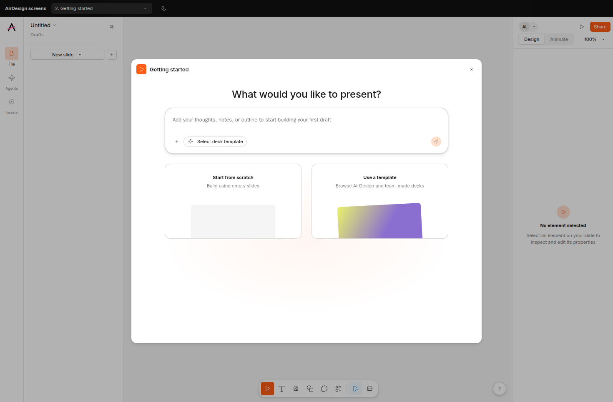
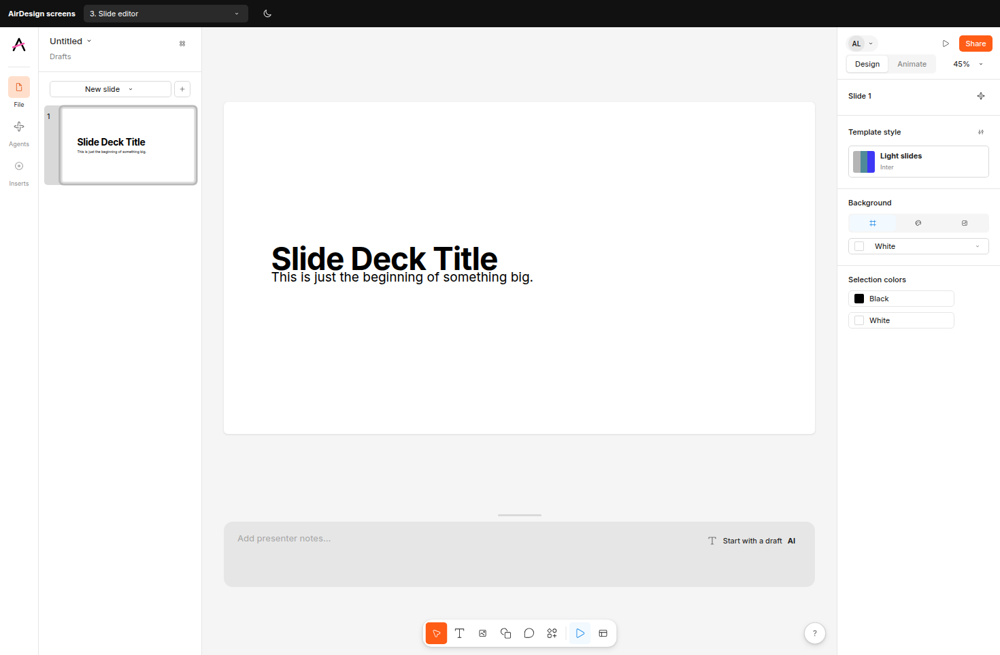
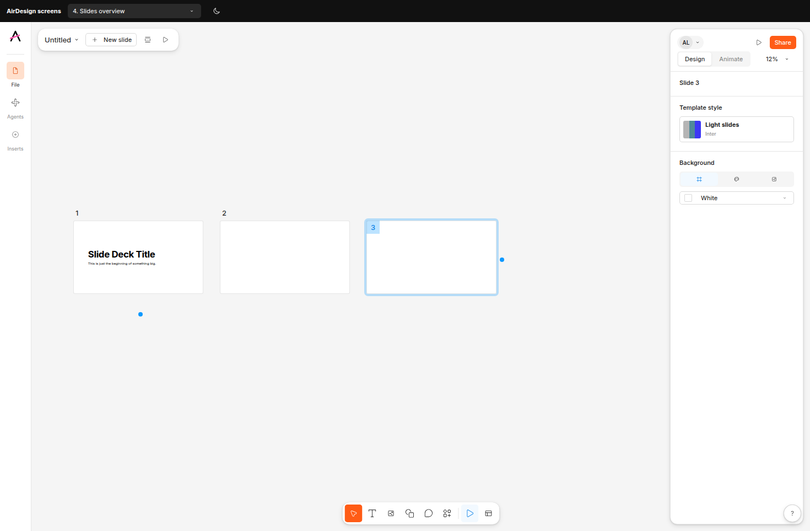
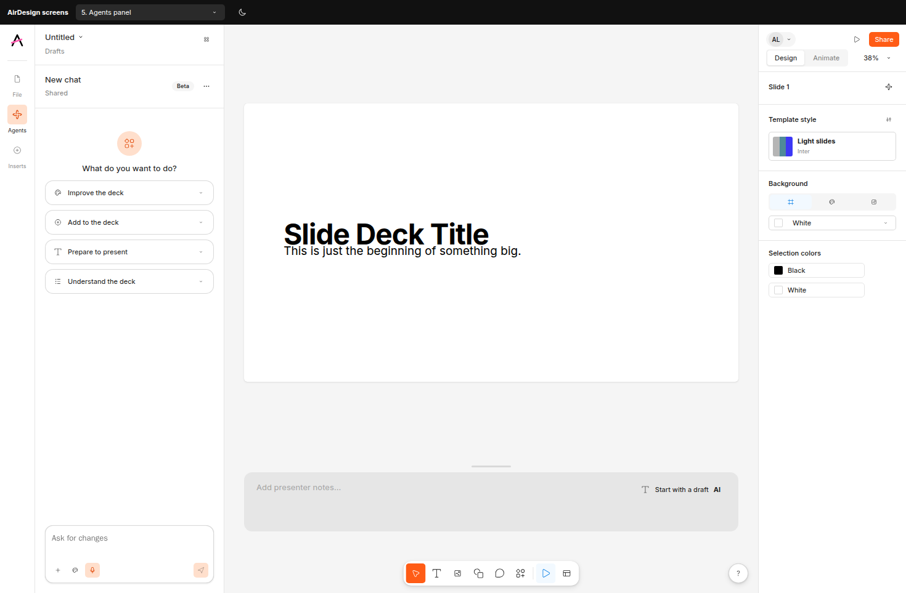
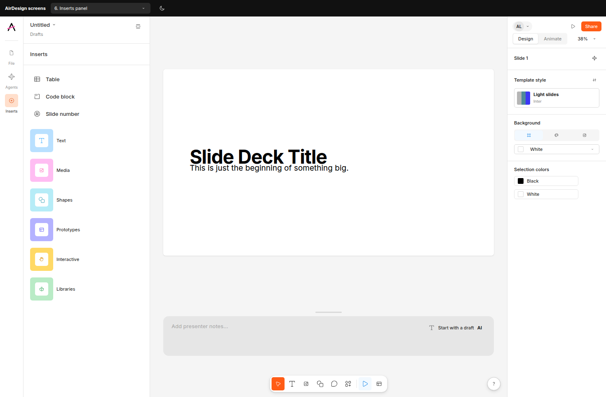

# Examples

The 11 AirDesign screens, rebuilt from `@airdesign/ui` in a small Vite app. Use the dropdown at the top to switch screens (or open `#home`, `#start`, `#slide`, `#overview`, `#agents`, `#inserts`, `#inserts-overview`, `#media-overview`, `#media`, `#shapes`, `#share`).

```sh
npm run build          # in the repo root, once (the app links the package from ../)
cd examples && npm install && npm run dev
```

| Screen | Built with |
|---|---|
| Home, Drafts (`HomeDrafts.tsx`) | `Sidebar`, `SearchField`, `Card`, `Badge`, `Avatar`, `Button` |
| Getting started dialog | `Dialog`, `ChatComposer`, `Button` |
| Slide editor | `NavRail`, `Toolbar`, `Tabs`, `IconButton`, `Select`-style controls |
| Slides overview, Inserts + overview, Shapes tray | the same editor shell with `canvas: "overview"`, a floating inspector and a shapes tray |
| Agents panel | `ChatComposer`, `Button` rows |
| Inserts panel, Media panel (+ slide view) | list rows, colour tiles, `SearchField`, a masonry grid |
| Share | `Dialog` with `Input`, `Button`, rows and a call-to-action row |

`src/EditorApp.tsx` is one editor with a small state object (`panel`, `canvas`, `inspector`, `overlay`, `shapes`), so every editor screen is a preset of the same component. Interactive bits work: the rail switches panels, Inserts → Media opens the media panel, the shapes tool opens the tray, Share opens the dialog.

Content is generic (the account is "Ada Lovelace", the photos are tonal placeholders). Dark mode toggles from the switcher bar.

Linking note: when an app links the kit from a folder that has its own `react`, set `resolve.dedupe: ["react", "react-dom"]` (see `vite.config.ts`) or you get "Cannot read properties of null (reading 'useState')". A normal install from npm does not need this.









